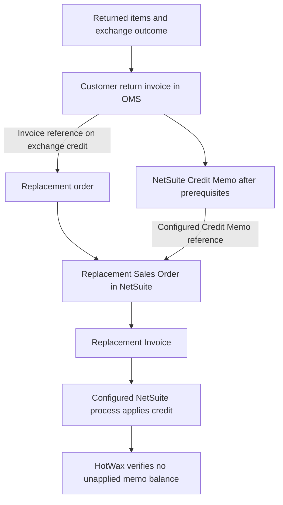

# Exchanges

An exchange has two linked parts: the return of the original merchandise and the new order for its replacement. HotWax Commerce tracks the returned value separately from fulfillment of the replacement order.

The connector supports an exchange-credit lifecycle in which a NetSuite Credit Memo pays for the replacement order. Some existing integrations represent exchange value as a discount on the replacement order instead. Use the method configured for your integration when reconciling the exchange.

## Link the return to the replacement order

The commerce or returns system creates the replacement order, and HotWax imports it through the order integration. The return's outcome links its returned items to that order. HotWax groups the returned items by their original NetSuite Sales Order and return type, then creates a customer return invoice in OMS for each group.

The replacement order's exchange-credit payment preference references the customer return invoice that supplies its credit. This reference connects the new order to the correct NetSuite Credit Memo when the memo is available.

See [Returns](../returns/README.md) for authorization and receipt requirements, including configured financial-only outcomes.

## Wait for the accounting customer

The return and replacement order need compatible customer information for NetSuite to apply the credit. A configured warranty exchange waits for one linked, imported replacement order and a known NetSuite customer before posting its final financial records.

When a replacement order supplies the customer, HotWax can update the return and customer return invoices that do not yet have a NetSuite Credit Memo. The approval step updates an existing RMA with the final customer, address, tax, location, and configured fields. An invoice that already has a Credit Memo retains that memo's customer.

Some integrations book returns to the return facility's accounting customer. Others use the replacement customer's NetSuite ID or a configured store customer for an anonymous sale. These are implementation choices, not a single customer rule for all exchanges.

## Apply the exchange credit

The return settlement job does not create a Customer Refund for exchange credit. When configured, it writes the Credit Memo reference to the replacement Sales Order. It can also update an open Invoice that NetSuite created before the reference was available.

The configured NetSuite billing and credit-application process applies the Credit Memo to the replacement Invoice. The connector then reads the Credit Memo's unapplied amount. If any balance remains, the OMS customer return invoice stays ready for settlement and is checked again on a later run.

The reference fields and NetSuite application script must be configured for this path. Without them, creating both orders and the Credit Memo does not complete the exchange settlement.

## Handle a difference in value

The source system records how the customer pays or receives the difference:

* A higher-priced replacement can include an additional payment, which follows the replacement order's payment integration
* An equal-value exchange can use the returned credit for the replacement value
* A lower-priced replacement can leave a refund, store-credit, or gift card amount, which follows the return settlement method recorded in OMS

The integration uses the linked outcome and payment amounts. It does not infer the customer-facing refund or collect an additional payment solely from the difference between two order totals.

## Receive the original merchandise

Replacement fulfillment and receipt of the original merchandise are separate events. An OMS return shipment produces a NetSuite Item Receipt from its RMA when the receipt prerequisites are met. Warehouse receipts created directly in NetSuite can be imported as receipt history without receiving the inventory again in OMS.

The store's return settings determine whether the Credit Memo waits for receipt evidence. Inspect partial receipt quantities and the restock decision independently from the exchange payment.

## Handle a cancelled replacement order

When the configured cancellation flow runs, the connector attempts to delete the Credit Memo that funded the cancelled replacement, close its open RMA lines, and cancel the OMS customer return invoice. NetSuite allows deletion only while the memo has no applications. A refusal stops the cancellation flow and leaves the invoice available for review; the connector does not automatically reverse an applied financial transaction.

## Reference existing discount-based exchange feeds

Existing Loop integrations can represent the returned value as a discount, such as `loop-discount`, on a new Shopify order. In that setup, the replacement order's discount and any additional payment follow the configured order feed. Web exchanges can use the Sales Order flow, while a separately configured POS exchange feed can create Cash Sales.

Channel names, POS identification rules, discount mappings, and feed schedules belong to that installed integration. Do not use a `Loop Exchange` channel or a shipping-method label alone to infer which accounting path is active. The discount-based approach does not establish that the Credit Memo application lifecycle described above is configured.

See [Order approval](../sales-order/order-approval.md), [POS orders](../sales-order/pos-orders.md), and [Synchronize returns](../../synchronization-flows/returns/README.md) for the related flows.
