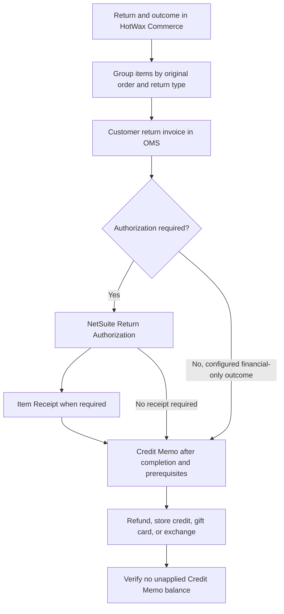

# Returns

HotWax Commerce synchronizes a return with NetSuite in three stages: authorize the return, record merchandise received, and settle the returned value. Each stage has its own records, so an authorized return can still be waiting for a receipt or financial settlement.

This page describes the connector's return lifecycle. Your configured rules select the return channels, outcomes, and dates that use it. Existing file-based return integrations and Cash Refund flows require their own configuration; they do not automatically follow this lifecycle.

## Follow each return group

A return can include items from different original orders or have different outcomes. HotWax creates a customer return invoice in the order management system (OMS) for each group of items with the same original NetSuite Sales Order and return type. This OMS invoice tracks the group's returned value; it is separate from a NetSuite sales Invoice.

Each group has its own Return Authorization, Credit Memo, and settlement records when those records are required. For example, items returned for a refund and items returned for an exchange can follow separate chains within the same return.

A group with no monetary value can have an authorization and receipt without a Credit Memo when the configured rules include that type of return.

## Capture the return and its outcome

The source integration supplies the original order and item references, quantities, return reason, expected inventory condition, destination, and outcome. Refunds, store credit, and replacement orders must remain linked to the return items they resolve. A return request alone does not establish that money has been refunded.

HotWax can create an authorization while the return is requested, or after it is completed, according to the configured rules. A customer return invoice created before completion remains in process. Once the return is completed and required replacement-order information is available, HotWax prepares the final invoice values and approves it for the next stage.

For Shopify intake, see [Import returns from Shopify](../../../learn-shopify/shopify-integration/order-return/import-returns-from-shopify.md).

## Create the Return Authorization

A return merchandise authorization (RMA) is represented by a NetSuite `Return Authorization`. When the original Sales Order is available, HotWax creates the RMA from that order and sends the group's items, return prices, locations, and configured fields.

If an original order has not reached NetSuite, the group waits for its NetSuite order ID. For historical orders, the connector can look up the Sales Order using the configured source-order field and the order name. An ambiguous match remains unresolved.

Returns without an original order can use a standalone Return Authorization. A return booked at a return facility in a different subsidiary from the original order also uses a standalone authorization. These cases need explicit customer, location, subsidiary, item, and tax mappings.

HotWax records the RMA ID and the NetSuite line ID for each return item from the batch results. Later stages use those mappings.

## Record received merchandise

When HotWax holds a received return shipment, the connector creates one NetSuite `Item Receipt` for that shipment. All items in the shipment must belong to the same RMA. Separate shipments are required when the items belong to different RMAs.

The receipt uses the shipment's receiving location and recorded arrival date. The expected condition of each return item determines whether it is restocked. Bin and inventory-status mappings apply when the item requires them. Kit receipts also need complete component quantities and component mappings.

For merchandise received directly in NetSuite, a separate import records receipt lines against the corresponding return and RMA. This import records the NetSuite receipt history in OMS; it does not receive the same stock again in OMS.

Receipt requirements depend on the return's destination, item disposition, and store settings. The Credit Memo can wait for receipt evidence for a warehouse return, a restocked item, or merchandise already recorded as arrived. The arrival check requires `NS_RTN_ARRIVAL_RCPT_CH_PARENT` on the return's explicit Product Store; recording arrival alone does not enable it. A separate channel setting can bypass the warehouse receipt wait. See [return settings](../../synchronization-flows/returns/README.md#choose-the-relevant-return-settings). Review quantities separately when receipts are partial; receipt evidence and receipt of every expected unit are different checks.

## Create the Credit Memo

After the return is completed, its customer return invoice is approved, and its prerequisites are met, HotWax prepares the NetSuite `Credit Memo`.

For the RMA path, the connector creates the Credit Memo from that group's authorization. It then reads the saved memo and checks the merchandise value by NetSuite item against the OMS invoice. A mismatch remains available for review instead of advancing the invoice to settlement.

Appeasements and configured outcomes that do not require an RMA use a standalone Credit Memo. These paths need the appropriate financial items and mappings. Do not assume that every no-restock return skips the authorization or receipt; the configured outcome and the physical movement determine the path.

Discounts, restocking fees, gift card amounts, and tax differences use their configured NetSuite items. Tax handling follows the store and return-facility mappings. A tax-variance item is optional; when it is absent, the connector does not add a balancing line through that setting.

## Settle the returned value

The recorded outcome determines how each group's value is used. A return can combine more than one method, and one refund amount can be divided across groups.

| Outcome | NetSuite posting |
| --- | --- |
| Original payment method | A Customer Refund for each group's share of a refunded payment preference, applied to that group's Credit Memo |
| Store credit through an Invoice | A separate Invoice containing the configured store-credit item, with the Credit Memo applied to it |
| Gift card | A negative line on the configured gift card item within the Credit Memo; no separate Customer Refund for that amount |
| Store credit on the Credit Memo | When `StoreCreditOnMemo` is enabled, a negative line follows the gift card posting path instead of creating a store-credit Invoice |
| Exchange credit | A reference to the Credit Memo on the replacement order and, when needed, its open Invoice; the configured NetSuite process applies the credit |

### Record refunds

The source system records the customer-facing refund. The connector posts the corresponding accounting record in NetSuite using the linked refunded payment, amount, date, and mapped company payment method.

HotWax writes an OMS payment record before requesting the Customer Refund. It checks the returned refund reference, applied Credit Memo, and amount before updating the payment and its application. Each refund has its own payment record, so split refunds must be reconciled across all of those records.

### Record store credit

The commerce or returns system issues customer-facing store credit. NetSuite records the accounting impact through the configured Invoice or Credit Memo line path. Creating a NetSuite Invoice does not issue credit in the commerce platform.

### Apply exchange credit

The replacement order follows the order integration. The return integration links its customer return invoice to the replacement order's exchange credit and supplies the Credit Memo reference for the configured NetSuite application process. See [Exchanges](../exchanges/README.md).

## Confirm synchronization

HotWax advances a customer return invoice from approved to ready when the required Credit Memo result is recorded. It marks the invoice paid when NetSuite reports no unapplied Credit Memo balance. A return with several groups must be checked group by group.

Before treating the return as synchronized, verify:

* The expected authorizations and line mappings exist for every group
* Receipt quantities, receiving locations, and inventory conditions match the physical return
* Each Credit Memo matches the expected items, amounts, tax, and accounting customer
* Refund payment records contain the corresponding NetSuite Customer Refund IDs
* Store-credit or exchange applications match the recorded outcome
* Required result files have been imported without unresolved errors

An exported file, completed NetSuite task, or stored Credit Memo ID is one checkpoint. It does not establish that all receipts and financial applications are complete.

See [Synchronize returns](../../synchronization-flows/returns/README.md) for setup, batch processing, and recovery checks. For the source feed contract, see [Returns financial feed](../../../integrate-with-hotwax/api/returns/returns-financial-feed.md).
