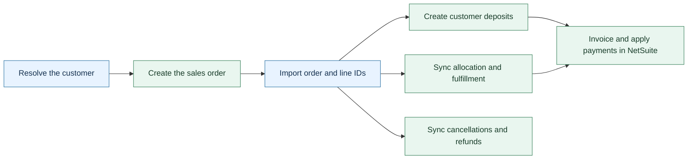

# Sales orders

HotWax Commerce sends sales orders to NetSuite so you can track the sale, payment, and fulfillment in your financial system. The order sync creates each record when its prerequisites are available and brings the NetSuite identifiers back into HotWax Commerce.

The batch integration uses rules to select orders and tracks each order through preparation, submission, and result import. Your configuration determines which channels and facilities participate, when jobs run, and how NetSuite fields are populated.

## Follow the order through the integration

1. Resolve the customer. The default flow waits for the bill-to customer's NetSuite ID. A deployment can instead use the default customer assigned to the selling facility. HotWax Commerce records the selected customer on the order.
2. Select eligible orders. Active rules select orders for the product store. The sync checks product mappings, allocation, holds, exchange credits, and payment coverage before preparing an order.
3. Create the sales order. HotWax Commerce saves a batch file and submits it through the configured NetSuite API or batch script. Each order has a tracking record that records the batch, result, or failure reason.
4. Import the result. HotWax Commerce imports the NetSuite order ID and line IDs through Data Manager. These identifiers connect later updates to the correct NetSuite records.
5. Sync later activity. Separate jobs handle eligible deposits, allocation changes, store fulfillment, cancellations, and refunds. NetSuite invoicing and payment application follow the configured NetSuite workflows.

For prerequisites, configuration, and result tracking, see [Order sync](../../synchronization-flows/order-sync/README.md).

## Understand when an order waits

An order waits when an item has no active NetSuite product ID, an open item has no usable NetSuite location, an unresolved hold exists, or an exchange credit has no NetSuite credit memo. The default preparation also waits for the customer and sufficient payment coverage.

Waiting orders remain available for a later run. An order with a preparation error or a NetSuite refusal needs a different recovery path because its tracking record prevents the next selection from creating another submission. See [Orders not syncing with NetSuite](../../troubleshooting/order-do-not-sync.md).

## Sync changes after order creation

Allocation updates use the stored NetSuite line identifiers to update the relevant sales order lines. Store fulfillment exports completed order items according to the configured rules and prerequisites. Warehouse fulfillment follows the warehouse integration configured for the deployment.

Cancellation sync closes eligible NetSuite lines. A refund is a separate financial record; closing an order line does not by itself return a payment. Returns and exchanges also have their own records and dependencies. See [Returns](../returns/README.md) and [Exchanges](../exchanges/README.md).

## Check your deployment's integration path

The batch flow and the earlier Secure File Transfer Protocol (SFTP) flow use different jobs and acknowledgement records. Confirm which path your deployment uses before troubleshooting or changing schedules. Job frequency, batch size, NetSuite processing, and result import determine the total sync time.

For deployments using CSV exports over SFTP, see [Customer sync over SFTP](../../synchronization-flows/order-sync/sync-customer.md) and [Order ID sync over SFTP](../../synchronization-flows/order-sync/sync-orderIds.md). Point of sale (POS) orders can also use the separately configured [POS cash sales flow](../../synchronization-flows/order-sync/pos-cash-sales.md).
