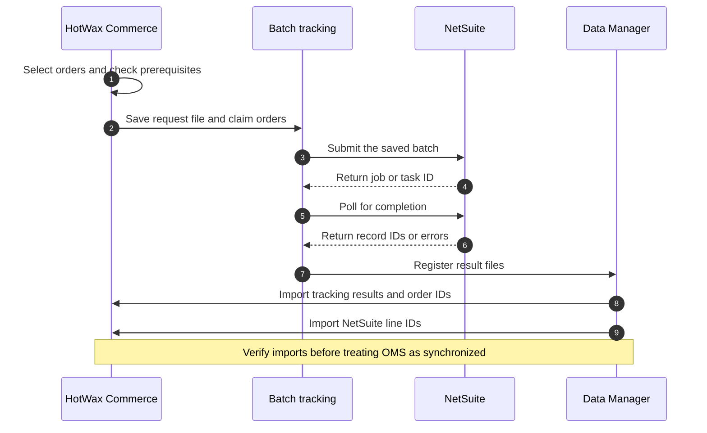

# Order sync

HotWax Commerce sends eligible orders to NetSuite in batches and imports the results into the order management system (OMS). Separate jobs create customers, sales orders, deposits, and later fulfillment or refund records. Each job waits for the identifiers and business conditions it needs.

This guide describes the batch integration. The earlier CSV integration has separate [customer](sync-customer.md) and [order ID](sync-orderIds.md) instructions.

## Prepare the integration

Before scheduling the order sync, verify the following configuration:

| Configuration | What to verify |
| --- | --- |
| Product and facility mappings | Each order item has an active `NETSUITE_PRODUCT_ID`. Fulfillment facilities resolve to the intended NetSuite locations. |
| Customer mapping | The bill-to party has a `NETSUITE_CUSTOMER_ID`, or the configured facility customer service resolves a `DEFAULT_B2C_CUSTOMER` with a NetSuite ID. |
| Existing records | Import verified customer and order identifiers before cutover so existing NetSuite records retain their OMS mappings. |
| Shopify shop | The order resolves to one Shopify shop with a timezone. The default preparation uses that timezone for transaction dates. |
| Selection rules | Active rules cover the intended product store, channels, facilities, and cutover period. Check orders that match no rule. |
| Field mapping | The configured NetSuite mapping tree supplies required order, item, shipping, tax, discount, and payment fields for your account. |
| Connection | The NetSuite connection has the permissions required by the selected record API and scripts. |
| Batch processing | Producer, sender, result polling, and Data Manager import jobs are configured. Script batches also need the File Cabinet folder, handler, and active RESTlet deployments. |

Job names and schedules are deployment-specific. Loading the shared batch definitions does not schedule the order producers, senders, or result pollers for a client.

## Select orders and resolve prerequisites

The default selection reads `NetSuiteOrderDueView`. It includes Shopify sales orders that have neither a NetSuite order ID nor an existing sales order tracking record. Active rules run in sequence and select distinct orders. Rules determine business scope and priority; they do not override the eligibility checks.

The sync checks each selected order for these conditions:

| Condition | Result |
| --- | --- |
| An item has no active NetSuite product ID | The order waits. |
| An open item is at a facility that gives it no NetSuite location | The order waits. |
| An unresolved hold task exists | The order waits. |
| An exchange credit is waiting for its return's credit memo | The order waits. |
| The default bill-to customer has no NetSuite ID | The order waits for customer sync. |
| A required facility customer is missing | Preparation records an error. |
| The shop or its timezone cannot be resolved | Preparation records an error. |
| Payment coverage is insufficient | The order waits. |
| The rendered order has no item lines | Preparation records an error. |

The default preparation compares valid authorized and settled payments with the sum of item values and order adjustments. Its payment tolerance is 1%. A zero-value order does not need a payment. This check does not create a deposit or capture payment.

The optional shop property `netsuite.salesOrder.cutoffOrderId` prevents the default preparation from sending Shopify order IDs at or below the configured cutoff. An order selected despite that cutoff receives a preparation error. Align the selection rules with the cutover configuration.

The customer step stores `NETSUITE_CUSTOMER_ID` on the order before rendering it. An order that already carries a different customer ID keeps that ID and logs the mismatch. Review the mapping instead of changing the customer reference on an existing NetSuite sale.

## Follow a batch to completion



1. The producer prepares each eligible order and saves the request as a JSON Lines file, with one record per line. The system message stores the file location in `messageText`.
2. A sales order tracking record, `NetSuiteSalesOrderDetail`, associates each order with its batch and external ID. Preparation errors also create tracking records, even when no batch is submitted for that order.
3. The sender submits the saved request through the configured transport. The message retains the remote job or task ID for result lookup.
4. The result consumer resolves each order's NetSuite ID or error and registers Data Manager files. The REST path also looks up sales orders by external ID, including records that already exist in NetSuite.
5. Data Manager imports the tracking results, order IDs, and NetSuite line records. Later jobs use these persisted identifiers to select their work.

The batch file is the saved request. Correcting an order after the file is created does not change that file. Keep the file and tracking references available until recovery and reconciliation are complete.

### Choose the sales order transport

| Message type | Submission and result path |
| --- | --- |
| `NetSuiteSalesOrderBatch` | Sends an asynchronous collection to the NetSuite REST sales order API, polls the job, and resolves order IDs and task errors. This is the producer's default message type. |
| `NetSuiteSalesOrderScriptBatch` | Uploads the saved file to the configured File Cabinet folder, starts the batch runner, and reads the script result file. The configured sales order handler creates or locates each order. |

Use the message type, remote, and handler configured together for your deployment. The script path uses registered RESTlet purposes for upload, batch submission, status, and download.

### Configure batch limits

The sales order producer accepts these settings:

| Parameter | Purpose |
| --- | --- |
| `ruleGroupId` | Selects the active rules that choose and prioritize orders. |
| `productStoreId` | Limits the run to the intended product store. |
| `rootNodeId` | Selects the mapping tree that builds the NetSuite order. |
| `customerServiceName` | Selects the bill-to party or facility customer resolution service. |
| `systemMessageTypeId` and `systemMessageRemoteId` | Select the transport and connection. |
| `batchSize` | Sets the maximum number selected for a run. The default is 100; later customer or preparation checks can reduce the submitted count. |
| `maxBatchesInFlight` | Limits open batches of that message type for the connection and product store. The default is one. |

Open batches are messages in `SmsgProduced`, `SmsgSent`, or `SmsgReceived`. When the limit is reached, the producer claims no more orders. Raising the limit allows more batches to be open; it does not bypass holds or complete a stalled result import.

Deposit, customer refund, and store fulfillment producers also have their own batch limits. Configure each job against the NetSuite account's processing capacity and the observed result import rate.

## Verify the imported result

A consumed system message means the consumer finished its work. For this flow, that work includes registering result files; it does not prove that Data Manager imported them successfully.

| Data Manager configuration | Result to verify |
| --- | --- |
| `IMP_NS_CUSTOMER_RESULT` | Customer ID or error is recorded, including the customer identification on success. |
| `IMP_NS_SALES_ORDER_RESULT` | The sales order tracking record has a NetSuite ID or error. |
| `IMP_NS_SALES_ORDER_ID` | The order has its `NETSUITE_ORDER_ID`. |
| `IMP_NS_SALES_ORDER_ITEM` | NetSuite sales order line IDs are available for later updates. |

Check each applicable import and its persisted result. Order ID and item files are generated when they contain records. A missing order ID, failed import, or unresolved line mapping needs investigation even if the remote task has completed.

## Sync the next records

Customer deposits have a separate producer and tracking record per eligible payment. The job uses the configured payment selection and mapping after the order's NetSuite ID is available. Gift card, store credit, and exchange payment treatment depends on the configured accounting mappings.

Allocation updates and cancellations use NetSuite line identifiers. Store fulfillment creates records for completed items according to its rules and prerequisites. Invoicing and payment application remain separate configured NetSuite processes.

For returns, credit memos, refunds, and exchange settlement, see [Return sync](../returns/README.md). For stalled orders, use [Orders not syncing with NetSuite](../../troubleshooting/order-do-not-sync.md).

## Upgrade an existing batch integration

Before upgrading, check persisted order selection rules for `taxLineWithoutRateOrderId` and `taxWithoutNexusOrderId`. The current `NetSuiteOrderDueView` no longer exposes these fields, so a rule that still names either field fails its selection query. This read-only query identifies the affected conditions:

```sql
SELECT RULE_ID, FIELD_NAME
FROM RULE_CONDITION
WHERE FIELD_NAME IN ('taxLineWithoutRateOrderId', 'taxWithoutNexusOrderId');
```

Preserve any required tax-rate and tax-nexus holds in the client integration before removing the old rule conditions. Verify the replacement checks and updated selection rules before enabling the upgraded producer.

The file format changes the meaning of the system message's `messageText`: new senders expect a file location where older messages can contain record bodies. Apply the matching upgrade data for existing message types as well as the connector code.

Before switching senders, pause the affected producers and finish older unsent batches through their previous processing path. Flows whose result readers use the saved request file, including brokered-order updates, must also finish result consumption before the change. Follow the installed release's upgrade steps for each affected message type, then verify the persisted sender configuration, result consumers, and Data Manager imports before resuming producers.

Keep the request files available through result processing and recovery. Review [return batch upgrades](../returns/README.md#upgrade-existing-batch-flows) when the same deployment also processes returns.
