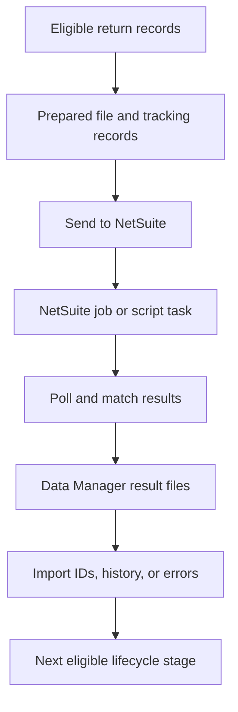

# Synchronize returns

Return synchronization advances from recorded business facts: the return's status, its customer return invoices, NetSuite identifiers, receipt history, and financial applications. Scheduled jobs select eligible records through configured rules. A return can progress through several jobs and batches before every group is synchronized.

A return merchandise authorization (RMA) records the authorized return in NetSuite. The order management system (OMS) tracks the related invoices and imported identifiers.

Read [Returns](../../integration-flows/returns/README.md) for the business lifecycle and [Exchanges](../../integration-flows/exchanges/README.md) for replacement-order settlement.

## Prepare the integration

Confirm the following setup for each return path you enable:

| Area | Required setup |
| --- | --- |
| Return intake | Original order and item references, quantities, return type, expected condition, destination, and links to refunds or replacement orders |
| Product and order mappings | NetSuite item IDs for merchandise and financial products; original NetSuite Sales Order IDs when an order exists |
| Accounting mappings | Customer, subsidiary, location, department, tax codes, and company payment methods for the records being created |
| Receipt mappings | Receiving facility's NetSuite location, arrival date, bin and inventory status where used, and kit component mappings where applicable |
| Financial items | The items required by your outcomes: group credit, store credit, gift card redemption, discount, restocking fee, and optional tax variance |
| Return settings | Included channels and return types, receipt-wait policy, warranty policy, return-facility accounting, and store-credit posting method |
| NetSuite processing | Connection, deployed handlers, batch runner, File Cabinet upload, and any exchange-credit application script |
| OMS processing | Rule groups, scheduled lifecycle jobs, batch send and poll jobs, and queued Data Manager result imports |

The connector supplies services and result-import definitions. Client configuration supplies the selection rules, record-field mappings, schedules, and deployed script choices. Loading connector seed data alone does not turn on a complete return integration.

When an original order exists but its NetSuite ID is missing, use the returned-order lookup or complete the order synchronization. The lookup matches the configured source-order field and order name; unresolved or ambiguous orders continue to wait.

### Choose the relevant return settings

| Setting | Effect |
| --- | --- |
| `NS_RTN_NO_RMA_CHANNEL` | Identifies configured channels, optionally with a required reason, that use a Credit Memo without an RMA |
| `NS_RTN_NO_RCPT_WAIT_CH` | Allows the configured channel for the return's own store to bypass the warehouse receipt wait |
| `NS_RTN_ARRIVAL_RCPT_CH_PARENT` | Enables arrival receipt waiting for a return channel's parent enumeration; the setting value must match that parent, and the setting is read from the return's explicit Product Store |
| `NS_RTN_GROUP_CREDIT_PROD` | Names the financial product used when one money line represents the group's returned merchandise |
| `NS_RTN_STORE_CREDIT_PROD` | Names the product used by the separate store-credit Invoice path |
| `BookAtReturnFacility` | Uses the return facility's configured accounting customer, location, department, and subsidiary |
| `StoreCreditOnMemo` | Posts Shopify store credit as a negative Credit Memo line instead of a separate Invoice |
| `RestockFeeProductId` | Names the product whose active NetSuite item mapping represents a restocking fee |
| `TaxVarianceItemId` | Enables the corresponding Credit Memo balancing line when configured; a return-facility override can supply its own item |

The final four settings belong to `NETSUITE_RETURN_CONFIG`. A return with conflicting settings from multiple stores needs an explicit store association. Keep the configured NetSuite fields aligned with the record type and deployed scripts.

Arrival receipt waiting is separate from the warehouse receipt wait. With `NS_RTN_ARRIVAL_RCPT_CH_PARENT` configured, an arrived item with an open RMA line and no recorded Item Receipt can hold back the Credit Memo. Recording an arrival alone does not enable this check, and a return without an explicit `productStoreId` does not enter it. Verify this setting and store association when the receipt and Credit Memo would otherwise update the same RMA at the same time.

## Run the lifecycle stages

| Stage | Selection and result |
| --- | --- |
| Create customer return invoices | Completed returns with eligible, unbilled items create one OMS invoice per original NetSuite Sales Order and return type; configured zero-value returns can receive an invoice without money |
| Create requested-return authorizations | The requested-return job first creates in-process OMS invoices, then prepares their RMAs |
| Approve customer return invoices | Completed returns finalize in-process invoices; required replacement-order information must be available |
| Create completed-return authorizations | Approved groups that require an RMA and have the required order mappings enter an RMA batch |
| Synchronize receipts | Received OMS shipments create Item Receipts; a separate job imports eligible receipts created directly in NetSuite |
| Create Credit Memos | Approved invoices with money and the required authorization, receipt, and customer facts enter the appropriate memo batch |
| Settle customer return invoices | Ready invoices post the configured refund or credit application and become paid when NetSuite reports no unapplied memo balance |

An open return hold excludes the return from the relevant due views. An invoice, receipt, or authorization claimed by an active batch waits for that batch's result. RMA attempts in terminal message states can become eligible again, as described in the recovery table below. Jobs that hold the same return lock defer a busy return to a later run.

## Follow a batch through its results

The connector writes each batch as a JSON Lines file and stores its file location on the system message. The file contains the prepared records for that attempt. RMA and RMA-based Credit Memo result processing reads the sent lines again to match the returned records.

| Batch type | Delivery |
| --- | --- |
| RMA from a Sales Order | File Cabinet batch processed by the configured RMA handler |
| Standalone RMA | NetSuite asynchronous REST batch |
| Return Item Receipt | File Cabinet batch processed by the configured receipt handler |
| Credit Memo from an RMA | File Cabinet batch processed by the configured Credit Memo handler |
| Standalone Credit Memo | NetSuite asynchronous REST batch |

Customer Refunds and store-credit Invoice applications in this lifecycle use the settlement services after the Credit Memo is recorded. They are separate from the batch used to create the memo.

The batch message progresses through produced, sent, and received states as it is submitted and its result is consumed. Data Manager then imports the generated result files. Check both the message and those imports: a consumed batch can still have queued or failed result records.

The connector limits batches in flight for the relevant account, message type, and, for receipt batches, store. An unresolved batch can therefore delay subsequent records in the same flow.

## Check the recorded results

| Record | What it establishes |
| --- | --- |
| Customer return invoice and item billing | Which return items belong to each financial group |
| RMA history on each return item | The group's NetSuite authorization and each NetSuite line ID |
| Return shipment and receipt-line history | The NetSuite Item Receipt ID and recorded quantities |
| Customer return invoice's external ID | The group's recorded NetSuite Credit Memo |
| Refund payment's external ID | The NetSuite Customer Refund for that payment's share |
| Store-credit sales invoice's external ID | The separate NetSuite Invoice when that posting method is used |
| Customer return invoice status | In process, approved for posting, ready for settlement, or paid after the application check |

The return header history summarizes transactions per customer return invoice. For split refunds, use the individual payment records to find every Customer Refund; a single header field is not the complete refund list.

## Diagnose a waiting or failed return

1. Find the customer return invoices and the items billed to each one.
2. Check return status, open holds, selection rules, and missing order or replacement-customer mappings.
3. Inspect the current batch message, its saved request file, and NetSuite job or task result.
4. Inspect every related Data Manager import for recorded IDs and errors.
5. Compare NetSuite receipt quantities and Credit Memo applications with the expected outcome before retrying.

| Condition | Recovery behavior |
| --- | --- |
| Missing order ID or another lifecycle job holds the return | The record remains waiting or busy and is checked on a later run |
| RMA or receipt fails a local preparation check | The batch writes a refusal file; after correcting the source fact, a later run checks it again |
| NetSuite refuses an RMA | The recorded refusal normally stops automatic selection; `INVALID_INITIALIZE_REF` receives one further attempt before it is treated as a persistent refusal |
| NetSuite refuses a receipt | The recorded refusal excludes that shipment from the due view until it is reviewed for retry |
| Credit Memo preparation fails, NetSuite refuses it, or its merchandise values do not match | The invoice retains its tracking record and does not automatically enter a new memo batch |
| Result consumption or Data Manager import fails | Inspect the message and failed imports, then retry the appropriate result-processing stage; the asynchronous REST poller restores unsuccessful consumption to sent for a later poll |
| Batch sending reaches its retry limit, or a script task fails | The system message enters an error state and needs review. An RMA attempt in `SmsgError`, `SmsgCancelled`, or `SmsgRejected` no longer counts as open; without an imported RMA or persistent refusal, a later producer can select it again automatically |
| Credit Memo still has an unapplied balance | Settlement remains incomplete; verify the refund or Invoice application and the configured NetSuite exchange process |

Stable external IDs, saved batch files, and persisted transaction IDs allow supported retries to find existing records. They do not make every refusal self-correcting. Resolve the named source fact and reconcile any existing NetSuite record before retrying. For controlled RMA recovery, first pause the relevant producer or hold the return so automatic selection does not overlap the investigation. Recover any existing remote result using its stable external ID before resuming the intended stage. Do not erase transaction IDs to force another creation.

Changes after an RMA has been created also need review. The approval update does not rebuild every original RMA line; for example, a restocking fee added after RMA creation is not automatically added to that RMA.

## Upgrade existing batch flows

The file-backed batch format changes what the system message contains. An older message can contain record bodies where the new sender expects a file location.

Before switching an existing integration to this format, pause the affected batch producers and drain their pending work using the previous processing path. RMA and Credit Memo batches must finish both sending and result processing because the RMA result readers also use the saved request file. Receipt batches must have no older unsent messages. Apply the connector's matching upgrade data for existing message types, then verify the senders, result readers, and Data Manager imports before resuming producers.

Keep request files available through result processing and recovery. A completed NetSuite task cannot replace a missing request file that the connector needs to match its results.
