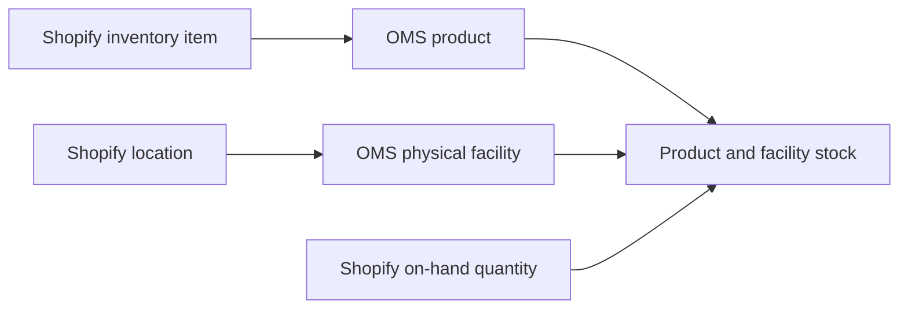

# Import inventory from Shopify

Use the inbound Shopify inventory reset to seed physical stock in HotWax Commerce when Shopify owns the starting inventory. The reset reads Shopify `on_hand` and applies changed quantities to mapped OMS products and physical facilities.

This flow is separate from [outbound Shopify inventory event sync](inventory-sync.md). Outbound sync publishes OMS available-to-promise inventory to Shopify. Importing Shopify stock does not establish what OMS can promise for sale, which also depends on reservations, demand, eligibility, and the configured inventory rules.

For the cutover sequence and Company App actions, follow [Seed starting inventory from Shopify](../../../system-admin/administration/company/product-store-onboarding.md#8-seed-starting-inventory-from-shopify). This page explains the inbound integration and its verification requirements. Available controls depend on your installed connector and configuration.

## Confirm the source and mappings

Before starting the reset:

1. Confirm that Shopify is the intended source of physical stock for this import and that the selected shop has an active connection.
2. Complete product sync and verify the shop's variant-to-OMS-product links, including Shopify inventory item IDs.
3. Map each intended Shopify physical location to its OMS facility. Review [location mapping](location-mapping.md) for the outbound target distinctions.
4. Resolve ambiguous product or location mappings. Do not use the reset to guess which OMS record a Shopify ID represents.
5. Confirm that the bulk-query sender, result polling or completion webhook, and Data Manager importer are configured.
6. Finish outstanding inventory resets before starting another. Coordinate the reset with the cutover sequence so the exported snapshot still represents the intended starting stock.

The `sync_ShopifyInventoryReset` job template is installed paused and requires `shopId`. Its presence does not mean an inbound inventory import is scheduled or enabled for your shop.

For installations using the changed-quantity preparation flow, verify that `RESET_SHOPIFY_INVENTORY` uses `co.hotwax.sob.product.InventoryServices.import#ShopifyInventoryReset` and has grouping enabled with `multiThreading=Y`. Fresh-install seed data and the existing-installation upgrade both matter. A source-code update alone does not confirm that the persisted import configuration was upgraded.

## Understand what is included

The Shopify query selects active products and their variants, inventory items, and location-level `on_hand` quantities. Draft and archived products are outside this query. It does not use Shopify `available` as the physical stock value.

Each inventory level represents one Shopify inventory item at one Shopify location. HotWax resolves both IDs within the selected shop:



A level missing from the export is not an instruction to reset OMS stock to zero. A received, mapped level with an explicit `on_hand` value of zero can reset that product and facility to zero.

Two target types do not accept inbound stock:

* A Shopify location mapped by a currently active inventory channel
* A Shopify location mapped to a virtual facility, including a virtual facility subtype

An aggregate channel location represents inventory OMS publishes for a facility group. It does not hold physical stock to import. The importer checks channel and virtual-facility status when each row runs, even after the file has been prepared.

## Follow the reset pipeline


### Validate and prepare the export

HotWax downloads the completed bulk result and prepares it before inventory writes begin. Where the originating bulk operation ID is present, preparation requires a completed operation with an object count and file size. The downloaded file must match those values.

Preparation validates the product and variant structure, inventory level IDs, and numeric `on_hand` values. It checks the file content again after reading it so a file changed during preparation is rejected.

HotWax resolves location and product mappings, then compares each mapped level with OMS quantity on hand. It uses bounded database reads, with a default comparison chunk size of 5,000 levels, instead of querying stock separately for every level.

Only changed levels enter the import file. Unchanged levels are counted and omitted. If all eligible quantities are unchanged, preparation still creates an empty import receipt so the run can be traced.

### Queue and apply changed quantities

HotWax creates a linked Data Manager import using `RESET_SHOPIFY_INVENTORY`. The prepared rows use product-based groups, with 12 group keys, so levels for the same product stay together during grouped processing. A group is a processing boundary, not a product count or a stock quantity.

For each prepared level, the importer checks the current channel, product, and facility mappings. It skips channel and virtual locations. If the resolved product or facility differs from the prepared mapping, it fails the row and requires a fresh prepared file.

Eligible rows call the OMS inventory reset with the exported `on_hand` value. The operation sets the product and facility's physical stock to that value; it does not add the exported quantity to existing stock. The resulting inventory reset records carry the originating Shopify connection so configured inventory-event publication can identify the source shop and avoid sending its own reset change back to it.

## Read the counts correctly

Preparation statistics are saved as parameters on the linked Data Manager import. Use them with the import's processed and failed counts:

| Count | Meaning |
| --- | --- |
| `sourceObjectCount` | All nonempty objects read from the Shopify file, including products and variants |
| `sourceInventoryLevels` | Inventory levels received from Shopify |
| `mappedInventoryLevels` | Levels whose Shopify location has an OMS facility mapping, before product mapping is checked |
| `unmappedLocationLevels` | Levels omitted because the location has no usable facility mapping |
| `unmappedProductLevels` | Location-mapped levels omitted because the inventory item has no OMS product mapping |
| `unmappedInventoryItems` | Distinct unmapped inventory items behind those omitted product levels |
| `unchangedLevels` | Mapped levels omitted because the quantity comparison found no change |
| `changedLevels` | Levels written to the import file after comparison |
| Import `totalRecordCount` | Records in the prepared import, rather than every level received from Shopify |

At preparation, the level counts reconcile as follows:

```text
sourceInventoryLevels = mappedInventoryLevels + unmappedLocationLevels
mappedInventoryLevels = changedLevels + unchangedLevels + unmappedProductLevels
```

Changed levels are candidates for import, not proof of stock changes. The importer can later skip a channel or virtual location, fail a row, or find that the reset has no quantity difference. Those live skips are logged with a `skipReason`; they are separate from the preparation counts above.

A successful run with missing mappings can still omit stock. Review skipped counts against the intended scope before accepting the result. A zero-record import is expected for an unchanged snapshot, but does not prove that every intended product and location was mapped.

## Verify completion

1. Record the shop, system message ID, Shopify bulk operation ID, and linked Data Manager import ID.
2. Confirm that the Shopify operation completed and that the file passed preparation checks.
3. Review the preparation counts, especially missing mappings and unchanged levels.
4. Wait for the linked import to reach its final status. Review failed records and logged channel or virtual-location skips.
5. Compare the exported `on_hand` value with the resulting OMS quantity on hand for the same product and physical facility. Review the resulting inventory reset record and quantity difference.
6. Account for stock movements after the export when comparing current quantities. Confirm outbound publication separately if the cutover also requires inventory to be sent to Shopify.

A queued request, completed Shopify export, consumed system message, or finished preparation step does not prove that the OMS inventory reset finished. If Shopify returns no result URL, the bulk handler consumes the request without creating an import; this is not evidence of a populated inventory reset.

## Recover without replaying stale stock

| Condition | Behavior and next step |
| --- | --- |
| No facility mappings exist | Preparation fails. Configure the intended physical mappings, then request a fresh export. |
| Some locations or products are unmapped | Preparation omits and counts those levels. Complete product sync or correct the mappings, then request a fresh export to include the omitted levels. |
| A product or location mapping is ambiguous | Preparation fails. Resolve the ambiguity before preparing another file. |
| A product mapping appears, disappears, or changes during preparation | Preparation fails to avoid a partial item snapshot. Stabilize the mappings and use a fresh export. |
| The file is incomplete, changes during preparation, or contains invalid levels | Preparation fails. Investigate the export and download; do not import a partial result. |
| Another reset is pending, queued, running, or awaiting cancellation | Consumption is blocked. Wait for that import to reach a final state before retrying consumption. |
| The same system message already has an import | Consumption returns the existing import instead of creating a duplicate. Inspect that import's outcome. |
| A newer reset for the same connection already finished | Consumption rejects the older file. Request a fresh export. |
| A prepared product or facility mapping changed before import | The row fails with a mapping-change error. Prepare a fresh file before retrying. |
| A location is now an active channel or virtual facility | The row is skipped without an inventory reset. Verify that the target change was intended. |

The overlap check covers unfinished imports for the reset configuration, including the older batch configuration, across shops. A reset for another shop can therefore block preparation consumption.

Before retrying failed records, determine whether the exported snapshot is still authoritative and whether other stock changes or newer resets occurred. An absolute stock reset is not a blind replay operation: an old file can overwrite a later stock position. When the source stock or mappings have changed, use a fresh Shopify export and preparation after the earlier work has finished.
