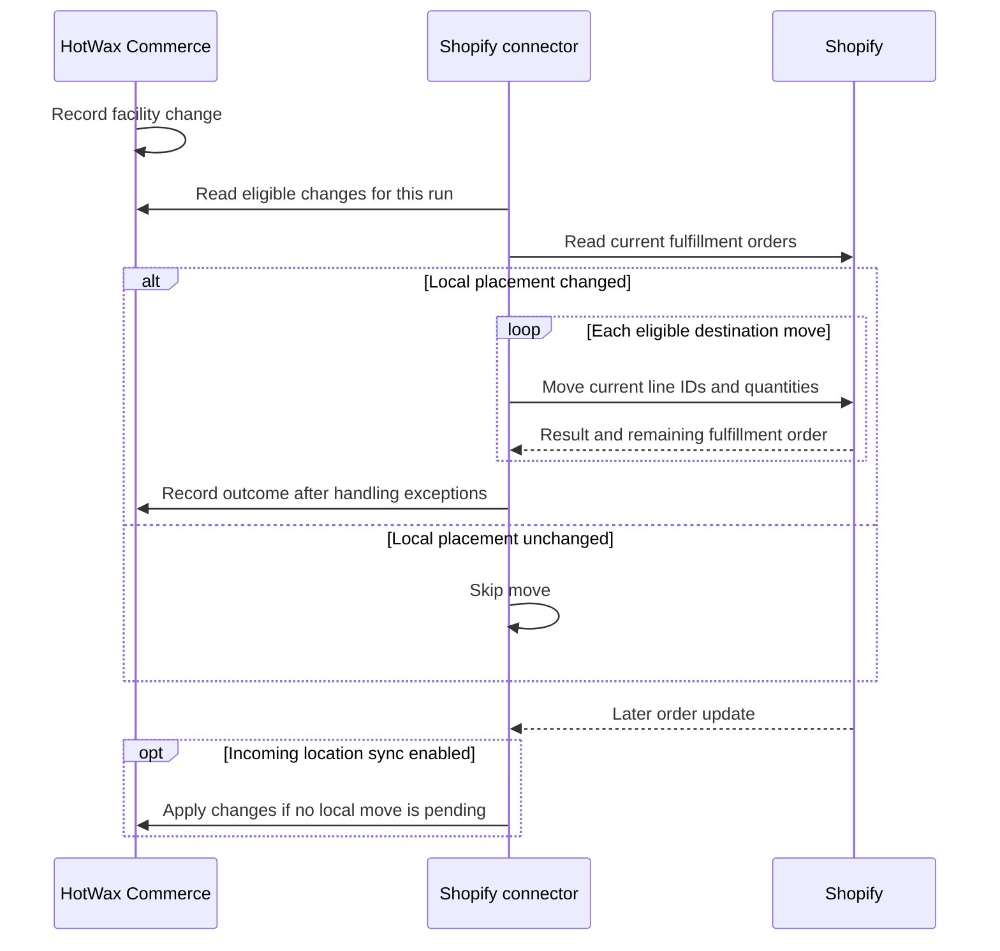

# Routing location sync

Routing location sync updates Shopify when the HotWax Commerce order routing engine assigns or reassigns unfulfilled items to a facility. Shopify can then show the location responsible for those quantities before the items ship.

A HotWax facility and a Shopify location are separate records. Start with [location mapping](../inventory/location-mapping.md), then configure the routing sync for your shop.

## Choose the right sync

These workflows have separate controls:

| Workflow | Direction | Purpose | Control |
| --- | --- | --- | --- |
| Routing location sync | HotWax Commerce to Shopify | Send eligible routing decisions before fulfillment | `sync_RerouteShopifyFulfillments` job |
| Incoming location reconciliation | Shopify to HotWax Commerce | Apply changed Shopify location assignments to active order items | Shop setting `SHPFY_LOC_SYNC` set to `Y` |
| Fulfillment update | HotWax Commerce to Shopify | Send shipped quantities and tracking, with location reconciliation during posting | The configured fulfillment workflow; `SHPFY_POST_FUL_LOC_SYNC` controls handling of an unmapped shipment facility |

The inbound setting does not start or stop the outbound routing job. For shipment posting, see [Order fulfillment](../order-fulfillment/README.md). Changing a routing location does not mark an item as shipped.

## Follow an outbound routing update

1. HotWax Commerce records the facility change when the order routing engine assigns or reassigns an item.
2. The scheduled job selects changes within its date window and configured store, sales channel, and facility filters.
3. The connector reads the order's current Shopify fulfillment orders, including their locations, line IDs, remaining quantities, and holds.
4. The connector compares the local allocation with its saved location baseline. If the allocation is unchanged, it skips the move.
5. For each destination, the connector sends the relevant fulfillment-order line IDs and quantities through `fulfillmentOrderMove`. After a subset move, it uses the returned remaining fulfillment-order and line IDs for subsequent destinations.
6. The connector records the resulting local location baseline when no newer eligible routing change remains outside that run's window. A rejected move can instead leave affected items parked with a sync-exception task.

## Match locations by line and quantity

A Shopify fulfillment order groups work assigned to a Shopify location. A HotWax ship group groups local fulfillment work. Their IDs represent different records, and a move can change Shopify fulfillment-order and line IDs. Do not use a ship-group ID as a Shopify fulfillment-order ID.

The connector matches the Shopify order line to its HotWax order items, then tracks the changed quantities, source location, and destination facility. One order can route to several destinations. One Shopify order line can also have quantities across several fulfillment orders.

For example, one order line contains three units:

| Destination | HotWax allocation | Shopify location after a successful sync |
| --- | --- | --- |
| Store A | 2 units | Store A's mapped location holds 2 unfulfilled units |
| Store B | 1 unit | Store B's mapped location holds 1 unfulfilled unit |

The connector caps each move at the line's remaining quantity in Shopify. Successful moves to one destination remain separate from failures at another destination. Review the full quantity distribution, rather than expecting one fulfillment order for each ship group.

## Configure the routing job

Before enabling the job, verify that your installed connector and its upgrade steps support this workflow. Existing installations also need the location-history fields and applicable location-baseline migrations. Source configuration does not establish that a shop has enabled the feature.

1. Complete the shop's facility mappings. Verify the primary Shopify location and its HotWax facility mapping if your design uses the default-location fallback.
2. Verify the connected app can read the relevant fulfillment orders and has the write permissions for their management type. Shopify requires either `write_merchant_managed_fulfillment_orders` or `write_third_party_fulfillment_orders` for a location move. See [Shopify's move requirements](https://shopify.dev/docs/api/admin-graphql/2026-01/mutations/fulfillmentOrderMove).
3. Set the job's `systemMessageRemoteId` to the connection for the intended shop.
4. Set a valid starting date and any filters below. Confirm the date covers the routing changes you intend to sync.
5. Enable the job and verify its first run against the selected orders in both systems.

| Job parameter | What to check |
| --- | --- |
| `jobName` | Identifies the job whose progress date is read and updated |
| `lastRunTime` | Saved progress date. A populated value takes precedence over `sinceDate` |
| `sinceDate` | Starting date used when the job has no populated `lastRunTime` |
| `productStoreId`, `salesChannelEnumId` | Optional comma-separated filters for the orders in scope |
| `fromFacilityId`, `toFacilityId` | Optional comma-separated source and destination facility filters |
| `fromFacilityTypeId`, `toFacilityTypeId` | Optional comma-separated facility-type filters, including child types |
| `trailingMarginSeconds` | Defaults to `60`. Keep this margin so very recent changes wait for a later run |

These are job parameters. Empty filters leave that dimension unrestricted. Changes from a virtual facility, such as a parking or brokering queue, bypass the source-facility filters so recovered items can sync; destination filters still apply.

The supplied job is paused and scheduled every 15 minutes, with an empty shop connection and starting dates. Your instance can use a different schedule. A missing or invalid starting date prevents the job from reading unbounded routing history.

## Check whether a move can proceed

The job excludes completed and canceled orders. It also excludes completed and canceled item quantities. The remaining Shopify fulfillment order must be eligible:

| Shopify status | Routing behavior |
| --- | --- |
| `OPEN` | Plan a move for remaining quantities |
| `ON_HOLD` without an active hold | Plan a move |
| `ON_HOLD` with active holds | Attempt to release that fulfillment order's specific hold IDs before a required move, if the app has the release scope |
| `IN_PROGRESS` | Attempt to reopen before a required move, if the app has the reopen scope |
| `SCHEDULED`, `INCOMPLETE`, `CANCELLED`, or `CLOSED` | Skip the move plan |

Reopening and releasing holds happen only when a move is needed. Reopening accepts the merchant-managed or third-party write scope. Hold release additionally accepts `write_marketplace_fulfillment_orders`; that scope alone does not authorize a location move. See Shopify's [reopen](https://shopify.dev/docs/api/admin-graphql/2026-01/mutations/fulfillmentOrderOpen) and [hold-release](https://shopify.dev/docs/api/admin-graphql/2026-01/mutations/fulfillmentOrderReleaseHold) requirements.

Shopify can still reject a move because the destination does not stock the item or a fulfillment-service request locks the assignment. Requests in `SUBMITTED`, `ACCEPTED`, `CANCELLATION_REQUESTED`, or `CANCELLATION_REJECTED` cannot be reassigned directly. See [Shopify's location-move restrictions](https://shopify.dev/docs/api/admin-graphql/2026-01/mutations/fulfillmentOrderMove).

After checking all fulfillment orders, the connector checks unresolved quantities against fresh Shopify state. Quantities already fully represented at the intended destination can remain in place. Other unresolved quantities are parked for review.

## Understand the default-location fallback

The normal destination comes from the facility's Shopify location mapping. If that mapping is missing, the connector can use the shop's primary Shopify location only when the primary location also maps to a HotWax facility.

For a physical facility, a successful fallback also reallocates the local items to the default facility. A virtual queue or parking facility retains its local assignment, so the fallback does not erase its pending routing state. Without a usable mapping or default, affected items are parked with a sync-exception task.

If Shopify rejects a mapped target with `Location not found`, the connector can retry at the configured primary location. If Shopify accepts that move but the primary location has no local mapping, the connector parks the local items and creates a task. Check both systems in this case: a local exception does not mean Shopify stayed at the original location.

For configured aggregate inventory channels, a successful move can also trigger inventory corrections. Those corrections have their own outcome; a logged correction failure does not reverse the location move. Review [inventory synchronization](../inventory/README.md) separately.

## Understand incoming Shopify changes

When `SHPFY_LOC_SYNC` is `Y`, the order-update workflow can reconcile incoming Shopify location assignments. It sums each order line's remaining quantities by destination, keeps local units already at a required facility, and moves units to fill the remaining gaps. Completed and canceled items stay in place. Native Shopify store-pickup lines use their separate configured route.

An active aggregate inventory-channel location sends the items to the brokering queue for routing. A physical Shopify location needs a facility mapping. A missing mapping produces a sync-exception task when an active item is available to anchor it.

Incoming and outgoing reconciliation share a lock on the Shopify order's sync-history record. Two saved fingerprints serve different purposes:

| Fingerprint | What it tracks |
| --- | --- |
| `locationsHash` | Local line quantities and resolved locations, including the last placement of completed and canceled items |
| `fulfillmentOrdersHash` | The last handled Shopify location payload, including remaining quantities and fulfillment-order update times |

A pending local routing change takes priority over an incoming location update. The connector defers the incoming location branch and leaves its payload fingerprint unwritten so it can be reconsidered. If no local baseline exists, recorded routing changes after the outbound job's progress date provide the pending-change check.

Repeated handled payloads skip location reconciliation. Connector-generated reallocations are marked `ALLOCATED` and excluded from the outbound candidates to avoid a loop. A saved fingerprint records processing state; it is not proof that every requested move succeeded.

The connector can record the payload fingerprint while incoming location reconciliation is disabled. Enabling the setting alone does not reprocess unchanged historical payloads.

## Review an exception before retrying

1. Record the shop, order, affected line quantities, intended facilities, and job run. Read the sync-exception task and the exact Shopify error.
2. Retrieve the current Shopify fulfillment orders. Check their current IDs, line IDs, remaining quantities, locations, statuses, holds, and request status. An earlier move may have changed these records.
3. Check the facility mapping, primary-location fallback, destination stocking, app scopes, and job filters. Review any parked quantities separately from quantities that already moved successfully.
4. Correct the cause and reroute eligible parked items through the normal routing workflow. A new routing decision can enter a later outbound run. Do not repeatedly resend an old move payload.
5. Verify the final line quantities and locations in both systems, along with the exception-task outcome and job progress date.

A service error prevents the batch from advancing its progress date. A handled rejection can park items, record the resulting baseline, and allow the batch to advance. A completed job alone is therefore insufficient evidence of a successful move.

For an incoming missing-mapping exception, adding the mapping alone does not automatically retry the old payload. A later payload must change the fulfillment-order fingerprint, through a location, remaining quantity, or contributing fulfillment-order update time, to re-enter location reconciliation. Changing only the order's update time may leave that fingerprint unchanged. Clearing a fingerprint alone does not fetch the order again, and deleting the order's sync history is not a recovery procedure.

## Check compatibility limits

The incoming reconciliation expects each local order-item row to represent one unit. Older data with multiple units in one row needs reservation review; a matching facility alone does not confirm the correct reservation quantity. Outbound exception handling also works at local item-row granularity.

Incoming order queries read up to 50 fulfillment orders and 50 lines per fulfillment order without following those nested pages. Orders exceeding either limit need a separate completeness check. Outbound reads follow fulfillment-order and line pages, but a subset-move response reads up to 250 remaining lines.

When the recorded source location is unavailable, matching relies on current line quantities and locations. This does not establish a permanent link between an individual HotWax unit and a specific Shopify fulfillment-order line. Review ambiguous splits before using an old routing record for recovery.
