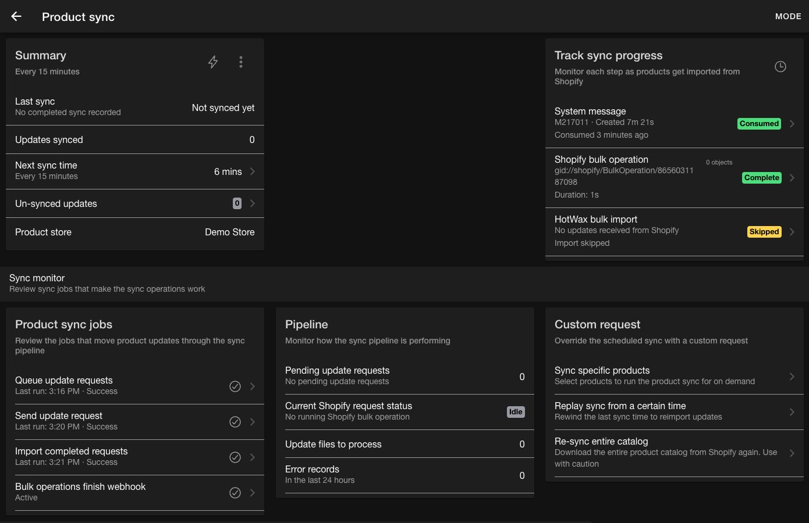

# Product sync console

Use the product sync console to follow a Shopify product request through export and import, inspect failed products, and review previous runs. Check the selected shop and the import result before treating a run as complete.

For query scope and product identifiers, see [Product download](download-products.md). For supported field changes, see [Update product details](update-product-details.md).

## Open the console

1. Open the Company App and select `Shopify`.
2. Open the connection you want to review.
3. Select `Product sync`.

Automatic mode uses the shop's recorded product sync request history to choose the setup or returning-user view. A returning-user view does not establish that products are linked or that an import succeeded. Use `Mode` to inspect or change that view selection. Changing the view does not run an import or repair missing product links in HotWax Commerce.

If the setup view appears unexpectedly, check the selected shop and its sync history before starting another catalog import. For first-time setup, follow [Set up HotWax Commerce with Shopify](../../../system-admin/administration/company/product-store-onboarding.md).

## Read the dashboard

The `Summary` card shows the recorded last-sync time, the associated import's record count, the next scheduled run or paused state, and the linked product store.

The last-sync summary uses a consumed or confirmed request with a linked import. It does not prove that every import record succeeded. `Un-synced updates` lists Shopify products updated after the recorded boundary; it is not a complete list of failed records from earlier imports.

<figure><figcaption>
Product sync dashboard
</figcaption></figure>

### Track the selected run

Open each available stage in `Track sync progress`:

| Stage | What to verify |
| --- | --- |
| `System message` | Request ID, status, error text, connection, and the job responsible for the next step |
| `Shopify bulk operation` | Operation ID, Shopify status, object count, and whether a result file exists |
| `HotWax bulk import` | Data Manager log ID, final status, total records, successful records, and failed records |

The dashboard can show a run opened from history, a newly started run, or the latest available run. It keeps the selected request while its details load. It does not automatically select the oldest unfinished import. Check history and the `Pipeline` card for other pending work.

A completed Shopify export is separate from a completed HotWax import. If Shopify returns no result URL, the request can finish without creating an import. Object counts include Shopify export objects; they are not a count of successfully imported HotWax products.

### Check jobs and pending work

Use `Product sync jobs` to inspect the shop's request schedule, the shared sender and completion-processing jobs, and the completion webhook. The `Pipeline` card shows pending requests, the current Shopify operation, files waiting for import, and recent errors.

Open the corresponding job to check its parameters, active state, schedule, and recent runs. Review an existing request before starting another one. For exact actions, including webhook behavior and partial-save recovery, use [Monitor Shopify product sync](../../../system-admin/administration/company/manage-shopify-product-sync.md#review-jobs-and-pipeline-health).

## Review product changes

`Recently synced product updates` shows saved product-update history for the selected shop. Search by internal name and inspect the product reference, update time, and field changes when available.

The history describes data processed by the importer. It does not replace a check of the current product record or prove that every exported field has an OMS mapping. Use the [field mapping reference](update-product-details.md#review-the-field-mappings) to interpret titles, identifiers, prices, images, features, metafields, and calendar dates.

For an unexpected result, compare the Shopify product, saved comparison history, and current HotWax record. Pay particular attention to blank values, identifier changes, and an existing Shopify inventory-item link.

## Correct errors and retry a product

1. Review `Parsed error details` and identify the Shopify parent product and failed Data Manager import.
2. Open `View details` and correct the source data or configuration named in the error.
3. Select `Retry` when a numeric Shopify product ID is available.
4. Review the returned synced, failed, and missing-product counts, then verify the product and its mappings in HotWax.

The product retry fetches current data from Shopify through the on-demand importer. It does not rerun the original failed file. The original import history remains evidence of that attempt.

When a failed record has no usable Shopify product ID, inspect its details to identify the product before using a custom request. Download the raw or failed-record file from history when the corresponding file is available.

See [Review errors and retry products](../../../system-admin/administration/company/manage-shopify-product-sync.md#review-errors-and-retry-products) for the operational controls.

## Review sync history

Select the history icon in `Track sync progress`. History stays scoped to the selected Shopify shop.

Use `System message status`, `Sort`, `Created after`, and `Created before` to find a run. `Newest first` is the default; `Oldest first` is also available. Date filters apply to each retrieved page, and the page loads additional history to fill the filtered result. Continue loading when the period you need is outside the displayed results.

Expand a run to check the message, Shopify operation, and import independently. Use `View query` to confirm the actual filter. Select the total or failed record count to download the corresponding file when available.

| History result | Meaning |
| --- | --- |
| Total record count | Records in the linked import, not a count of successful products |
| Successful record count | Records reported as successful by that import |
| Failed record count | Records requiring error review |
| No import | Check whether the export is pending, failed, or returned no file |

For all history controls and file links, see [Review sync history](../../../system-admin/administration/company/manage-shopify-product-sync.md#review-sync-history).

## Choose a recovery request

Use a targeted product sync when a small set of products needs another import. A replay queues a request from the selected date. A full catalog re-sync removes the generated date window but retains configured status and query filters.

Before replaying, check the query, existing imports, and the affected product identities. Neither a full import nor a replay replaces the separate [product deletion flow](delete-products.md).

Follow [Run a custom request](../../../system-admin/administration/company/manage-shopify-product-sync.md#run-a-custom-request) for the available actions. Their availability depends on the installed app, connector, connection, and permissions.
