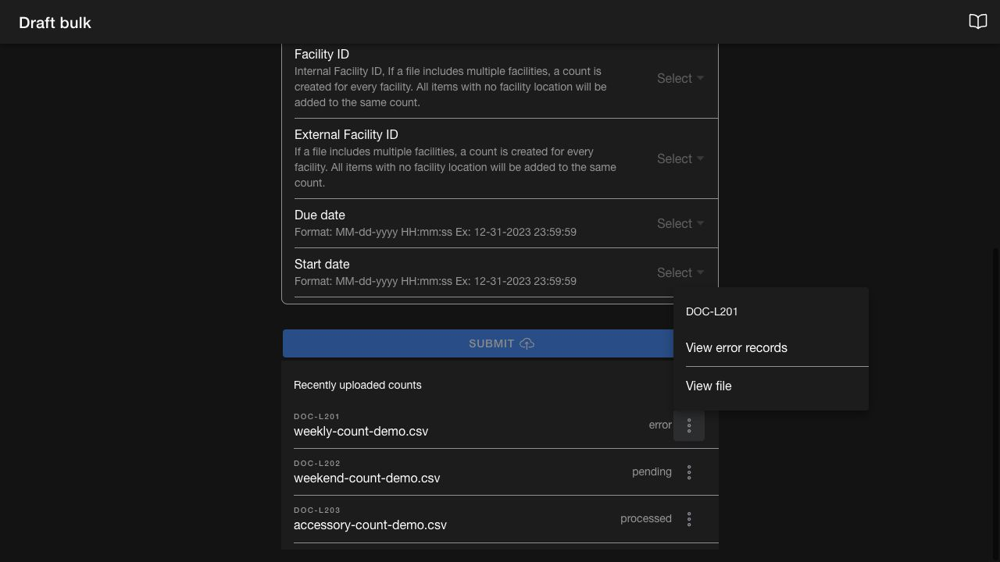

# Bulk upload

Use `Draft bulk` in the Cycle Count app to create multiple cycle counts from a CSV file. The page provides a template, saved field mappings, and the status of recent uploads.

## Required permissions

Access to bulk upload requires `COMMON_ADMIN` or `INV_COUNT_ADMIN`.

## Prepare and upload a CSV

1. Open `Draft bulk` and select `Download template`.
2. Prepare the file using the template fields.
3. Select `Upload` and choose the CSV from your device.
4. Choose a saved field mapping or map each column to the corresponding system field.
5. Review the mapping and select `Submit`.

Use these fields when preparing the file:

| Field name | Meaning | How to get the right value |
| :---- | :---- | :---- |
| `countImportName` | Unique name used to identify the cycle count and differentiate multiple uploads. | Use a meaningful naming format such as `Count-Jan-Store12` or `CycleCount-W1`. Avoid duplicates so tracking stays clean. |
| `purposeType` | Type of cycle count being created. | Choose based on the count type: `HARD_COUNT` for a full physical count; `DIRECTED_COUNT` for a targeted or partial inventory count. |
| `idType` | How the product will be identified in the system (for example, `SKU`, `UPCA`). | Check which identifier your system uses as the primary key. |
| `idValue` | The product value based on the `idType` selected. | If you select `SKU` in `idType`, then `idValue` must contain product SKUs. |
| `externalFacilityId` | External ID of the facility to which the count will be assigned. | Find this in the Facilities app under the external mappings section. |
| `estimatedCompletionDate` | Due date by which the count should be completed. | Format: `MM-DD-YYYY`. |
| `estimatedStartDate` | Date the cycle count is allowed to begin. | Format: `MM-DD-YYYY`. |

## Creating Hard Counts with bulk upload

Hard counts are created from the same CSV flow. To avoid missing-product errors when you don’t want to preload item lines:

1. In your CSV, set `purposeType` to `HARD_COUNT` for the rows you want to create as hard counts.
2. During field mapping, choose `Skip` for the product identifier field (`productSku`). This tells the uploader not to look for item rows when building the count.
3. Map the remaining required fields (for example, `countImportName`, `facility`, `estimatedStartDate`, `estimatedCompletionDate`) and submit.

The uploader creates a hard count with no product list preloaded, so the count opens as a blank, full physical count in the app.

## Track recently uploaded counts

Find the file under `Recently uploaded counts`. Each row shows the filename, Data Manager log ID, processing status, and a three-dot action menu. Keep the filename and log ID when investigating an import.

The list refreshes approximately every 15 seconds and shows up to 100 records from the last 24 hours. Use the record's status to track processing. Upload acceptance does not confirm that every count was created.

| Status | Meaning |
| --- | --- |
| `pending` | Waiting to process or waiting for the next processing status |
| `processing` | The import is running |
| `processed` | Processing finished with no reported failed records |
| `error` | The import failed, crashed, or finished with one or more failed records |
| `cancelled` | The import was cancelled |

*An import with failed records shows error even when processing has finished.*

## Review an upload error

1. Open the file's three-dot menu.
2. Select `View error records` to download the available error-record file.
3. Review the failed records and their errors. Use `View file` to download the original CSV for comparison.
4. Correct the affected data before submitting another upload. Check which records already succeeded to avoid repeating them unnecessarily.

`View error records` is available when the import fails, crashes, or reports failed records.

## Cancel a pending upload

1. Find an upload in `pending` status.
2. Open its three-dot menu and select `Cancel`.
3. Wait for the list to refresh and confirm the resulting status.

The cancellation notification confirms that cancellation was requested. Check for `cancelled` before treating the upload as stopped.

After processing, review the created counts in [Draft](draft.md) or [Assigned](assigned.md), depending on your approval permission.
