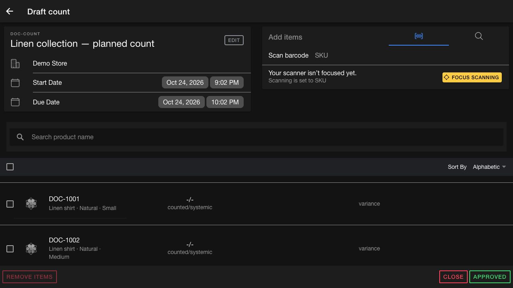

# Upcoming count administration

> **Release preview — checked 23 October 2026.** The changes below come from separate open PRs and are not a confirmed release bundle. Each section identifies its required PR. Screenshots show the actual PR UI running locally with synthetic data. Continue using the existing [Create count](create-count.md) and [Bulk upload](bulk-upload.md) guides unless the corresponding change is deployed.

## Review a draft before counting

**Requires [PR #1438](https://github.com/hotwax/inventory-count/pull/1438).** This introduces a Draft workspace for users with the `INV_COUNT_APPROVAL` permission. The permission is checked explicitly; an administrator role alone does not substitute for it.

1. Open **Draft** and select the count to review.
2. Confirm the count name, facility, start date, and due date. Use **Edit** to change the name and the date controls to adjust timing.
3. Review the assigned products. Use the scan or search controls under **Add items** to add products, or select rows and use **Remove items** to remove them.
4. When the draft is ready, select **Approved**. This is the button label in the proposed UI.
5. Confirm that the count leaves the draft workflow and appears in the appropriate assigned list.

*PR #1438 preview. This is approval of the planned count, before counting begins. Demo Store and DOC-COUNT are synthetic examples.*

Draft approval changes the count from Created to Approved. It is separate from reviewing variances after counting. **Close** is a separate action and does not approve the draft.

The proposed list behavior depends on the signed-in user's permission. Users with `INV_COUNT_APPROVAL` see Approved and In progress counts in Assigned/Store lists, with Created counts handled in Draft. Users without that permission retain the Created/In progress list behavior. Do not assume this PR makes pre-count approval mandatory for every user.

## Interpret product tag totals

**Requires [PR #1483](https://github.com/hotwax/inventory-count/pull/1483).** Tag filters in count creation count eligible product variants. A virtual parent product is not an extra item to count.

For example, a tagged parent with three eligible variants should contribute three countable SKUs, rather than four results including the parent. Review the resulting products before creating the count; the tag number is not an inventory quantity.

The PR addresses the parent-versus-variant mismatch. It does not resolve every tag-search issue: the separately tracked tokenized matching case, such as `new` matching `New Release`, is outside this change.

## Track bulk uploads through Data Manager

**Requires [PR #1327](https://github.com/hotwax/inventory-count/pull/1327).** The upload form continues to accept a CSV and column mappings, while processing and recent-upload actions move to Data Manager records.

1. Open **Draft bulk** and use **Download template** when preparing a new file.
2. Choose the CSV, map its required and optional columns, and select **Submit**.
3. Find the file under **Recently uploaded counts**. Keep its displayed log ID and filename when investigating a problem.
4. Check its processing status. Upload acceptance alone does not confirm that all counts were created.
5. Open the file's three-dot menu to inspect available actions.

| Displayed status | Meaning in this proposed UI |
| --- | --- |
| **pending** | Waiting to process; some transitional states also fall back to this label |
| **processing** | The import is running |
| **processed** | Processing finished without a reported failed-record count |
| **error** | The import failed/crashed, or one or more records failed even if processing finished |
| **cancelled** | The import reports a cancelled status |

*PR #1327 preview. DOC-L201 finished with failed records, so its status is **error** and its menu offers **View error records**.*

### Inspect files and request cancellation

- **View file** downloads the original uploaded file.
- **View error records** downloads the error-record file when the import failed, crashed, or reports failed records.
- **Cancel** is offered for a Pending import. It requests cancellation; wait for the refreshed status to confirm the outcome. A cancellation-requested notification is not proof that processing has stopped.

The recent list refreshes approximately every 15 seconds and requests up to 100 records from the last 24 hours. It is a recent-activity view, not a complete historical archive. The old Next run/Last run countdown is removed; use the individual record's status. The book icon in the header opens the upload guide.

This workflow requires the compatible server-side Data Manager upload, log, download, and cancellation APIs and the `INV_COUNT_IMPORT` configuration. Its presence in a frontend PR alone does not prove that a particular environment is ready.

### Separate older error-file proposal

[PR #1367](https://github.com/hotwax/inventory-count/pull/1367) adds error-file download to the older system-message upload workflow. It overlaps #1327, which replaces those records with Data Manager logs. Select the instructions for the workflow actually deployed; do not combine system-message IDs and Data Manager log IDs.

## Related preview

Store associates can use the [upcoming directed hand-count guide](../../../store-operations/cycle-count/upcoming-directed-hand-count.md) to prepare for total quantity editing and explicit zero counts. That guide depends on a separate PR.
