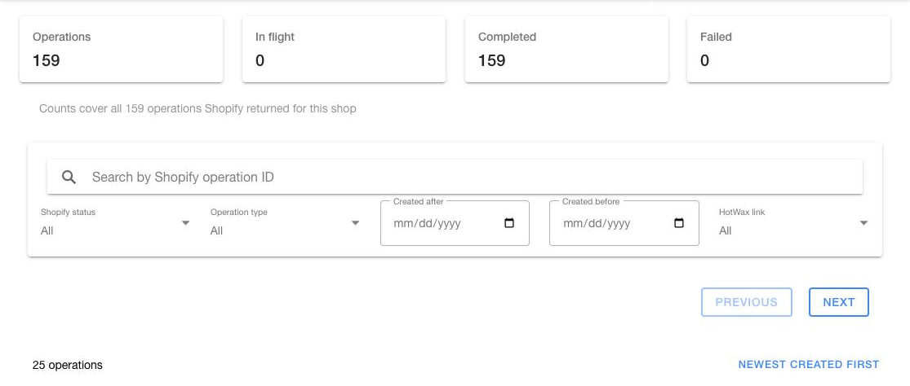
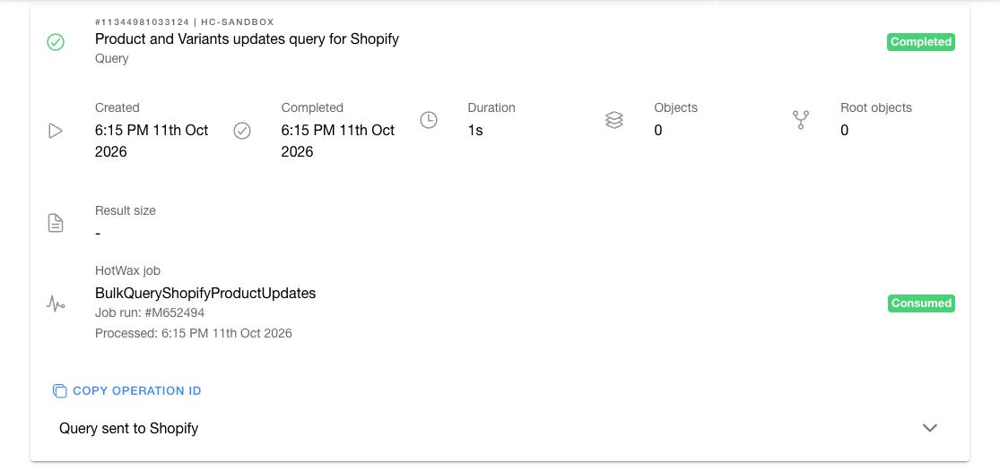

# Review Shopify bulk operations

Open `Shopify` > `Bulk operations` to review the bulk operations Shopify ran for HotWax Commerce, such as product downloads and bulk updates.

HotWax Commerce records the ID of each Shopify bulk operation on the system message that requested it. The page uses that ID to show Shopify's status next to the HotWax Commerce processing status. Compare them to see whether a sync stopped in Shopify or in HotWax Commerce.

<figure><figcaption>
Search and filter the bulk operations Shopify ran for the selected shop.
</figcaption></figure>

## Choose the shop

The page shows the Shopify shops connected to the product store selected in the app menu. When the product store has more than one shop, use `Shop` to select one shop or keep `All shops`.

- One shop: Use `Previous` and `Next` to page through its operations, 25 at a time.
- `All shops`: The page shows the most recent operations from each shop, merged by date, without paging. Select a single shop to page through its full history.

If one shop fails to load while the others load, the page names that shop at the top of the list. Its operations are missing from the results until it loads.

Changing the product store reloads the page for the shops connected to the new store.

## Review operation totals

Use the summary cards to compare:

- `Operations`
- `In flight`: Created, Running, or Canceling
- `Completed`
- `Failed`: Failed or Canceled

Shopify does not report a total number of bulk operations. The cards count the 250 most recent operations for each shop that match the search and the status, type, and date filters. The note below the cards states how many operations they counted. Changing the sort order does not change the cards.

## Find an operation

Use `Search by Shopify operation ID` to find an operation anywhere in the shop's history, not only on the current page. Enter any of these forms:

- The number shown on an operation card, such as `11339280253092`
- The number with its `#`
- The full ID, such as `gid://shopify/BulkOperation/11339280253092`

Separate several IDs with spaces or commas to find them together. If the search text does not contain an operation ID, the page shows a hint and keeps the list unfiltered.

Combine the search with these filters:

- `Shopify status`: Created, Running, Completed, Failed, Canceling, or Canceled
- `Operation type`: Query or Mutation
- `Created after` and `Created before`
- `HotWax link`: Linked to a job, or No HotWax record

Shopify applies the search, status, type, and date filters to every operation it keeps for the shop. Shopify reads both dates in the shop's time zone, not the time zone selected in Job Manager.

`HotWax link` filters only the operations on the current page. The page hides this filter when your HotWax Commerce version cannot match bulk operations to system messages, and then shows Shopify information only.

Use the sort control in the list header to show the newest or oldest operations first, by created time or by completed time.

## Read an operation card

<figure><figcaption>
Compare Shopify's status with the HotWax job that requested the operation.
</figcaption></figure>

The top of the card shows the Shopify operation ID, the shop, the description of the HotWax job when one is available, the operation type, and Shopify's status.

The card also shows:

- `Created` and `Completed`
- `Duration`
- `Objects` and `Root objects`
- `Result size`
- `Error code`, when Shopify reports one

Select `Result file` to download the results of a completed operation, or `Partial data` for the results a failed operation produced before it stopped. Shopify keeps these files for 7 days after the operation ends.

Select `Copy operation ID` to copy the full Shopify ID, and expand `Query sent to Shopify` to review the query or mutation the operation ran.

`HotWax job` shows the system message type, the job run, the time HotWax Commerce processed the result, and the system message status. Select it to open [Trace a system message](../system-messages/message-details.md). When you return, the page keeps your place in the list.

The card shows `No HotWax message found for this operation` when no system message records the operation's ID. This can happen when the operation started outside HotWax Commerce.

## Investigate a stalled sync

Compare Shopify's status with the HotWax Commerce status on the same card:

| Shopify status | HotWax Commerce status | What it means |
| --- | --- | --- |
| Created, Running, or Canceling | Any | Shopify has not finished the operation. |
| Completed | Consumed | Shopify finished, and HotWax Commerce processed the result. |
| Completed | Not yet Consumed | Shopify finished, but HotWax Commerce has not processed the result yet. |
| Failed or Canceled | Any | Shopify stopped the operation. Review `Error code` and `Partial data`. |
| Any | No HotWax message | Shopify ran the operation, but no system message records its ID. |

1. Search for the operation ID, or filter by `Shopify status`.
2. Compare Shopify's status with the HotWax Commerce status.
3. If Shopify completed the operation but HotWax Commerce has not processed it, select `HotWax job` and [follow the message journey](../system-messages/message-details.md#follow-the-message-journey).
4. If the system message failed, [trace the failed message](../troubleshooting/system-messages.md#trace-a-failed-message).

To learn how HotWax Commerce uses Shopify bulk operations to download products, see [Download products from Shopify](https://docs.hotwax.co/documents/learn-shopify/shopify-integration/products/download-products).
