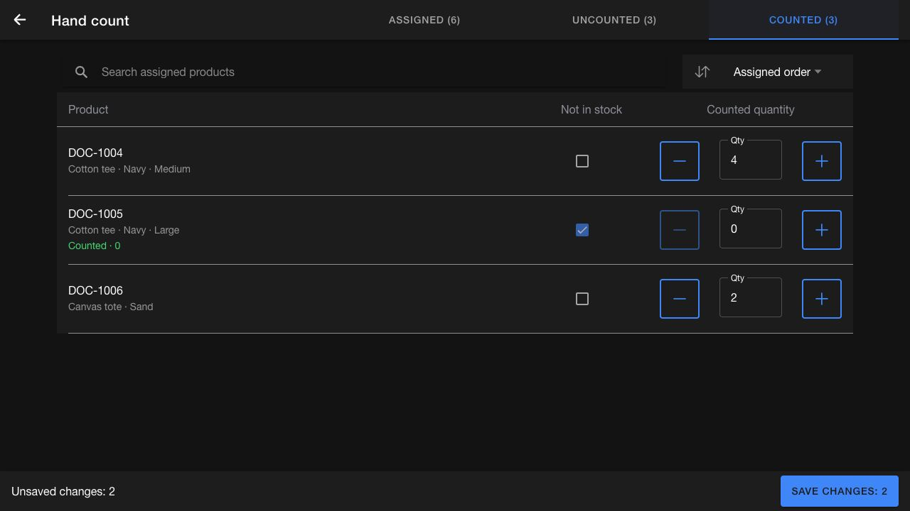
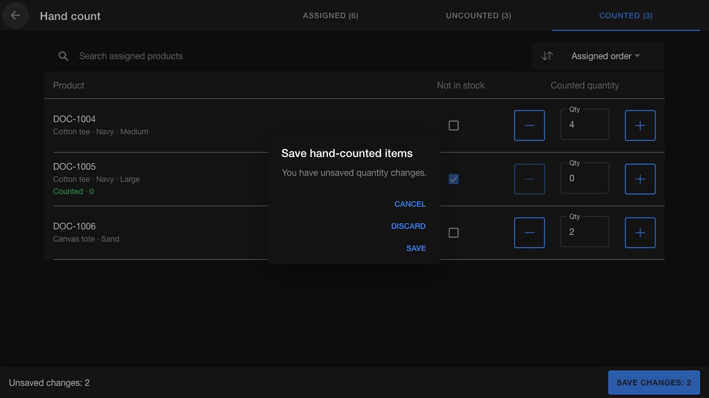

# Arrived: directed hand counting

> **Arrived — source checked 23 October 2026.** This guide describes [Inventory Count PR #1488](https://github.com/hotwax/inventory-count/pull/1488), which merged on 23 October 2026. Deployment has not been verified. For the earlier workflow, see [Start and complete a session](start-complete-session.md). Screenshots show the actual PR UI running locally with synthetic products; they do not show a customer environment.

Directed counts start with a list of assigned products. The **Hand count** page lets you work through that list and enter each product's total counted quantity without searching for and adding every product individually.

## Open and filter the assigned products

1. Open your assigned directed count and its active counting session.
2. Open **Add hand-counted items** from the session's actions.
3. Choose **Assigned** to see all assigned products, **Uncounted** for remaining work, or **Counted** to review products already recorded.
4. Use **Search assigned products** and the sort control to find the item you are counting.

Tab counts describe recorded items. Unsaved edits remain marked **Unsaved changes** until you save; they do not immediately move an item to the Counted tab.

## Enter a total or confirm zero stock

Enter the **total** you counted in **Qty**, or adjust it with the minus and plus buttons. For example, if the recorded quantity is 4 and you recount 7, enter **7**, not **3**. Use non-negative whole numbers.

For an assigned product you checked and did not find, select **Not in stock**. This explicitly records a zero count. A row that still shows its untouched default 0 is not proof that someone counted it.

*PR #1488 screen. DOC-1001 has a pending total of 7; DOC-1002 is explicitly marked Not in stock. DOC-1003 remains uncounted. All products are examples.*

## Save and review your work

1. Review the **Unsaved changes** count in the footer.
2. Select **Save changes: n** to save the edited rows.
3. Open **Counted** to check recorded quantities, including products counted as zero.
4. Continue through **Uncounted**, then return to the session and follow the normal session-submission workflow.

*PR #1488 screen. A confirmed zero is shown as **Counted · 0**. The footer can still show unsaved edits made on another tab.*

Saving hand counts saves progress in this session. Submitting the session, submitting the combined count, and reviewing inventory variances remain separate actions.

If the app reports **Saved on this device. Waiting to sync.**, your edits are saved locally but have not finished syncing. Keep using the same device and session, restore connectivity, and confirm synchronization before treating the count as received by the server.

## Leave without losing pending edits

When you leave with unsaved quantity changes, the app offers three choices:

| Choice | What happens |
| --- | --- |
| **Cancel** | Stay on the page and keep editing |
| **Discard** | Leave and discard the pending edits |
| **Save** | Attempt to save the pending edits before leaving |

*PR #1488 screen. The dialog applies to pending edits, not previously saved session counts.*

Draft recovery uses storage in the same browser and is scoped to the instance, user, and session. It is not a cross-device backup. If you see **Draft recovery is unavailable. Save your changes before leaving or reloading this page.**, save before navigating away.

If the session is no longer available for counting, editing is disabled. Return to the session and confirm that it is still active and available to you before continuing.

## Other store changes

[PR #1444](https://github.com/hotwax/inventory-count/pull/1444) isolates locally held variance data by facility. Check the active facility before reviewing variances, especially after switching stores. Ordinary navigation within one facility preserves its working context; changing facility clears the manual variance working data associated with that switch.

[PR #1486](https://github.com/hotwax/inventory-count/pull/1486) makes failure messages more specific by displaying the server's explanation when available. Read the message before retrying; a failed save must not be treated as a successful submission.

[PR #1302](https://github.com/hotwax/inventory-count/pull/1302) makes **Previous good scan** and **Next good scan** entries clickable while resolving scan context. Selecting one scrolls to that scan and briefly highlights it, helping you locate the surrounding successful scan.

## Release selection note

[PR #1376](https://github.com/hotwax/inventory-count/pull/1376) proposes an older, per-item **Add Count** dialog that adds a quantity. It overlaps the total-editing workflow in this guide. These are separate proposals: do not use the additive instructions from #1376 with #1488's total fields. This guide specifically documents #1488.
