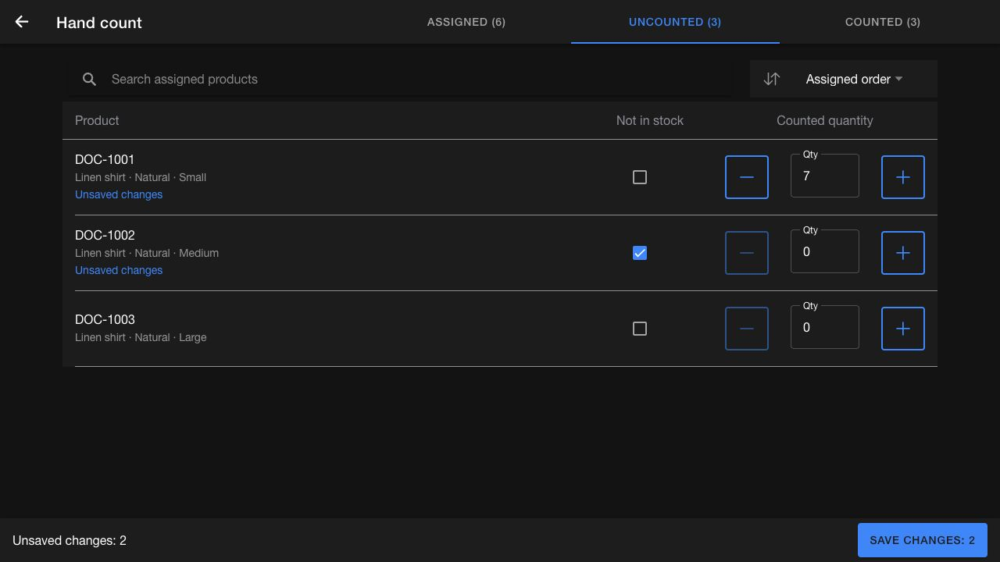

# Start and complete a session

## Starting the count

Once the start time arrives, the `Start counting` button becomes active in the count card. After starting, the count moves into the `In progress` state.

## Required permissions

* Open the Counts list and start sessions: any of `FULFILL_INVCUNT_ADMIN` or `INV_COUNT_ADMIN`.
* Start a count before its planned start time: any of `COMMON_ADMIN`, `INV_COUNT_ADMIN` or `INV_COUNT_PRE_START` (otherwise `Start counting` stays disabled until the start time).
* Force‑release another user’s active session: `COMMON_ADMIN`.

## Creating sessions

Managers or associates can create multiple sessions to divide the work. When they click `New session`, a form appears to:

* Enter the session name
* Select the area (Backstock, Display, etc.)

The system automatically creates one default session. Multiple sessions can run in parallel. If a session is active, no other user can work on that same session. Managers have permission to forcibly release another user's active session when a session is abandoned or blocked.

## Performing the count

Inside a session, the associate will see:

* Count name and type
* Options to edit the session name/area
* Option to discard the session
* `Submit` button for when the session is complete

### Session actions (edit, discard, submit)

* **Edit**: Opens a modal to update the session name and area. Available while the session is `In progress` and not locked by another user.
* **Discard**: Shows a confirmation before marking the session as discarded. Available while the session is `In progress` and not locked. Once discarded, the session is removed from review and you are returned to the counts list.
* **Submit**: Completes the session. Appears only while the session is `In progress`; disabled when the session is locked. Submission is blocked until all unmatched items are resolved.
* **Locked sessions**: If another user/device holds the lock, all action buttons are disabled until the lock is released.
* **After submission**: The action bar only shows `Re-open session` (outline, yellow) so you can resume counting if needed.
* **Discarded sessions**: The action bar shows a `Session discarded` badge; no other actions are available.

### Scanning items

Before counting with a Bluetooth scanner, follow [Connect the Socket Mobile scanner](connect-scanner.md). Configure the scanner to send `Enter` after each barcode so the app records the scan.

The scan action button changes based on session state:

* Before the session starts, it shows `Start counting` (green). Tapping it moves the session to `In progress` and focuses the scanner input.
* During the session, if the input is not focused, it shows `Resume counting` (red) as a reminder to return focus to the scanner field.
* When the scanner input is already focused, it shows `Scanner ready` and is disabled until focus is lost.

The scanned items will appear in the left panel. If a wrong item is scanned, the associate can remove it, and the system will adjust the count automatically.

### Item categories during scanning (for directed counts)

Scanned items automatically fall into four sections:

* `Counted`: Items assigned to this session and matched correctly
* `Unmatched`: Items scanned but not found in the system
* `Undirected`: Items that exist in system but were not assigned to the associate
* `Uncounted`: Items given for counting but not yet scanned

### Item categories during scanning (for hard counts)

Scanned items automatically fall into two sections:

* `Counted`: Items assigned to this session and matched correctly
* `Unmatched`: Items scanned but not found in the system

While scanning, the system will also display the total number of units scanned and the number of unique products counted. This helps the store team track their progress and supports the reconciliation process.

For example, before counting a shelf, the team may identify that it contains 40 units. As they scan each item, the system will update the count of units and products scanned, allowing them to verify that everything has been captured accurately.

During scanning, some items may appear in the `Unmatched` tab. These are items whose UPC/UPCA does not match any product in the system. Store associates must review and manually match these items before submitting the session.

### How to match an unmatched item

1. Open the `Unmatched` tab inside the session.
2. Locate the item that needs to be matched.
3. Click on the `Match` icon.
4. A `Match Product` modal will open.
5. The scanned UPC/UPCA will already be auto-filled in the search field.
6. The system will display possible product matches based on the code.
7. Select the correct product from the results.
8. Click `Save` to confirm the match.

### What happens after saving the match

* If the matched product belongs to the count, it moves to the `Counted` tab.
* If the item is not assigned in the count, it moves to the `Undirected` tab.
* The item is removed from the `Unmatched` list.

The unmatched item card shows when the item was scanned and how many scans ago it occurred. Select `Previous good scan` or `Next good scan` to scroll to the surrounding matched scan. The selected scan is briefly highlighted so you can locate the unmatched item in the store.

This ensures the store team can complete the count with all items correctly mapped to system products.

### Add hand-counted items

Use `Add hand-counted items` from the session actions to record quantities counted without a scanner.

#### Directed counts

The `Hand count` page lists the products assigned to the count. Use `Assigned` to see the full list, `Uncounted` to find remaining work, or `Counted` to review recorded quantities. Use `Search assigned products` and the sort control to find an item.

1. Enter the total counted quantity in `Qty`, or use the minus and plus buttons. Use non-negative whole numbers.
2. If you checked a product and found no stock, select `Not in stock` to record a zero count.
3. Review the `Unsaved changes` count in the footer.
4. Select `Save changes: n` to save the edited rows.
5. Open `Counted` to check the recorded quantities, then continue through `Uncounted`.

Enter the total quantity, not the difference from a previous count. For example, if the recorded quantity is 4 and you recount 7, enter **7**.

*Enter each product's total quantity. Select Not in stock only after checking that no stock is present.*

An untouched `0` does not record a count. A product explicitly marked `Not in stock` appears as `Counted · 0` after saving. Unsaved edits do not move products between tabs until they are saved.

*Use Counted to review saved quantities, including confirmed zero counts.*

#### Save or discard pending edits

When you leave with unsaved changes, choose one of the following:

| Choice | Result |
| --- | --- |
| `Cancel` | Stay on the page and continue editing |
| `Discard` | Leave without saving the pending edits |
| `Save` | Save the pending edits before leaving |

*The confirmation applies to pending edits. Previously saved session counts remain unchanged.*

Draft recovery uses the same browser, instance, user, and session. It does not transfer drafts to another device. If `Draft recovery is unavailable. Save your changes before leaving or reloading this page.` appears, save before navigating away.

If the app reports `Saved on this device. Waiting to sync.`, keep using the same device and session, restore connectivity, and wait for synchronization to finish. A local save does not confirm that the server has received the count. If saving fails, read the error message, correct the problem, and save again.

Editing is disabled when the session is no longer available for counting. Return to the session and confirm that it is active and available to you.

#### Hard counts

1. Search for the product using its SKU or parent product name and press Enter to add it.
2. Enter the quantity, or use the plus and minus buttons.
3. Remove an incorrectly added item using the cross button.
4. Select `Save` after entering all quantities.

#### Submit the session

Saving hand counts records progress in the session. Return to the session, resolve any unmatched items, and select `Submit` when counting is complete. The store manager submits the combined count for head-office review separately.
