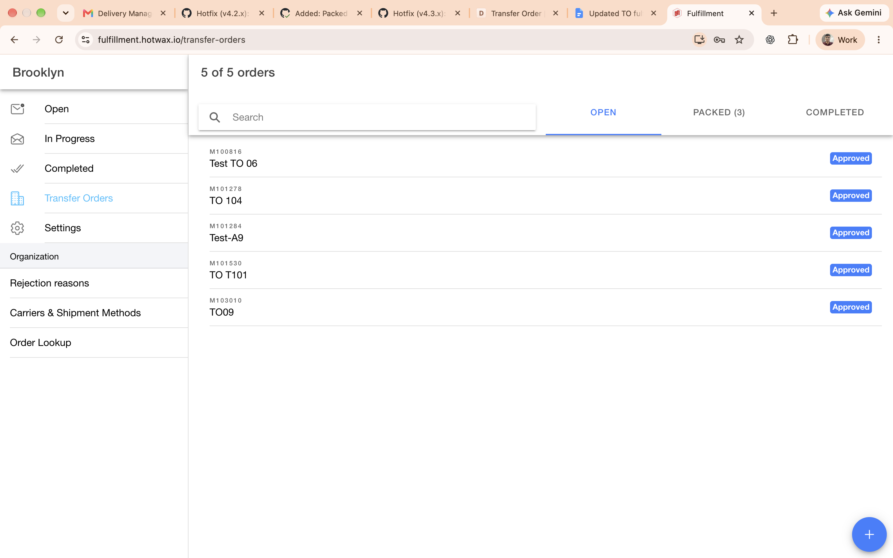
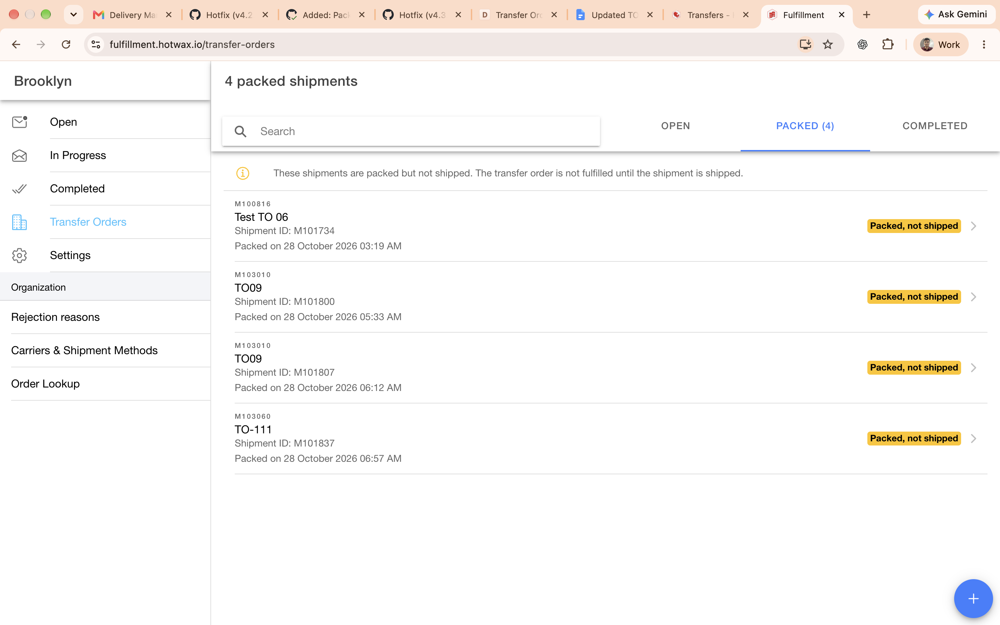
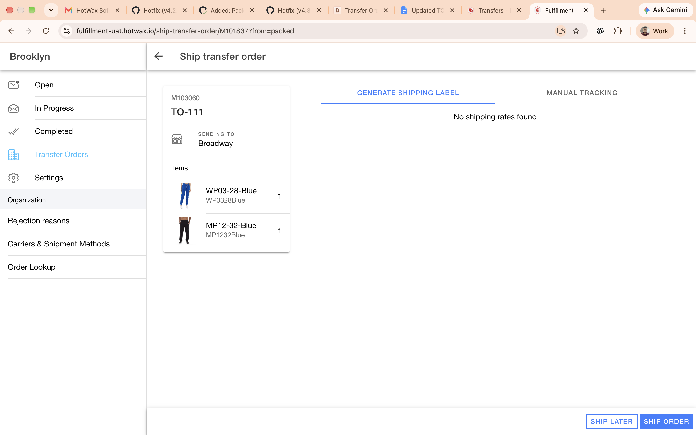

# Transfer Order

Use the Transfer Orders page to create transfer orders, track their fulfillment status, and ship packed shipments.

## Find Transfer Orders

The Transfer Orders page opens to the Open tab. Use the search bar to find transfer orders by name.

*Transfer Orders page with Open, Packed, and Completed tabs.*

### Open, Packed, and Completed tabs

Use the tabs at the top of the page to view transfer orders by status:

- **Open**: Transfer orders awaiting fulfillment.
- **Packed**: Shipments that are packed but not shipped. The tab shows the number of packed shipments waiting to ship.
- **Completed**: Transfer orders with shipped shipments. An order can also remain in Open if items still need fulfillment.

### Details Shown for Each Transfer Order

Each row shows the transfer order name and ID. The status appears next to the order name as **Approved** while fulfillment is pending, and **Completed** when all items have been fulfilled and shipped.

## Packed Transfer Order Shipments

A packed shipment still needs to be shipped. The transfer order is not fulfilled until its shipment is shipped.

*Packed segment showing shipments awaiting shipment.*

Select **Packed** to view shipments waiting to ship. Use the search bar to find a transfer order by name. Each row shows the transfer order ID and name, shipment ID, packed date, and a **Packed, not shipped** status. A package count appears when a shipment has more than one package. Select a row to open its **Ship transfer order** page. The row is available to users with the `APP_TRANSFER_ORDER_UPDATE` permission.

*Ship transfer order page opened from a Packed row.*

To ship a packed shipment:

1. Choose **Generate Shipping Label** or **Manual Tracking**.
2. If you choose **Manual Tracking**, select a carrier and shipping method, then enter the tracking code.
3. Select **Ship order**.

When you open a packed shipment from the Packed tab, use the back arrow to leave without shipping. The app returns to Packed and keeps the shipment listed. Open its row again when you are ready to continue shipping.

## Transfer Order Creation

Create a transfer order from the Transfer Orders page.

### Steps to Create a Transfer Order

1. Open **Transfer Orders** and select **+** in the bottom-right corner.
2. Enter a transfer name and select a destination facility. The destination must be different from the current facility.
3. Select the save icon at the bottom-right of the dialog. The **Create transfer order** page opens.
4. Scan a barcode or select **Search Products**. Search by product parent name, SKU, or UPC, then select **Add to transfer**.
5. Review or enter the quantity for each product in its **Qty** field. **Book QOH** appears only for an item without an ordered quantity; select it to set the transfer quantity to the quantity on hand.
6. To save the transfer order without tracking details and ship it later, select **Ship Later**, then select **Continue** in the confirmation dialog. The order returns to the Open tab with an **Approved** status.

## Transfer Order Fulfillment

Open a transfer order from the Open tab to view **Transfer Order Details**. The page header shows the transfer order name and ID, item count, and status.

### Open tab and item cards

The **Open** tab shows items that still need fulfillment. Each item card displays the product image, SKU when available, product name and variant, **Qty** field, **Pick all** button, picking progress, and ordered and shipped quantities. Scan barcodes or enter a picked quantity in **Qty**; select **Pick all** to pick the available quantity. You can create a shipment for the quantity picked while other ordered quantities remain open. Do not ship more than the ordered quantity. When no shipment has been created yet, a **Report an issue** menu may also be available.

### Completed tab

The **Completed** tab shows shipped shipment details, including the shipped date and time, shipment ID, shipping method, and tracking code. Product rows show ordered and shipped quantities. A **Regenerate Shipping Label** button is available for a completed shipment.

### Pick items and create a shipment

1. Pick available items by scanning barcodes or selecting **Pick all** on an item card. To pick a specific quantity, enter it in **Qty**.
2. Select **Picklist** at the bottom of the page to generate a picklist.
3. Select **Create Shipment**. Review the quantity reminder, then select **Create**.

### Ship the transfer order

The **Ship transfer order** page shows the shipment items and destination.

1. Select **Generate Shipping Label** to view available rates. If no rates are available, select **Manual Tracking**.
2. In **Manual Tracking**, select a carrier and method, enter the tracking code, then select **Ship order**.

> **Important:** Once a shipment is completed, it cannot be edited.

### Transfer order status

A transfer order can have completed shipments while other items remain in Open. The order stays **Approved** until all items are fulfilled and shipped, then its status changes to **Completed**.

## Permission required for the Transfer Orders page

- `ORD_TRANSFER_ORDER_ADMIN`: Grants full access to Transfer Orders, including viewing, creating, and updating.
- `ORD_TRANSFER_ORDER_VIEW`: Allows the user to view the Transfer Orders page in the left-hand menu.
- `ORD_TRANSFER_ORDER_CREATE`: Allows the user to create and update transfer orders.
- `APP_TRANSFER_ORDER_UPDATE`: Required to open a packed shipment from the Packed tab. The ship page itself does not check this permission.
