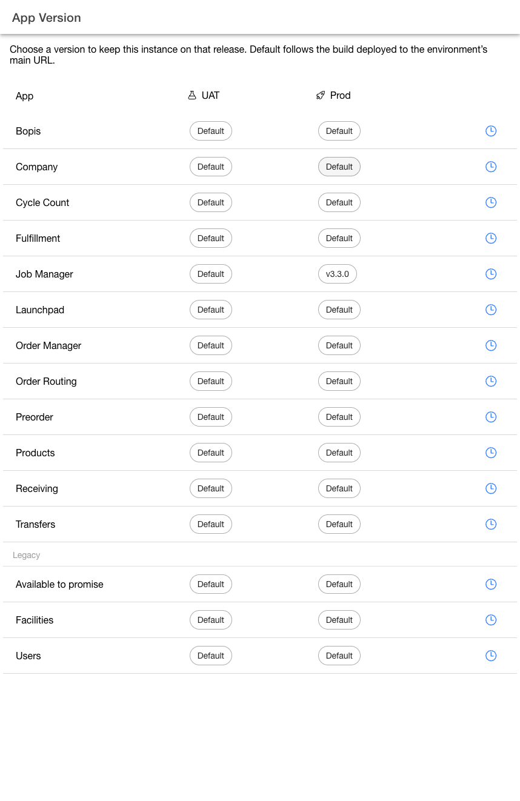
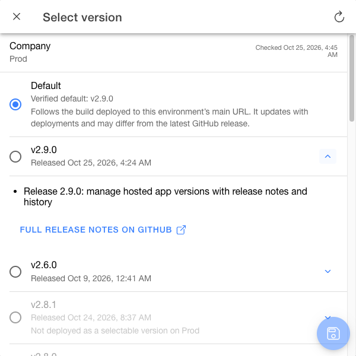
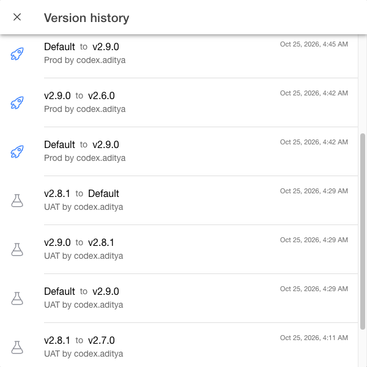

# Manage app versions

Use `App Version` in the **Company App** to control when an Order Management System (OMS) instance adopts an app release. You can test a release in user acceptance testing (UAT), keep production on a selected version, and return to an earlier version while it remains hosted.

## Open App Version

1. Open the **Company App** and confirm that you are signed in to the intended OMS instance.
2. Select `App Version` from the menu.
3. Find the app and choose its version chip in the `UAT` or `Prod` column.

The page lists the catalog apps, including Company. `Legacy` groups Facilities, Users, and Available to promise. Each app has one history button covering both environments.

<figure><figcaption>
Choose the app and environment before changing a version. Captured from Company 2.9.0 on October 25, 2026.
</figcaption></figure>

## Choose Default or a specific version

The setting applies to the signed-in OMS instance and the selected environment. UAT and production have separate selections.

| Choice | Result |
| --- | --- |
| `Default` | Follows the build deployed at the environment's main app URL. It changes with deployments and may differ from the newest GitHub release. |
| A specific version | Keeps the instance on that hosted release for the selected environment. The release must remain available on that environment's app host. |

Not every app has multiple hosted releases. A GitHub release can appear in the picker without being available to select. When no separate versions are hosted, use `Default` to follow the deployed build.

## Review a release and save the selection

1. Open the version chip for the intended app and environment.
2. Review the verified default build and the available version choices.
3. Expand a release's notes using the chevron on its row. Review the published date and short notes, or select `Full release notes on GitHub` for the complete release.
4. Select the radio button for a hosted version or `Default`.
5. Select the `Save` icon at the bottom of the picker.
6. Confirm that the version chip shows the saved choice.

Company checks public hosting availability and checks again before saving. Unavailable versions cannot be selected. Use the `Refresh` icon in the toolbar to check again when availability has changed or could not be verified. If saving cannot be confirmed, refresh and review the choice before trying again.

Use the close icon at the start of the toolbar to leave the picker without saving.

<figure><figcaption>
Review release information beside the version choice. The versions available to your instance depend on what is hosted for that app and environment.
</figcaption></figure>

## Apply the choice to an existing session

An already-open app session does not pick up a changed selection with an ordinary browser refresh.

1. After saving the choice, sign out of the affected app.
2. Open the app again and sign in to the same OMS instance. Login re-entry resolves the version selection again.
3. Confirm the running version. For Company, use [Settings](settings.md) to review the app version and build.
4. Reload after re-entry and confirm that the selected version remains active.

The saved chip records the instance's selection. It does not prove that every already-open session has moved to that build.

## Return to an earlier release

1. Open the same app and environment's version chip.
2. Select the earlier release if it is still hosted and available.
3. Save and confirm the chip.
4. Sign out and re-enter the affected app to apply the selection to an existing session.

Choose `Default` instead when you want the instance to follow the build at the environment's main URL again. Default is not a shortcut to a particular earlier release.

## Review version history

1. Select the history icon at the end of the app's row.
2. Review UAT and production changes together, newest first.
3. Check the previous value, new value, environment, username, and change time.
4. Select `Load more` when it is available to review older changes.

Times use your [selected timezone](settings.md#change-the-timezone). The history does not display a timezone suffix, so confirm your timezone before comparing records with another user. If a username cannot be resolved, the history shows `Username unavailable`.

<figure><figcaption>
One history view brings both environments together. Example records show version changes made during product verification.
</figcaption></figure>
