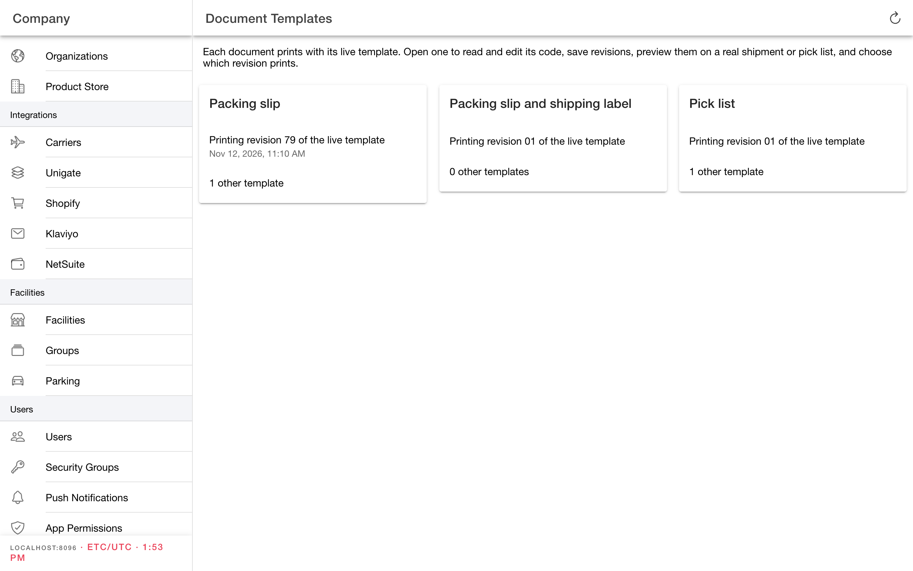
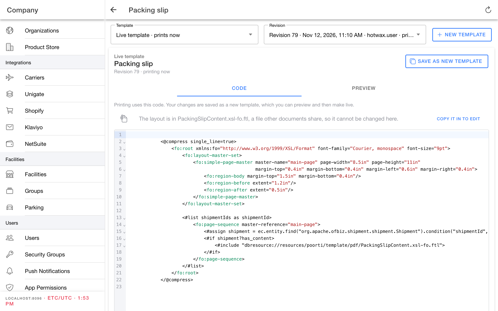
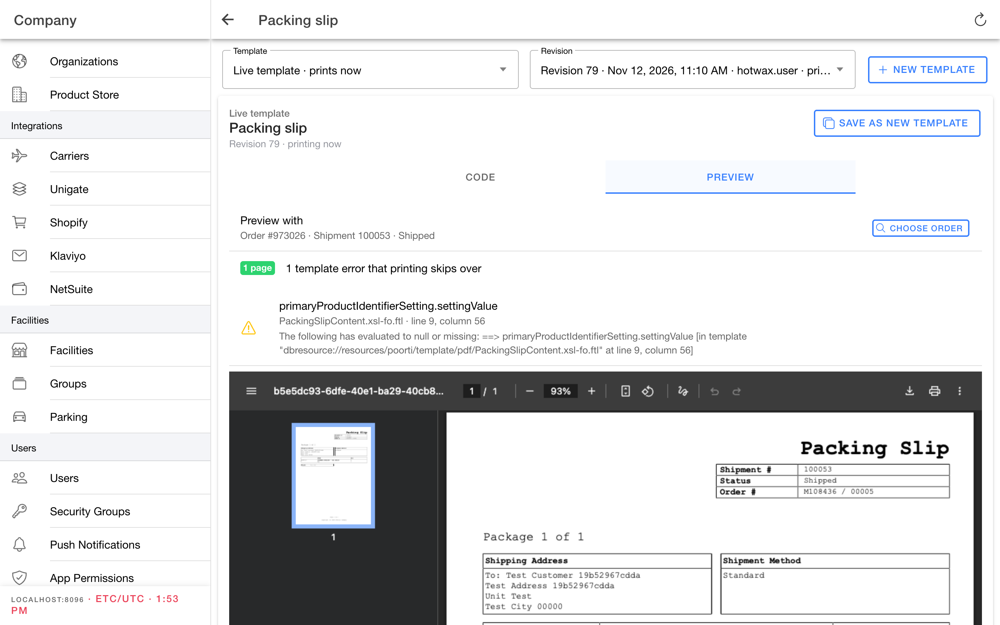
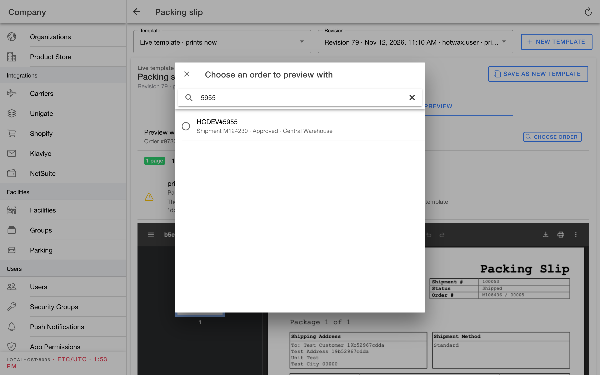
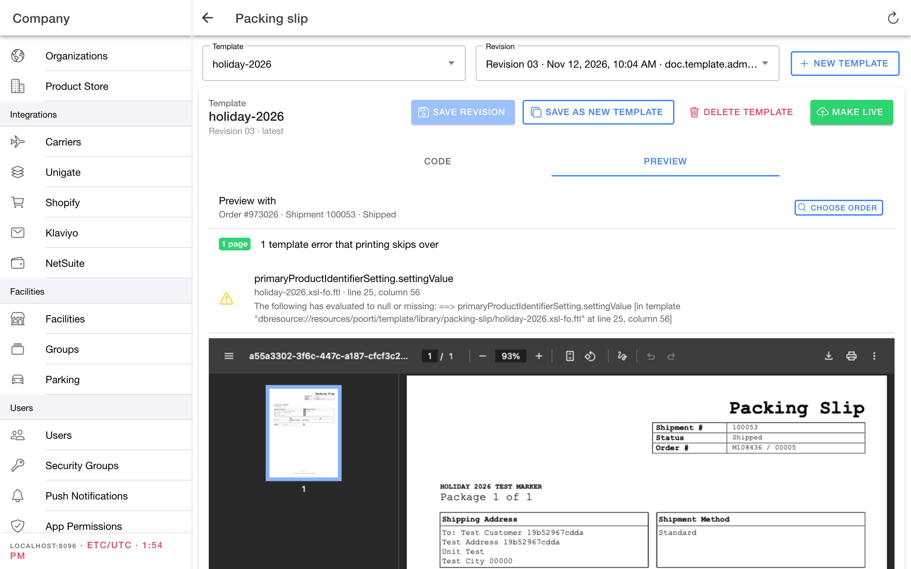

# Edit document templates


**Early alpha.** Document Templates is new and still changing. Screens, wording, and behavior may change between releases, and some actions may not be available on every instance yet. Preview every change on real orders before you make it live, and tell HotWax about anything that looks wrong.


Use `Document Templates` in the **Company App** to change how packing slips and pick lists print. You can read and edit a template's code, save your work without changing what prints, preview it on a real order, and then choose which revision prints.

## How templates work

Each document has one **live template**. Every packing slip or pick list prints from it.

| Term | Meaning |
| --- | --- |
| Live template | The template that prints now. You can't edit it in place. |
| Template | A named copy you edit, such as `holiday-2026`. It never prints until you make one of its revisions live. |
| Revision | A saved version of a template. Every save adds a revision, so you can always go back. |

Making a revision live copies its code into the live template. That adds a revision to the live template's history, and the next print uses it. Deleting a template later doesn't change what prints.

There are three documents:

* Packing slip
* Packing slip and shipping label
* Pick list

## Before you start

* Template access comes with admin permissions. If `Document Templates` is missing from the menu, ask an administrator for access.
* Templates are FreeMarker XSL-FO code. Basic HTML or XML experience helps when you change a layout.

## Open Document Templates

1. Open the **Company App**.
2. Select `Document Templates` under `Settings` in the menu.
3. Select a document, such as `Packing slip`.

Each card shows which revision of the live template prints now and how many other templates exist for that document.

<figure><figcaption>
One card per document. Captured from Company 2.10 on November 12, 2026.
</figcaption></figure>

## Read a template's code

1. In `Template`, choose `Live template · prints now` or one of your templates.
2. In `Revision`, choose the revision to read. The newest revision is selected by default.
3. Select the `Code` tab.

The code editor numbers every line and highlights the code. Fold a block with the arrow next to its line number. Press `Cmd+F` (Mac) or `Ctrl+F` (Windows) to find or replace text.

<figure><figcaption>
The live packing slip includes a shared layout file. Use Copy it in to edit to change that layout for this document only.
</figcaption></figure>

### Change a shared layout

Some templates include a layout file that other documents share, such as `PackingSlipContent`. The page tells you when it does. Select `Copy it in to edit` to replace the include with the layout's code, so you can change it for this document without changing the others.

## Edit and save without changing what prints

### Start a new template

1. Open the live template, or any template you want to start from.
2. Make your changes in the `Code` tab.
3. Select `Save as new template`.
4. Accept the suggested name, such as `packing-slip-copy`, or enter your own. Use lowercase letters, numbers, and hyphens.

To start from the live template without editing first, select `New template` and enter a name.

### Save a revision of a template

1. Choose your template in `Template`.
2. Edit the code.
3. Select `Save revision`.

If you edit an earlier revision, saving adds a new revision after the latest one.

If the code can't be read as a template, the save is refused. The page shows the reason and a `Go to line` link to the line it points at, which is also marked in the editor.

Switching templates or leaving the page with unsaved changes asks before discarding them.

## Preview a revision

1. Choose the template and revision.
2. Select the `Preview` tab.

The preview renders the saved revision the way printing would. It shows the PDF, the page count, and any errors. **Template errors that printing skips over** are problems printing ignores silently, such as a missing value. Compare them with the live template, which may already have some.

If you have unsaved changes, the preview shows the saved revision. Save first to preview your changes.

<figure><figcaption>
The preview starts on the newest recent shipment or pick list.
</figcaption></figure>

### Choose the order to preview with

The preview starts on the newest recent shipment, or pick list for the pick list. To test a particular case:

1. Select `Choose order`.
2. Search by order name, order ID, or external ID.
3. Select one of the order's shipments, or pick lists for the pick list.

The search covers approved orders that aren't picked yet, are picked, or are packed. A packing slip prints from a shipment and a pick list from a pick list, so only orders that have one appear.

<figure><figcaption>
Search for the exact order you want to test with.
</figcaption></figure>

## Make a revision live

1. Open the template and revision you want to print.
2. Preview it and check the PDF and any template errors.
3. Select `Make live`, then confirm.

`Make live` is available only after you preview that exact revision and it produces a PDF, with no unsaved changes. If someone else changed the live template since you opened the page, the change is refused so you don't replace their work unseen. Refresh and review before you try again.

The next print uses the new revision. The page then shows the live template's history with the new revision marked `printing`.

<figure><figcaption>
A previewed template revision can be made live.
</figcaption></figure>

## Restore an earlier revision

1. Choose `Live template · prints now` in `Template`.
2. In `Revision`, choose the earlier revision.
3. Preview it, then select `Restore this revision` and confirm.

Restoring adds a new revision to the live template with the earlier revision's code.

## Delete a template

1. Choose the template in `Template`.
2. Select `Delete template` and confirm.

Deleting removes the template and all its revisions. It can't be undone. Printing doesn't change, and the live template can't be deleted.

## Related

* [Settings](settings.md)
* [Manage app versions](manage-app-versions.md)
