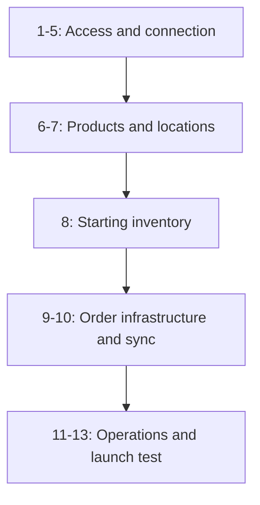

# Set up HotWax Commerce with Shopify

Use this canonical guide to connect one Shopify shop to a new HotWax Commerce instance and validate products, facilities, starting inventory, order import, routing, fulfillment, and named operational access. It covers the user-facing steps and evidence gates for the standard Shopify-only launch profile. HotWax Commerce completes backend setup using the [Everything launch runbook](https://github.com/hotwax/oms-documentation/blob/everything-bagel-pub/everything/operations/oms-administration/shopify-launch-runbook.md); application tasks remain in this guide.

## What this guide delivers

At completion, one Shopify shop is connected to one active product store. Shopify is the approved initial source for products, locations, and quantity on hand; HotWax Commerce publishes ongoing available-to-promise inventory after cutover. The launch team has imported and reconciled products and open orders, mapped facilities, tested routing and fulfillment, and saved evidence for every gate.

Use the chapter evidence and the progress table as the launch record. A queued job, a pending request, or the absence of a visible error is never proof that a step is complete.

## Confirm this guide fits your launch

Continue only when all of the following are true:

- You have one launched HotWax Commerce instance with no initial login claimed.
- You are connecting one Shopify shop, not multiple shops.
- Shopify is the initial source for products, locations, and quantity on hand.
- You use standard shippable products and standard fulfillment with one or more mapped facilities.
- The Shopify app has verified level-2 protected-customer-data access.
- The agreed history window does not require orders created more than sixty days ago.

Stop and contact HotWax Commerce for an advanced launch plan if you need an ERP integration, multiple Shopify shops, a migration, pickup, preorders, backorders with advanced inventory rules, returns integrations, Loop, kits, gift cards, SFTP or file-based integrations, custom product or order flows, or `read_all_orders` access for older orders. Do not mix those variants into this launch.

## Before you begin

The launch owner collects and approves these inputs before anyone configures the instance:

- Instance host name; named initial administrator; administrator email; and approved password-vault location.
- Shopify shop domain and named Shopify administrator.
- Confirmation of level-2 protected-customer-data access for the Shopify app.
- Product-store name, stable identifier, currency, locale, time zone, primary operating country, all approved operating countries, shipment weight unit, order prefix, and order approval and billing defaults.
- Product identity policy, including governed SKU and barcode rules.
- Each Shopify location and its intended physical HotWax facility.
- Agreed order-history start date, launch cutoff timestamp, merchant time zone, and deployed instance or JVM time zone.
- Written confirmation that Shopify quantity on hand is the approved initial inventory source.
- Launch owner, HotWax integration operator, Keychain approver, platform administrator, Company application administrator, and operations validator.

Store access tokens, passwords, and private keys in the approved password vault. Redact credentials, customer data, and private endpoints from tickets and screenshots.

## Track launch progress

The launch owner keeps this table current. An individual may hold more than one owner role, but every evidence reference must identify the person accountable for the chapter.

| Chapter | Owner | Status | Completion date | Evidence link or identifier |
| --- | --- | --- | --- | --- |
| 1. Initial OMS administrator | OMS platform administrator | Not started | — | — |
| 2. Instance readiness | HotWax integration operator | Not started | — | — |
| 3. Company and product store | OMS platform administrator and Company application administrator | Not started | — | — |
| 4. Shopify connection | Shopify administrator | Not started | — | — |
| 5. Shopify mappings | Company application administrator | Not started | — | — |
| 6. Product import | Company application administrator | Not started | — | — |
| 7. Facilities and locations | Company application administrator | Not started | — | — |
| 8. Starting inventory | HotWax integration operator | Not started | — | — |
| 9. Order infrastructure | HotWax integration operator | Not started | — | — |
| 10. History and recurring sync | HotWax integration operator | Not started | — | — |
| 11. Routing and fulfillment | Company application administrator | Not started | — | — |
| 12. Operational users | Company application administrator | Not started | — | — |
| 13. End-to-end launch test | Launch owner | Not started | — | — |

## Launch sequence at a glance

Follow the numbered chapters in order and save each chapter's evidence before moving on. Product identity and location mappings must be ready before the starting-inventory seed; finish inventory bulk work before the order-history flow. The final launch test ties the configured pieces together with a controlled order.

Use the progress table above to record owners, completion dates, and evidence. If a chapter's stop gate is unresolved, recover that stage before proceeding.

## 1. Confirm initial OMS administrator readiness

**Owner:** HotWax platform administrator

Ask the HotWax Commerce technical team to complete [initial administrator setup in Everything](https://github.com/hotwax/oms-documentation/blob/everything-bagel-pub/everything/operations/oms-administration/shopify-launch-runbook.md#1-create-the-initial-maarg-administrator). Confirm that two named, separately tested platform administrators can sign in, no demonstration administrator remains active, and the instance is restricted to approved administrators.

The platform administrator is a recovery and administration account, not a routine operations account. Its creation does not prove Company App or operational application access. Do not require an authentication factor until every required client has passed the compatibility test.

Save the named owners, successful login tests, recovery access confirmation, and application-access handoff. Do not continue if an initial administrator cannot be established through the supported setup procedure.

## 2. Pass the instance readiness gate

**Owner:** HotWax integration operator

**Application:** Company App, with backend prerequisites confirmed by the HotWax integration operator

### Before you begin

Have confirmation that the deployed HotWax applications are supported for this launch, the claimed administrator, the approved application-access package, and confirmation of Shopify's level-2 protected-customer-data approval.

### Steps

1. Confirm with HotWax Commerce that the deployed OMS, Company App, Shopify embedded app, HotWax Keychain, Shopify OMS bridge, Mantle Shopify connector, and Poorti versions are supported for this launch.
2. Verify required seed and base data, healthy search services, present Shopify integration components, and that no demonstration or temporary administrator remains active.
3. Apply the supported HotWax application-access package and verify that the named launch administrator can open every application used by the remaining chapters.
4. Confirm level-2 protected-customer-data approval for the Shopify app and that the agreed history does not require orders created more than sixty days ago.
5. If an authentication factor is required by launch policy, test every required Company App and operational client before enabling it for the launch account. The current basic OMS API login has no factor-code input even though OMS web login supports authentication factors.

### Expected result

The deployed applications and required access are ready, and the launch profile passes the access and order-history gates.

### Evidence to save

Save the supported-release confirmation, health-check results, application access test results, package reference, protected-data approval confirmation, and the history-window decision.

### Stop and resolve if

Creating an initial `ADMIN` account does not guarantee complete Company App access. Until the supported application-access package is included in the tested release, this is a HotWax-owned stop gate. Do not continue with legacy group or permission workarounds. Stop for an advanced launch plan if older order access is needed. Stop if a required client has not passed the authentication-factor compatibility test; do not mandate MFA for that account until it has.

### Next chapter

Continue when the launch administrator can use the required applications and all stated readiness evidence is positive.

## 3. Create the company and Product Store

**Owner:** OMS platform administrator and Company application administrator

**Application:** Company App, with backend prerequisites confirmed by the HotWax integration operator

### Before you begin

Have the approved product-store name, stable identifier, currency, locale, time zone, primary operating country, all approved operating countries, shipment weight unit, order prefix, and order approval and billing defaults.

### Steps

1. Have the platform administrator confirm the approved instance currency, primary operating country, and shipment weight unit through the Everything runbook. Record the verified defaults before creating the Product Store.
2. In Company App, open `/product-store` and select **Create product store** to open `/create-product-store`.
3. Enter **Company name** when this is the first Product Store, then enter **Name**, **ID**, and **Currency**. When **Operating countries** appears, select **Add**, choose every approved country, save the selection, and verify the selected country chips before continuing. Select **Manage configurations**. The page must display `Product store created successfully.` before it opens `/product-store-onboarding/<product-store-id>`. Have the platform administrator verify that each approved operating country was saved correctly before continuing.
4. In the **Configurations** screen, select **Configure manually** and set **Product Identifier**, **Auto approve orders**, and **Sales order ID prefix**. Select **Setup product store**.
5. Open `/product-store-details/<product-store-id>` and set the approved locale, time zone, order approval and billing defaults. Re-open the details page and verify every saved value before using the Product Store in a connection.

### Expected result

The approved global defaults and operating countries are saved, and an active Product Store can be selected by the Shopify connection and later associated with facilities and users.

### Evidence to save

Save the three verified System Property keys and values, selected operating-country Geo IDs, company and Product Store identifiers, configured defaults, selected time zone, and an active-state screen.

### Stop and resolve if

Stop if the identifier, currency, primary or approved operating countries, shipment weight unit, locale, time zone, or order defaults are undecided. Also stop if a global default disagrees with the one-store launch profile or an approved operating country is absent after creation. Do not change the Product Store identifier after integrations or transactions exist; treat it as a governed launch decision.

### Next chapter

Continue with the Shopify connection gates using this active Product Store.

## 4. Install, approve, and connect Shopify

**Owner:** Shopify administrator, HotWax Keychain approver, and Company application administrator

**Application:** Shopify Admin, HotWax Keychain, and Company App

### Before you begin

Have the approved Shopify app URL, shop domain, named Shopify administrator, valid Product Store, protected-data approval, approved OMS token issuance profile, and vault location. Confirm the simple launch does not need `read_all_orders`.

### Steps

1. Obtain a valid OMS authorization token from the approved platform administrator through the Everything token-issuance procedure. Record its subject, owner, purpose, expiry, and vault reference. This is not a Shopify access token.
2. Confirm the token handoff and permitted scope. Generation alone does not validate the Shopify connection.
3. In Shopify Admin, install the official HotWax Commerce app from the approved application URL. Complete Shopify OAuth, approve only the scope set authorized for the deployed app release and shop, and confirm level-2 protected-customer-data access. Do not copy scope handles from an older setup guide.
4. Enter the OMS host and the OMS **Access Token**. Never paste that token into a ticket or screenshot. Submission creates a pending connection request; pending is not connected.
5. In HotWax Keychain, open **Find Instance Requests**. The HotWax Keychain approver confirms the customer, instance, and shop, then accepts the correct pending request. For a failed, rejected, duplicate, or superseded request, stop it, record the request identifier and disposition, correct the cause, and submit only the intended replacement.
6. Reopen the connection in Company App. Confirm that the shop is connected, link it to the Product Store, and confirm the shop identifier and Product Store relationship.
7. In **Company App → Shopify connection → Configuration → Access scopes**, select **Refresh scopes**, record the returned Shopify OAuth handles, and complete both scope gates:
   * **Required API capabilities for the simple profile:** confirm the active requested set covers and the refreshed grant provides every capability below.
     * [ ] Product import: `read_products`
     * [ ] Shopify-location import: `read_locations`
     * [ ] Inventory read: `read_inventory`
     * [ ] Inventory publication: `write_inventory`
     * [ ] Order import: `read_orders`
     * [ ] Customer details on imported orders: `read_customers`
     * [ ] Merchant-managed fulfillment-order read: `read_merchant_managed_fulfillment_orders`
     * [ ] Merchant-managed fulfillment and tracking publication: `write_merchant_managed_fulfillment_orders`
   * Shopify write scopes include the corresponding read capability. Record whether `read_inventory` and `read_merchant_managed_fulfillment_orders` are explicit handles or are covered by their paired write handles; do not add duplicate read handles only to make the displayed list match.
   * **Verify the granted scopes:** compare the refreshed handles with the required capabilities above and record how each capability is granted. Resolve every missing or unexpected scope with HotWax Commerce before continuing. The later setup chapters and final validation confirm that the approved capabilities work.
   * **Not required by this simple profile:** `read_all_orders`; `write_orders` and `write_products` for pickup or preorder extensions; `read_fulfillments` and `write_fulfillments`; `read_assigned_fulfillment_orders` and `write_assigned_fulfillment_orders`; `read_third_party_fulfillment_orders` and `write_third_party_fulfillment_orders`; `read_channels`; `read_files` and `write_files`; `read_draft_orders` and `write_draft_orders`; `read_gift_cards` and `write_gift_cards`; and `read_returns` and `write_returns`. If the deployed manifest requests one of these or another additional handle, stop and have the HotWax release owner classify and approve it for the launch profile. Do not silently grant it or remove it from Keychain.
   * **Order-import compatibility:** have HotWax Commerce confirm that the deployed order import supports this standard scope profile without `read_returns`. Do not add `read_returns` unless returns are included in an approved advanced launch profile.
8. Have the integration operator verify the selected Shopify remote has `SHOP_RW_ACCESS` using the Everything runbook.
9. If the selected remote capability is blank or incorrect, have the integration operator correct and verify it before continuing. OAuth scope refresh alone does not correct this capability.
10. In **Company App → Shopify → open the connection → Products and Inventory → Product Sync**, verify the **Shopify API access** row displays **Write access**.
11. Document the rotation policy. HotWax Keychain retains the OMS token for credential resynchronization, so do not revoke or allow it to expire until it is replaced through the supported Keychain flow and a resync is proven.

### Expected result

The approved Shopify shop is connected to exactly one Product Store, every simple-profile API capability is available, the live OAuth handles match the approved scope profile, the selected remote has `SHOP_RW_ACCESS`, and Company Product Sync reports **Write access**.

### Evidence to save

Save the token subject, purpose, expiry, and vault record; connection request identifier and acceptance; shop and Product Store identifiers; returned OAuth handles and scope approval; order-import compatibility confirmation; selected remote identifier and access scope; and the positive Product Sync access state.

### Stop and resolve if

Stop if the launch requires a separate integration subject: the current token-issuance procedure cannot issue a token for it, and entering another username returns `You are not allowed to generate tokens for other users.` A signed-in named administrator may issue only that administrator's self-token when policy permits. Also stop if the request remains pending or is rejected; protected-data approval or a required API capability is missing; the refreshed handles do not match the approved scope profile; order-import compatibility is unconfirmed; an unexpected advanced handle is unresolved; the remote cannot be corrected; or Product Sync shows **Update required**, **Read only**, or **Unavailable**. Do not proceed to an order chapter when the deployed import requires `read_returns` for this standard profile. The Company token-generation action is not a supported issuance path in this release; obtain the token through the approved operator handoff. A Keychain payload can omit `accessScope`, so refreshing OAuth scopes alone does not correct the remote capability.

### Next chapter

Continue only after all four gates—OMS token, Shopify installation, Keychain approval, and Company verification—are positive and order-import compatibility is confirmed.

## 5. Review Shopify mappings

**Owner:** Company application administrator

**Application:** Company App

### Before you begin

Have the connected shop, active Product Store, actual Shopify values, and approved business meanings for product types, sales channels, payment methods and gateways, and shipping methods.

### Steps

1. Open Company App `/shopify-connection-details/<shop-id>`. For **Product types**, open `/shopify-connection-details/<shop-id>/product-types`, select each HotWax product type, enter its Shopify value in **Shopify ID**, and select the save icon. Confirm `Mapping updated successfully` and that the Shopify value displays as a chip beside the selected product type.
2. For **Sales channels**, open `/shopify-connection-details/<shop-id>/sales-channels`, select each HotWax sales channel, enter the Shopify order source in **Shopify ID**, and select the save icon. Confirm `Mapping updated successfully` and that the Shopify value displays as a chip beside the intended sales channel.
3. For **Payment methods**, open `/shopify-connection-details/<shop-id>/payment-methods`, select **Add** when the HotWax payment method does not exist, enter **Payment method name** and its Shopify value in **Shopify ID**, and save; confirm `Payment method created successfully`. Otherwise select the existing method, enter **Shopify ID**, and select the save icon; confirm `Mapping updated successfully` and the mapped value chip.
4. For **Shipment methods**, open `/shopify-connection-details/<shop-id>/shipment-methods`, select the carrier, select **Create shipment method** when needed, enter **Carrier**, **Shipment method name**, and **Shopify name**, and save. Otherwise edit the existing method's **Shopify Name** and select **Save all**. Confirm the Shopify value displays as a chip beside the intended shipment method and the page reports a successful saved mapping.
5. If starter mappings are present, compare every displayed Shopify value with the actual Shopify value. Confirm every value used by the launch has one intentional HotWax destination.

### Expected result

Each Shopify value used by the launch resolves to one reviewed HotWax destination with a clear business meaning.

### Evidence to save

Save the mapping export or screen references, source values, chosen destinations, reviewer, and timestamp.

### Stop and resolve if

Stop for unmapped values or many-to-one mappings whose business meaning is unclear. Do not import products or orders while a required mapping is unresolved.

### Next chapter

Continue with the initial product sync after the mapping review is complete.

## 6. Import and validate products

**Owner:** Company application administrator

**Application:** Company App

### Before you begin

Confirm governed SKU and barcode rules, products included from the connected shop, approved product-type mappings, and source Shopify product and variant counts.

### Steps

1. Open Company App `/shopify-connection-details/<shop-id>/product-sync`. If the connection card shows **Setup new product sync**, open it; **Update Shopify access scope**, **Shopify write access required**, **Upgrade required for new product sync**, **Upgrade to new product sync**, or **Disable old product sync** is a stop condition.
2. Select **Review configurations**. On **Confirm product store**, select the Product Store, review any linked Shopify shops, select **I have verified that these Shopify stores are part of the selected Product Store**, and select **Next**.
3. On **Confirm internal name mapping**, select the governed identifier—**SKU**, **UPCA / Barcode**, or **Shopify internal id**—and select **Next**. The choice must match the approved SKU and barcode policy.
4. On the import review, compare Shopify and HotWax product and variant counts, linked-shop count, and **Shopify API access**. Select **Am I making a mistake?** for the sample check. Resolve **Conflict** results and investigate unexpected **Not found in HotWax** results; if the page shows **Review possible catalog mismatch**, select **I reviewed the warning and want to continue** and **Continue to import** only for an approved exception.
5. Select **Run product import**. In **Background sync**, select **Setup Job** if the shop-specific job is missing, select **I understand and want to start the first product sync**, then select **Start product sync**.
6. Follow `Product export request payload`, `Pending bulk operations`, and `Bulk file process` until the run is terminal. Confirm `Product sync request completed.` Select **Finish setup** when offered and confirm `Recurring product sync scheduled every 15 minutes.`; it saves cron `0 */15 * ? * *` with paused `N` and opens the dashboard. If already active, select **Open sync page**.
7. Compare Shopify product and variant counts with imported counts; record failed and skipped counts. Inspect representative simple products and variants for SKU, barcode, Shopify product and variant identifiers, and Product Store association. Reconcile duplicate or missing identity exceptions with the launch owner.

### Expected result

The Product Sync terminal result and reconciliation show that intended Shopify products and variants have correct identity and Product Store association.

### Evidence to save

Save source and imported counts, terminal job state, failed and skipped counts, sample identifiers, identity exceptions, and their approved disposition.

### Stop and resolve if

Stop if Product Sync does not reach a terminal success state, counts do not reconcile, or any duplicate or missing identity exception is unapproved. Do not load inventory until exceptions are resolved or explicitly accepted by the launch owner.

### Next chapter

Continue to facilities and location mapping when product identity is reconciled.

## 7. Create facilities and map Shopify locations

**Owner:** Company application administrator

**Application:** Company App

### Before you begin

Have the approved facility list, Shopify location identifiers and names, physical-location intent, Product Store association, and each location's inventory, routing, and fulfillment role.

### Steps

1. To create a facility first, open Company App `/create-facility`, select **Type**, enter **Name** and **Internal ID**, optionally enter **External ID**, and select **Create facility**. Confirm `Facility created successfully.` Then open `/create-facility/address/<facility-id>` to save its address and `/create-facility/config/<facility-id>`.
2. In **Add Store Configuration**, select **Add** under **Product Stores**, select the Product Store, set it as **Primary** when appropriate, select **Sell Inventory Online** and **Uses native fulfillment app** only when approved for that facility, then select **Save configurations**. Confirm the facility detail page shows the Product Store association and selected fulfillment settings.
3. To import a Shopify location, open `/shopify-connection-details/<shop-id>/locations`, select **Import facility**, select only the intended Shopify locations, select **Retail Store** or **Warehouse**, and select the download action. Confirm the `{count} locations imported` result. Re-open each created facility and explicitly add and verify its Product Store association before mapping; importing from this screen alone does not prove that association.
4. In `/shopify-connection-details/<shop-id>/locations`, select the facility row, enter the Shopify location identifier in **Shopify ID**, and save. Confirm `Mapping updated successfully`, then select **Run Facility Audit** and verify the summary shows the required locations as **mapped** with zero unintended **not imported** or **stale** locations.
5. Review the Shopify location identifier and name, HotWax facility identifier and name, Product Store association, and whether the facility participates in inventory, routing, and fulfillment.

### Expected result

Every active Shopify location used by the launch has one intentional physical-facility mapping and Product Store association.

### Evidence to save

Save a location-to-facility mapping table with Shopify identifiers and names, HotWax identifiers and names, Product Store, and operational roles.

### Stop and resolve if

Stop if an active Shopify location has no intentional facility mapping or maps to an unsuitable physical facility. Do not use `_NA_` as a universal facility or location mapping.

### Next chapter

Continue to starting inventory only after products, facilities, and all required location mappings are reconciled.

## 8. Seed starting inventory from Shopify

**Owner:** HotWax integration operator and Company application administrator

**Application:** Company App, with backend prerequisites confirmed by the HotWax integration operator

### Before you begin

Confirm complete product identity, facility and location mappings, a valid Shopify remote internal identifier, approved inventory cutover, and that Shopify quantity on hand is the approved initial source. Pause the shared Shopify bulk-operation poller schedules and confirm global isolation before starting.

| Flow | Purpose in this guide | Source of truth |
| --- | --- | --- |
| Shopify to HotWax Commerce | One-time starting quantity-on-hand seed | Shopify |
| HotWax Commerce to Shopify | Ongoing available-to-promise publication after cutover | HotWax Commerce |

### Steps

1. Have the HotWax integration operator complete [the inbound starting-inventory procedure in Everything](https://github.com/hotwax/oms-documentation/blob/everything-bagel-pub/everything/operations/oms-administration/shopify-launch-runbook.md#8-seed-starting-inventory-from-shopify).
2. Confirm no unrelated inventory or history bulk operation overlaps the seed and that outbound publication remains contained.
3. Obtain the selected shop, job-run identifier, exact bulk-query message identifier, terminal import counts, and error review from the operator.
4. Compare representative Shopify quantity-on-hand values with the corresponding OMS inventory records.
5. Continue only after the source-to-import reconciliation is positive and the operator confirms the approved schedule states.

### Expected result

The recorded message completes its inbound Shopify inventory path, its `RESET_SHOPIFY_INVENTORY` Data Manager load is terminal and positive, and sample quantity-on-hand values reconcile in the Shopify-to-HotWax direction.

### Evidence to save

Save job-run final status; exact `BulkQueryShopifyInventoryReset` `systemMessageId`; Shopify bulk-operation identifier and transitions; `RESET_SHOPIFY_INVENTORY` counts and errors; sample quantity comparison; external reset records; and schedule-state evidence. Have the operator provide the corresponding job, message, and import evidence.

### Stop and resolve if

Stop if an unrelated produced or sent bulk message exists, the recorded message is queued without download and processing evidence, the Data Manager load fails, quantities do not reconcile, or outbound inventory publishes unapproved seed values. [Monitor Shopify inventory sync](manage-shopify-inventory-sync.md) in Company covers outbound HotWax-to-Shopify inventory publication; it does not import starting QOH from Shopify. Have the technical team perform the inbound seed using the Everything runbook until a tested Company import flow is released.

### Next chapter

Continue to order infrastructure only after inventory seeding is reconciled and approved normal schedules are restored.

## 9. Confirm OMS order infrastructure

**Owner:** HotWax integration operator

Have the operator complete [order infrastructure setup in Everything](https://github.com/hotwax/oms-documentation/blob/everything-bagel-pub/everything/operations/oms-administration/shopify-launch-runbook.md#9-configure-maarg-admin-order-infrastructure) before proceeding to order-history import. The backend configuration health banner alone is not runtime proof.

### Evidence to review

- Required import configurations, Shopify remote, queue, consumer, order properties, fallback job, and history job match the selected shop and approved environment
- Both `ORDERS_CREATE` and `ORDERS_UPDATED` webhooks exist and their EventBridge patterns match the intended topics
- Queue delivery, consumer reads, failed-test dead-letter delivery, redrive behavior, and approved policies are proven
- Existing fallback `runAsBatch`, `fromDate`, and `additionalParameters` values and history `windowDays` are recorded and verified after any configuration change; partial save actions must not silently clear them

Stop if any required prerequisite, access capability, topic, policy, parameter, or delivery result is missing. A test event does not by itself prove an OMS order import. Runtime import is proven with the controlled Shopify order in Chapter 13; realtime SQS import does not create a System Message.

Save the operator's identifiers, parameter values, test results, and evidence links before continuing.

## 10. Import open-order history and enable recurring Order Sync

**Owner:** HotWax integration operator and Company application administrator

**Application:** Company App, with backend prerequisites confirmed by the HotWax integration operator

### Before you begin

Have the agreed merchant-zoned history start and launch cutoff, deployed instance or JVM time zone, valid Shopify remote identifier, approved window size, level-2 protected-data approval, completed realtime infrastructure, and the Chapter 4 order-import compatibility confirmation. Inventory bulk work must be complete because inventory and history use overlapping bulk-operation responsibilities. `updatedAt` selects open, unfulfilled orders for a query window. For an order not already in HotWax Commerce, `createdAt < newOrderSync.launchDate` determines historical creation. Existing orders are not recreated; pre-cutoff orders are historical work, use `needsInventoryIssuance=N`, and park unfulfilled ship groups in `GENERAL_OPS_PARKING`.

### Steps

1. Have the integration operator complete [open-order history import in Everything](https://github.com/hotwax/oms-documentation/blob/everything-bagel-pub/everything/operations/oms-administration/shopify-launch-runbook.md#10-import-open-order-history-and-enable-recurring-order-sync). Agree on the merchant-zoned history start and launch cutoff, their converted runtime timestamps, and every window's exact bounds.
2. Review each window's job-run, bulk message, terminal import counts, and source-to-load reconciliation. Confirm there is no gap, overlap, or duplicate creation before the operator advances to the next window.
3. If a window fails, have the operator restore its cursor before retrying. Do not use an untested Company history action or enable recurring sync while history is unresolved.
4. After history reconciliation, open `/shopify-connection-details/<shop-id>/order-sync/configure`. Verify **Shopify shop**, **Product Store**, **Shopify remote**, and **Order mapping readiness**. Select **Create paused Order Sync job** and confirm **Batch job** and **Activation** both show **Paused**.
5. In **Schedule**, enter a valid containment **Quartz cron expression** whose displayed **Schedule preview** and next run are after the controlled validation window. Verify the displayed **OMS runtime timezone** and select **Save schedule**. Resolve every **Missing** mapping in the linked mapping screen or obtain an approved exception before activation.
6. Select **Review and activate**, verify the selected shop, remote, containment schedule, and mapping review in **Activate Order Sync**, then select **Activate Order Sync**. Confirm **Activation** shows **Active** and open `/shopify-connection-details/<shop-id>/order-sync` immediately; **Run now** is unavailable while the job is paused.
7. In the **Order sync jobs** card, open **Queue order requests**. With a controlled eligible Shopify order in the selected batch window, select **Run now** and confirm `The standard next batch was queued as <id>.` Save the resulting **Queued SystemMessage**, job run, the tied import, and its Data Manager result. Do not allow the containment schedule to fire while that run is unresolved.
8. If the controlled batch is positive, open **Queue order requests**, replace the containment expression with the approved normal recurrence in **Quartz cron expression**, verify its **Schedule preview**, and select **Save**. If the batch fails, immediately turn **Active** off in that same job detail and select **Save** before the containment schedule fires; preserve the failure evidence and do not enable normal recurrence.

### Expected result

Each history window has a positive terminal bulk and Data Manager result, the open-order reconciliation is complete, and the contained active Order Sync has a positive controlled batch before normal recurrence is saved.

### Evidence to save

Save converted property timestamps and the exact converted start and end timestamp for **every** queued history window, along with its history job-run identifier, `BulkOrderHistoryQuery` and result messages, exact `systemMessageId`, `BULK_ORDER_HISTORY` counts and errors, source-to-load reconciliation, duplicate proof, containment and normal recurrence expressions, first controlled-batch message, job-run, import, and Data Manager result, and activation record.

### Stop and resolve if

The history cursor advances when a window is queued; if it fails, reset the cursor to the failed window before retrying. Stop if the Chapter 4 order-query compatibility evidence is missing or if protected-data approval, the shared bulk isolation gate, the recorded window bounds, the Data Manager result, or reconciliation fails. Pause the contained job before its first scheduled fire if the controlled batch fails. Orders created more than sixty days ago need separately approved `read_all_orders` and are outside this guide. Do not use the current Company history action until its compatibility is released and tested.

### Next chapter

Continue to routing and fulfillment when history is reconciled and recurring Order Sync is safely active.

## 11. Configure standard routing and fulfillment

**Owner:** Company application administrator and operations validator

**Application:** Order Routing app and Company App

### Before you begin

Have mapped fulfillment facilities, approved routing and brokering policy, split-order behavior, shipping mappings, and fulfillment notification and tracking policy.

### Steps

1. In the Order Routing app, open `/order-routing`. Select **Create routing group**, enter the approved group data, select **Save**, and confirm `Changes saved successfully`. Open `/order-routing/<routing-group-id>` and set **Status** to **Active** rather than **Draft**.
2. In the routing-group detail, add the approved eligible facilities and routing rules. Set each routing rule to **Active**, select **Save**, and confirm `Saved` and `Changes saved successfully` before using the rule.
3. Set the approved split-order behavior in the active routing group. Use **Add schedule** or **Edit schedule** only for the approved routing cadence, then select **Save** and confirm the group's and each rule's **Active** state.
4. Open `/order-routing/<routing-group-id>/test` and run the controlled routing test with the standard shippable product, shipping method, and mapped facility. Confirm the result selects an eligible facility. Use **Run now** only for the approved schedule and inspect **History** for the resulting run.
5. In Company App, recheck `/shopify-connection-details/<shop-id>/shipment-methods` for the mapped Shopify shipping method. Open `/product-store-details/<product-store-id>` and verify **Fulfillment notifications** and **Enable tracking** are enabled for the approved standard flow.

### Expected result

A standard shippable Shopify order can route to an eligible facility, be fulfilled there, and return fulfillment and tracking information to Shopify.

### Evidence to save

Save the routing-group and rule identifiers, their **Active** states, controlled-test result, schedule and history references, selected-facility configuration, split-order decision, shipping mapping evidence, and notification and tracking settings.

### Stop and resolve if

Stop if the routing group or any required rule remains **Draft**, no eligible facility is selected by the routing test, shipping values are unmapped, or fulfillment and tracking publication is not configured. Do not add pickup, preorder, advanced promise, or returns setup to this standard launch.

### Next chapter

Continue to operational access once standard routing and fulfillment settings are proven.

## 12. Create operational users

**Owner:** Company application administrator

**Application:** Company App

### Before you begin

Have the named operational users, approved roles or groups, Product Store assignments, facility assignments, access owner, and access-review date. Stores and facilities must already exist.

### Steps

1. In Company App, open `/users` and select the create action to open `/create-user`. Leave **Facility login** off; it is a distinct party-group flow. Enter required **First name** and **Last name** and the approved optional **Employee ID**, **Email**, and **Phone number**, then select **Create User**. Confirm `User created successfully`, open `/user-confirmation/<party-id>`, and select **Quick Setup**.
2. Select the template that exactly matches the user's operational job, then follow only that template's visible fields and assignments:

   - **Admin:** enter **Username**, **Password**, and **Email**; choose **Require password reset on login** when policy requires it; select the approved **Product stores**; do not assign facilities; then select **Finish setup** and confirm **Setup complete**. Verify security group `ADMIN` and Product Store role `APPLICATION_USER`.
   - **Merchandising manager:** enter **Username**, **Password**, and **Email**; apply the approved password-reset policy; select the approved **Product stores**; do not assign facilities; then select **Finish setup** and confirm **Setup complete**. Verify security group `MERCHANDISE_MGR` and Product Store role `APPLICATION_USER`.
   - **CSR:** enter **Username**, **Password**, and **Email**; apply the approved password-reset policy; do not assign Product Stores or facilities; then select **Finish setup** and confirm **Setup complete**. Verify security group `CSR`.
   - **Fulfillment manager:** enter **Username**, **Password**, **Email**, and **Employee ID**; apply the approved password-reset policy; select every approved facility under **Select Facilities**; do not assign Product Stores; then select **Finish setup** and confirm **Setup complete**. Verify security group `STORE_MANAGER`, party role `WAREHOUSE_PICKER`, and each facility assignment with role `WAREHOUSE_PICKER`.
   - **Fulfillment:** enter **Employee ID** only, then select **Finish setup**. This template does not create a login, security group, Product Store assignment, or facility assignment; it ensures party role `WAREHOUSE_PICKER`, then redirects directly to `/user-details/<party-id>` without a **Setup complete** alert. It does not provide application access.

3. If a user needs an application login with an approved security group but no login-bearing template above supplies the required access, select **Setup Manually** at `/user-confirmation/<party-id>` and confirm the prompt; it opens `/user-details/<party-id>`. In **Login details**, enter **Username** and **Password**, then select **Add credentials**. In **Clearance → Security Group**, select **Add to security group** (or **Add**), choose the approved group or groups, and use the save-icon action; confirm `Security group(s) updated successfully.` In **Product stores**, select **Add to a product store** (or **Add**), choose the approved stores, and use the save-icon action; confirm `Role(s) updated successfully.` For required facilities, open the **Added to facilities** assignment row in **Fulfillment**, choose the approved facilities, and use the save-icon action; confirm `Facility associations updated successfully.` Re-open `/user-details/<party-id>` and verify the exact saved Username, **Block login** state, security groups, Product Stores, facilities, and application access. Do not infer that a template provides an unshown assignment.
4. For Admin, Merchandising manager, CSR, and Fulfillment manager, **Setup complete** confirms creation only; then open `/user-details/<party-id>` and verify **Username**, **Block login** is off, and the exact template-specific security group, Product Store, and facility results above. For **Fulfillment**, use the direct `/user-details/<party-id>` redirect to verify the `WAREHOUSE_PICKER` party role and the expected absence of login and security-group assignments. Confirm the relevant saved result when an assignment changes.
5. Sign in only with a login-bearing template and complete the job-specific application and action test. Record the access owner and review date for each user; do not retain plaintext credentials as evidence.

### Expected result

Each named operational user has the exact template-specific account, security group, Product Store, facility, and/or `WAREHOUSE_PICKER` role result. Every job that needs application access has a named login and a recorded successful job-specific test.

### Evidence to save

Save user identifiers; the exact security group where the template creates one, or explicit no-login/no-security-group evidence for **Fulfillment**; Product Store and facility assignments and count where applicable; `WAREHOUSE_PICKER` role evidence where applicable; access-test result; access owner; and review date. Do not save plaintext credentials.

### Stop and resolve if

Stop if the saved account, security group, Product Store, facility, or `WAREHOUSE_PICKER` role does not match the selected template and approved access, or if a required application login cannot be supplied through a tested login-bearing template or the supported manual route. The initial OMS administrator is a platform recovery and administration account, not a routine operations account. Do not recreate legacy raw permission records.

### Next chapter

Continue to launch validation once operational users have passed their job-specific access tests.

## 13. Validate the launch end to end

**Owner:** Launch owner and operations validator

**Application:** Shopify Admin and Company App, with operator evidence for backend processing

### Before you begin

Confirm that Chapters 1 through 12 are complete, a standard shippable test product is available, an eligible facility can fulfill it, and all evidence owners are available for sign-off.

### Steps

1. Place one controlled real Shopify order using a standard shippable product and record the Shopify order identifier.
2. Verify the expected payment and shipping values in Shopify.
3. Prove that the realtime path imports the order exactly once: Shopify event, SQS delivery, `consume_ShopifyOrders_SQS` consumer job run, Data Manager `logId` tied by `createdByJobRunId`, `SYNC_SHOPIFY_ORDER` configuration and terminal result, then the matching OMS order. Realtime SQS import does not create a System Message. Do not use the fallback batch to pass the realtime gate.
4. Verify product, channel, payment, shipping, and location mappings resolve; the order reaches the intended HotWax state; and routing assigns an eligible facility.
5. Have the facility process fulfillment and confirm fulfillment and tracking publish back to Shopify.
6. Verify inventory changes follow the approved post-cutover HotWax-to-Shopify direction.
7. Verify no duplicate order, fulfillment, or inventory message was produced.
8. Review and save the path-appropriate job-run, Data Manager, and application-screen evidence for every preceding result. Include System Message evidence for the earlier history and fallback checks, not for realtime SQS import.
9. Record sign-off, release versions, test order identifier, evidence links, known exceptions, and rollback ownership.

### Expected result

One controlled order proves import, mapping, routing, facility assignment, fulfillment, tracking return to Shopify, approved inventory direction, named operational access, and absence of duplicates.

### Evidence to save

Save the Shopify order identifier and states, HotWax order identifier and state, mapping and facility evidence, fulfillment and tracking confirmation, inventory evidence, the realtime consumer job run and tied Data Manager log, earlier history and fallback System Messages, release versions, sign-off, exceptions, and rollback owner.

### Stop and resolve if

Stop the launch for a pending or rejected Shopify request, missing OAuth scope, unmapped product or order value, product count mismatch, facility or Shopify-location mismatch, bulk operation that never downloads or processes, failed Data Manager load, history cursor advanced past a failed window, unavailable realtime queue or consumer, duplicate import, fulfillment or tracking not returned to Shopify, or inventory moving in the wrong direction. Recover the failed stage, save the failure evidence, and repeat the affected validation; do not sign off on a queued job, no visible error, or an order that merely exists somewhere.

### Next chapter

The launch is ready for operational handoff only after the launch owner records positive evidence and sign-off.

## Troubleshooting and recovery

Use this table to recover without bypassing the applicable stop gate.

| Symptom | Recovery action | Do not continue until |
| --- | --- | --- |
| Shopify request is pending, rejected, duplicated, or superseded | In HotWax Keychain, verify the intended request, record its disposition, correct the cause, and accept only the intended replacement. | The correct request is accepted and Company shows the expected connected shop. |
| OAuth scope or Product Sync access is missing | Refresh scopes, verify the selected remote is `SHOP_RW_ACCESS`, correct that selected remote if needed, and recheck Product Sync. | Product Sync shows **Write access**. |
| Product or order value is unmapped | Add or correct the reviewed mapping and retest the value. | Each used source value has an intentional destination. |
| Product counts or identity do not match | Compare source and terminal import counts, investigate failed or skipped records, and resolve identity exceptions. | Counts reconcile or the launch owner explicitly accepts a documented exception. |
| Facility and Shopify location disagree | Correct the physical facility mapping and Product Store association. | Every active operational location has an intentional mapping. |
| Bulk operation never downloads or processes | Keep the global `ShopifyBulkQuery` isolation gate, record the exact `systemMessageId`, run only the prescribed one-time job, and inspect downstream Data Manager evidence. | The recorded message and its Data Manager load are terminal and positive. |
| Data Manager load fails | Save its error and tied message, correct the source or configuration cause, then rerun the isolated affected flow. | Terminal counts and error review are positive. |
| History cursor moved past a failed window | Reset `orderSyncHistory.lastSyncDate` to the failed window before retrying and preserve the failure evidence. | That exact window is reconciled before later windows proceed. |
| Realtime queue or consumer is unavailable | Repair EventBridge, SQS, dead-letter, redrive, policies, consumer, and webhook prerequisites through the HotWax-owned handoff. | Test delivery, consumer read, and failed-test dead-letter path are proven. |
| Duplicate import, fulfillment, or inventory message | Pause the affected schedule, preserve identifiers and transitions, determine the duplicate source, and reconcile the data before resuming. | No duplicate is created in a controlled repeat test. |
| Fulfillment or tracking is absent in Shopify | Verify facility processing, shipping mapping, notification configuration, and tracking publication, then repeat the controlled fulfillment. | Shopify shows the expected fulfillment and tracking. |
| Inventory moves in the wrong direction | Pause unapproved publication, confirm the current launch phase, and reconcile sample values before resuming the approved direction. | Seeded inventory is Shopify to HotWax; post-cutover publication is HotWax to Shopify. |

## Learn more

Use application manuals only for optional operating detail after this guide's required outcome is complete. Keep the following boundaries clear:

- **HotWax technical team** owns backend administrator setup, tokens, service jobs, system messages, Data Manager, and integration setup through the Everything runbook.
- **Company App** is used for Product Store, connection verification, mappings, Product Sync, facilities, operational users, and recurring Order Sync.
- **Order Routing app** is used to create, activate, test, schedule, and review standard routing groups and rules.
- **Shopify Admin** owns app installation, OAuth approval, and the controlled order.
- **HotWax Keychain** owns acceptance of the pending instance request.

For advanced or excluded launch profiles, contact HotWax Commerce for an advanced launch plan rather than extending this procedure with untested steps.
