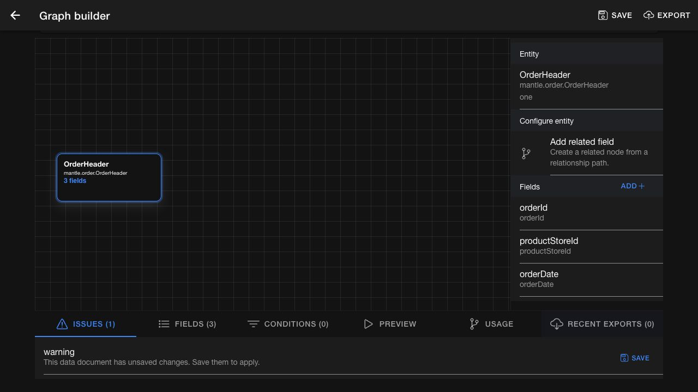
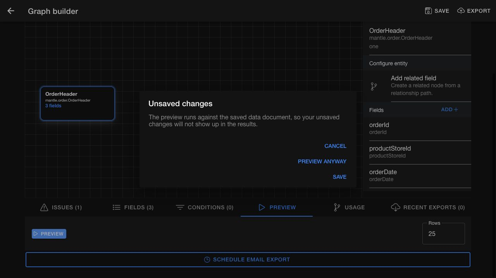

# Arrived: data-document builder

> **Arrived — source checked 23 October 2026.** This guide describes open [Job Manager PR #1112](https://github.com/hotwax/job-manager/pull/1112). Screenshots show its actual UI running locally with a synthetic order document. Saving and exporting against a customer system were not exercised. Deployment has not been verified. See also [Build a data document](data-documents/build-data-document.md).

## Edit the document metadata

Open the document's graph builder and confirm its primary entity and name. **Name** and **Title** remain available near the graph. Open **Advanced metadata** for the expanded form.

| Field | Use |
| --- | --- |
| **Primary Entity** | The starting entity for the document |
| **Name** | A recognizable name for people using the document |
| **Title** | The title of each generated document; use `${fieldName}` to insert a field value |
| **Data document ID** | The document's stable identifier; limited to 40 characters and read-only for an existing document |
| **Index Name** | The destination search index for indexed documents; use a lowercase name |
| **Manual Data Service** | An optional service that adds extra data to each document; it must implement `add#ManualDocumentData` |

Use the information button for field guidance. Save after reviewing the form; editing a field alone does not apply it to the saved document.

*PR #1112 screen. DemoOrderSummary is a synthetic existing document, so its ID is read-only.*

## Choose fields and retain exact aliases

Select an entity node, then use **Add** in its Fields section. The unified picker uses checkboxes to select fields. Review the resulting fields and their aliases before saving.

Aliases retain their intended capitalization. For example, use `productStoreId` consistently when defining a field and referring to it in a condition. Do not substitute a differently cased alias.

## Review issues before saving

The **Issues** tab distinguishes validation errors from an unsaved-changes warning.

- **Validation errors** must be corrected before the document can be saved.
- **Unsaved changes** means the current edits have not yet been applied. This warning includes a **Save** action; the warning itself does not block saving.

*PR #1112 screen. The warning is a reminder to save, not a failed validation result.*

When switching between documents, wait for the requested document to load. The revised page clears the previous document while loading and offers **Retry** if the requested document cannot be loaded. Confirm the document identity before editing.

## Define conditions with supported operators

Open **Conditions** and select the field alias, comparison, and value. The operator menu depends on the field's type.

| Field type | Available comparisons |
| --- | --- |
| All supported types | Equals, Not equals, Is null, Is not null, Greater than, Greater than or equal, Less than, Less than or equal |
| Text-like fields | The comparisons above, plus Like and In list |

Use `%` as the wildcard for **Like**. Enter **In list** values as a comma-separated list, for example `STORE_A,STORE_B`. For a range, add separate lower-bound and upper-bound conditions; the picker does not offer Between.

Review any condition-related validation issue before saving. Do not assume an older or differently named operator is accepted merely because it appears in a previously saved definition. Saved conditions are executed by the server when previewing the document, so confirm the result with representative data in the target environment.

## Preview the saved definition

1. Open **Preview**, select the number of rows, and select **Preview**.
2. If you have unsaved changes, read the confirmation dialog.
3. Choose the action that matches what you want to inspect.

| Choice | Result |
| --- | --- |
| **Cancel** | Return to editing without running a preview |
| **Preview anyway** | Preview the saved document; pending edits are excluded |
| **Save** | Save first, then preview if saving succeeds |

*PR #1112 screen. This distinction matters when testing a new field, alias, or condition.*

Check that the returned columns and records match the saved definition before exporting or scheduling it. Previewing does not itself schedule an export. See the existing [Preview, export, and schedule](data-documents/preview-export-schedule.md) guide for those separate actions.

## Separate field-order proposal

[PR #963](https://github.com/hotwax/job-manager/pull/963) independently proposes dragging field rows to reorder them, with sequence values displayed as read-only and renumbered in increments of 10. It is not included in the #1112 screenshots. Use that workflow only when the field-order PR is included in the deployed version.
