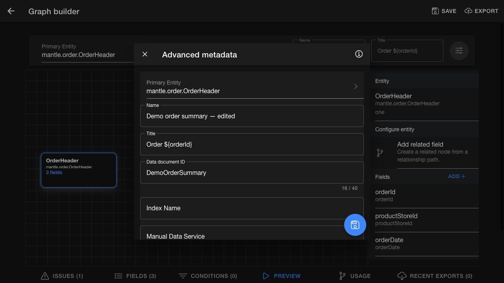

# Build a data document

Open `Data documents` > `Documents`, then select the create action. To edit a document, select it from the list.

## Create the document

1. Select `Primary Entity`.
2. Enter the document name and title.
3. Select `Add`.

Choose a primary entity that represents one row in the intended result. The entity determines which direct and related fields are available.

## Edit document metadata

`Name` and `Title` are available near the graph. Open `Advanced metadata` to review the full form.

| Field | Use |
| --- | --- |
| `Primary Entity` | The starting entity for the document |
| `Name` | A recognizable name for people using the document |
| `Title` | The title of each generated document; use `${fieldName}` to insert a field value |
| `Data document ID` | A stable identifier of up to 40 characters; read-only for an existing document |
| `Index Name` | The destination search index for indexed documents; use a lowercase name |
| `Manual Data Service` | An optional service that adds data to each document; it must implement `add#ManualDocumentData` |

Use the information button for field guidance. Save after reviewing the form to apply the changes.

*Review the document metadata. An existing document's ID is read-only.*

## Add fields

1. Select an entity node in the graph.
2. Select `Add` in its `Fields` section.
3. Use the checkboxes to choose direct or related fields.
4. Review the selected fields and their aliases.
5. Repeat for each required output value.

Use each alias with the same capitalization wherever you reference it. For example, a field defined as `productStoreId` must use that spelling in its conditions. Select only fields that the export consumer is authorized to receive.

## Add conditions

1. Open `Conditions` and select the add-condition action.
2. Choose the field alias and comparison operator.
3. Enter or select the comparison value.
4. Add the condition and review it with the other conditions.

The available operators depend on the field type:

| Field type | Available comparisons |
| --- | --- |
| All supported types | Equals, Not equals, Is null, Is not null, Greater than, Greater than or equal, Less than, Less than or equal |
| Text-like fields | The comparisons above, plus Like and In list |

Use `%` as the wildcard for `Like`. Enter `In list` values as a comma-separated list, such as `STORE_A,STORE_B`. To define a range, add separate lower-bound and upper-bound conditions.

## Review issues

Open `Issues` after changing metadata, entities, fields, or conditions.

- Correct validation errors before saving.
- Use `Save` beside the `Unsaved changes` warning to apply pending edits. This warning does not block saving.

*Unsaved changes is a reminder to save the draft, not a validation error.*

When switching documents, wait for the selected document to load and confirm its identity before editing. If loading fails, select `Retry`.

## Change the primary entity

Changing the primary entity can invalidate fields, relationships, and conditions.

1. Open the primary-entity control and select the replacement entity.
2. Review and confirm the change.
3. Rebuild invalid fields and conditions.
4. Review `Issues`.

## Save the document

Select `Save` after the definition is complete. If you leave with unsaved changes, choose whether to cancel navigation, discard the pending edits, or save them.

After saving, [preview the document](preview-export-schedule.md) to check its columns and records before exporting.
