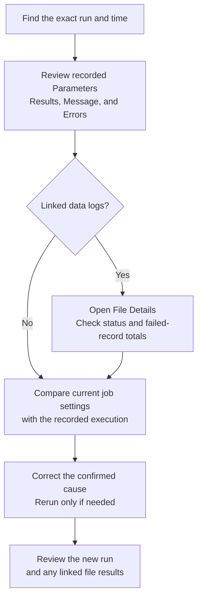

# Investigate job runs

Open `Jobs` > `Run history` to investigate service-job executions across the active instance.

## Review run totals

Use the summary cards to compare:

- Total runs
- Successful runs
- Failed runs
- Running jobs

The cards summarize the server search for the selected filters, including matching runs beyond the displayed page. Changing a filter refreshes the totals and returns the list to the first page.

## Find a run

Use `Search by run id, job, service, or user`, or combine these filters:

- `Status`: Running, Successful, Failed, or Terminated
- `Job`
- `User`: enter the exact username

Use `Previous` and `Next` to move through pages of results.

Each page loads matching runs from the server. The navigation controls prevent moving before the first page or beyond the last page. Clear a filter to broaden the search.

Use the job's [History tab](job-details.md#review-job-history) to inspect its linked data logs.

The active product store can exclude runs associated with another store. Confirm the selected store before treating a missing result as evidence that a job did not run.

## Read a run card

A run card shows the run identifier, job, service, status, start time, completion time, duration, and user.

Select the card to open its job. Expand a section without opening the job to review:

- `Message`
- `Errors`
- `Results`
- `Parameters`

To inspect linked imports, open the job's `History` tab, find the same run identifier, and select a data-log identifier to open the related [file detail](../mdm/file-details.md).

## Trace the execution evidence

Start with the exact run. Its recorded parameters describe that execution; the job's current settings may have changed since it ran. Sections appear only when the corresponding data is available.

Each linked file has its own processing status and record totals. Use [file-import recovery](../troubleshooting/file-imports.md#choose-the-next-check) when a file has failed records or needs correction.

## Investigate a failed run

1. Filter `Status` to `Failed`.
2. Find the affected job, time, or run identifier.
3. Expand `Errors` when available.
4. Review the available `Parameters` and `Results`.
5. Open the same run in the job's `History` tab, then inspect any linked data logs and their record totals.
6. Open the job and compare its current schedule and parameters with the failed run.

Record the original error before you rerun or edit the job.

If you rerun the job after correcting the cause, inspect the new run and any linked file results before considering the recovery complete.
