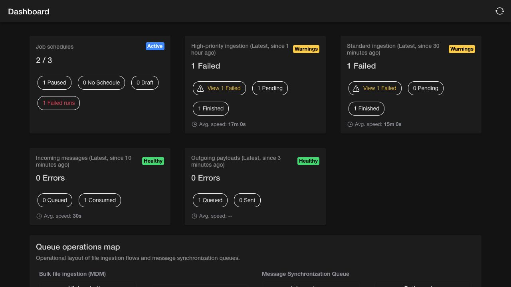
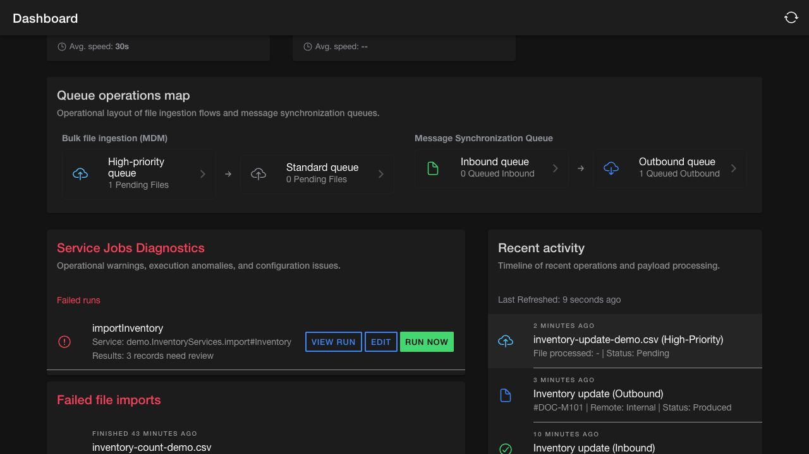
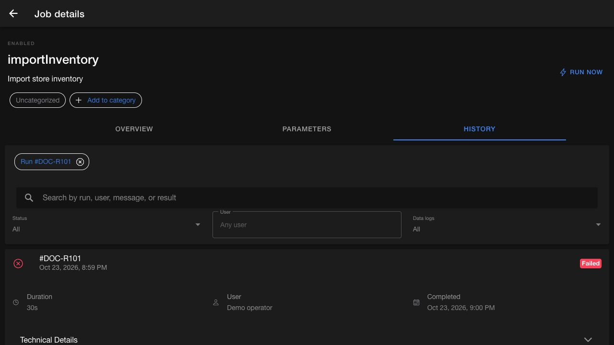
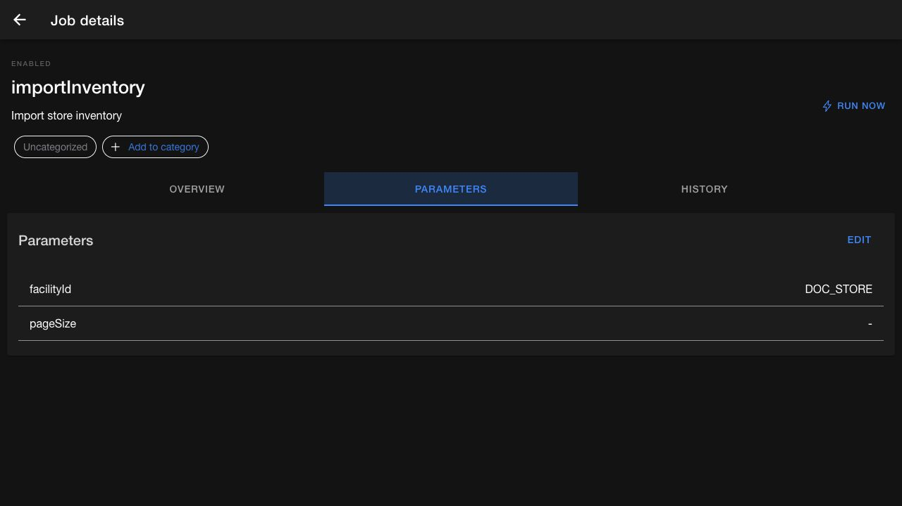

# Upcoming Job Manager operations

> **Release preview — checked 23 October 2026.** The main workflow in this guide comes from open [Job Manager PR #1071](https://github.com/hotwax/job-manager/pull/1071). Other proposals are identified separately. Screenshots show actual PR pages running locally with synthetic jobs and files; no live jobs were executed. Continue using the current guides until these changes are deployed.

## Open the records behind a dashboard warning

The Dashboard shows recent ingestion activity, message queues, and job diagnostics. Begin with the card's time window: a count for the latest loaded activity is not an all-time failure total.

1. Open **Dashboard** and locate the affected ingestion card.
2. Select **View n Failed** for High-priority ingestion or Standard ingestion.
3. In File history, inspect the inherited priority, failure, and time filters before broadening the search.
4. Open the affected file and examine its error information.

*PR #1071 preview. The examples contain one affected import in each ingestion group. The displayed “since” window is carried into the file search.*

The **Queue operations map** opens the relevant pending file or queued message view. Incoming and outgoing message error totals are summaries, not direct failure drill-downs in this proposal. Use Message history to investigate their underlying records.

## Go directly to a failed job run

1. Under **Service Jobs Diagnostics**, find the failed job.
2. Select **View run** to open Job details on **History**.
3. Confirm the **Run #…** chip matches the run you intended to inspect.
4. Review its status, user, start/completion time, and technical details.
5. Clear the run chip to broaden the history, then use the search, Status, User, or Data logs filters as needed.

*PR #1071 preview. **View run** preserves the failed run's identity when moving from the dashboard.*

*PR #1071 preview. The removable run chip narrows the history to the selected run. Identifiers and errors are synthetic.*

Use the evidence in the run before deciding to retry. Opening **View run** only inspects it; **Run now** is a separate execution action.

## Edit a job's complete parameter list

The **Parameters** tab includes supported service inputs even when an optional value has not been set. A blank optional value is not automatically a configuration error.

1. Open the job and select **Parameters**.
2. Review both configured values and blank optional inputs.
3. Select **Edit**, enter the intended values, and save the edits.
4. Use **Cancel** if you want to discard the current edits and retain the saved values.

*PR #1071 preview. `pageSize` is visible even though it has no saved value.*

## Create a job and enable it deliberately

With the required job-management permissions, open **Catalog** and start creating a job. Enter its name, description, exact service name, and schedule, then review its parameters. Supply the inputs required by the chosen service. Optional inputs can remain blank; blank values are omitted when creating its parameter records.

*PR #1071 preview. This uses a synthetic service name; choose the actual service required by your environment. The form was not submitted.*

A newly created job starts **paused**. After creation, open its detail page, verify its parameters and schedule, and enable it when ready. Add its category from the job detail page once the job has been created.

If the app reports **Job created, but its parameters could not be saved**, the job already exists. Open that job and repair its parameters before enabling it; do not repeat creation as if no job had been made.

This proposal uses a typed service name. The searchable service-name picker in [draft PR #1069](https://github.com/hotwax/job-manager/pull/1069) is explicitly parked pending its discovery API and is not part of these instructions.

## Understand the other proposed changes

| Proposal | What changes for the operator |
| --- | --- |
| [#1072](https://github.com/hotwax/job-manager/pull/1072) | Run history uses the server's search and pagination results. Filters and totals are tied to that search; this requires its compatible server API. |
| [#1123](https://github.com/hotwax/job-manager/pull/1123) | Previous/Next navigation guards against invalid history pages. |
| [#1125](https://github.com/hotwax/job-manager/pull/1125) | Long selected job names are truncated so the clear control does not overlap the User filter. |
| [#1081](https://github.com/hotwax/job-manager/pull/1081) | A file's Errors payload is fetched when the Errors tab is first opened, then reused during that view. Allow the initial load to finish. This PR sits on the #1071 follow-up stack. |
| [#1121](https://github.com/hotwax/job-manager/pull/1121) | API failure notifications show the server's error explanation when available. |
| [#1127](https://github.com/hotwax/job-manager/pull/1127) | **Go to OMS** is hidden for a Moqui-only login. |
| [#1065](https://github.com/hotwax/job-manager/pull/1065) | The ACCXUI app entry permission changes to `JOB_MANAGER_ACCXUI_APP_VIEW`. Confirm the environment's permission setup when this PR is included. |

PRs #1123 and #1125 merged on 23 October 2026 while this guide was prepared. Their deployment has not been verified; the remaining proposals above were still open at the final source check.

PR #1071 also removes the obsolete chained lifecycle display from system-message detail. Use the current message's ID, status, payload, and error details. A consumed message alone does not establish the downstream business outcome.

The websocket/live-update proposal in [draft PR #1048](https://github.com/hotwax/job-manager/pull/1048) is separate and not documented here as an available capability.

## Related guides

- [Upcoming data-document builder](upcoming-data-document-builder.md)
- [Current job details](jobs/job-details.md)
- [Current run history](jobs/run-history.md)
- [Current file history](mdm/file-history.md)
