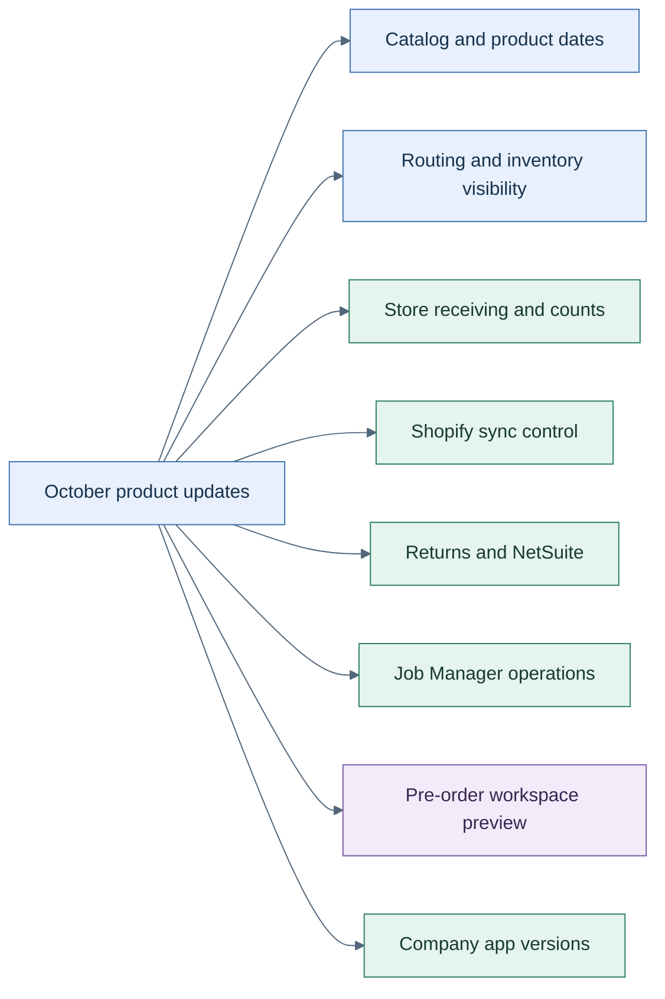

# October 2026 product updates

**Draft editorial package, 1–23 October 2026, Asia/Kolkata. Company app-version addendum verified October 25.**

This package brings together October's product changes, release references, and diagrams for review. Start with the [release notes](release-notes.md) for the full digest or choose a feature story below.

Eight feature stories, with availability stated separately for each. [Open the SVG diagram](assets/october-overview.svg).

## Feature stories

| Update | Reader benefit | Availability summary |
| --- | --- | --- |
| [Company app version management](product-updates/company-app-version-management.md) | Control rollout timing, review releases, and return to a hosted earlier version. | Company v2.9.0 deployed to UAT and production, verified October 25. |
| [Product calendar and catalog control](product-updates/product-calendar-and-catalog-control.md) | Find products across the store and edit only the intended dates. | Merged; app release not established. |
| [Routing and inventory visibility](product-updates/routing-and-inventory-visibility.md) | Connect an order's path with inventory constraints. | Order Manager v1.5.0; network dashboard merged later in a separate app. |
| [Store receiving and counting](product-updates/store-receiving-and-counting.md) | Follow scans through saved receipts, count progress, and packed transfers. | Mixed: merged work plus Fulfillment v4.2 maintenance releases. |
| [Shopify transfer and fulfillment control](product-updates/shopify-transfer-and-fulfillment-control.md) | Investigate partial sync and understand recovery. | Company and connector releases plus later merged fixes. |
| [Returns and NetSuite reconciliation](product-updates/returns-and-netsuite-reconciliation.md) | Connect returned goods with ERP receipts and settlement. | Release-listed components with setup prerequisites. |
| [Job Manager operations](product-updates/job-manager-operations.md) | Compare Shopify completion with HotWax consumption. | Merged; System Tasks needs supported OMS 6.5.0 or later. |
| [Pre-order workspace preview](product-updates/preorder-workspace-preview.md) | Review the new demand-to-supply workspace and import contract. | Preview; backend migration and hosted acceptance remain open. |

## Included assets

- One consolidated release-note draft and eight feature articles with titles, descriptions, stable slugs, and content keys.
- Eight editable Mermaid diagrams, embedded in Markdown, with matching `.mmd` sources and SVG exports under `assets/`. Text explains each diagram for readers using assistive technology.
- A [source ledger](source-ledger.md) with PR merge dates, immutable merge commits, release evidence, known limits, and editorial exclusions.
- A [publication manifest](publish-manifest.json) with file paths and SHA-256 content hashes. Its draft metadata is descriptive, not an execution guard for the repository publisher.

## Scope and review

This is a curated product digest rather than a list of every engineering commit. It excludes customer incident details, tenant record IDs, credentials, security-fix mechanics, internal tooling, and duplicate maintenance backports. Raw investigation exports remain outside this public repository.

The collection used GitHub PRs, changed-file patches, release records, and targeted ancestry comparisons. Product behavior is grounded in those sources; the original collection did not rerun application QA or certify deployments. The Company addendum separately uses October 25 deployed UI and hosting verification, recorded in the source ledger. Private component links are retained for reviewers with access and should be replaced with approved public documentation before a customer-facing publication if needed.

The Company addendum is a targeted follow-up, not a complete October 24–25 collection. The practical guide is proposed in [PR #1949](https://github.com/hotwax/oms-documentation/pull/1949); its article links currently open the reviewable guide on GitHub. Replace them with the approved live guide URL after the guide is published and before publishing this package.

Before publishing the final October edition, include the remaining 24–31 October changes, refresh release and acceptance status, confirm which app/backend combinations are available to readers, and check the target publisher's Mermaid support. SVGs provide a portable diagram alternative. Publication to a CMS or website is a separate action from this draft PR.
