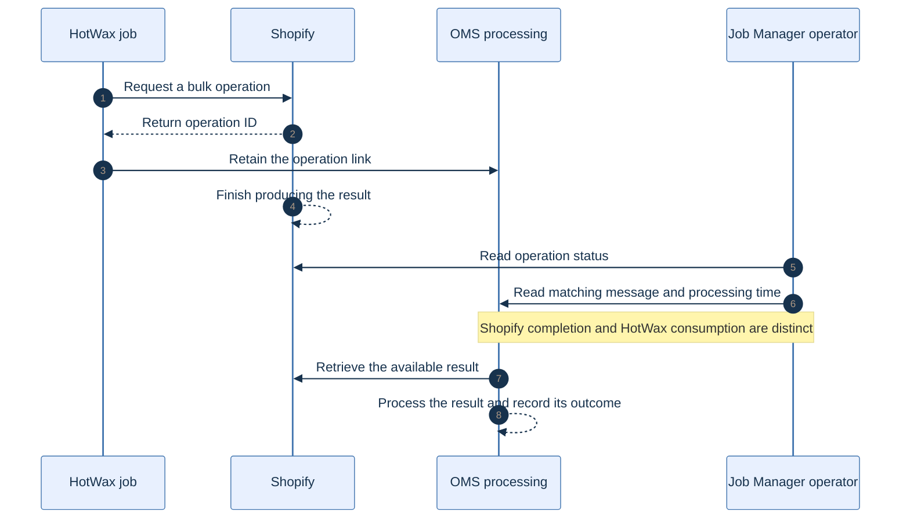

<!-- markdownlint-configure-file { "MD025": { "front_matter_title": "" } } -->

# Follow jobs from Shopify operations to run history

HotWax Commerce's Job Manager adds a clearer answer to common operations questions: has Shopify finished, has HotWax processed the result, and which job run needs attention?

**Availability:** Job Manager **v3.5.0**, published October 24, lists bulk operations, shared-remote jobs, System Tasks, instance-wide run history, and Data Document Builder improvements. System Tasks additionally requires a recognized OMS release of **6.5.0 or later** and the corresponding administrative APIs. The release limits instance-wide history to **All** and **Failed**; Successful, Running, and Terminated filters and counts are temporarily disabled pending a backend framework fix. Individual-job history retains its local status filters.

## Follow the operation across systems

The new **Shopify → Bulk operations** page reads Shopify's operations and matches them to HotWax messages. It shows the Shopify status, timing, counts, and available result files alongside the linked HotWax job, run, status, and processing time.

A Shopify operation can be **Completed** while HotWax has not yet consumed its file. Unmatched operations remain visible so operators can see when a pipeline link is missing.

The page lets an operator compare the two stages without treating one completion time as proof of the other. [Open the SVG diagram](../assets/bulk-operation-visibility.svg).

## Filter within the right scope

Shop selection follows the selected product store. All shops combines separate shop queries, and partial failures identify the shops that could not be loaded. Search accepts operation IDs; dates follow the shop's timezone. The HotWax-link filter applies to the currently loaded page, and count tiles describe a bounded recent window rather than a lifetime total.

Linked HotWax details depend on the message-lookup APIs the instance supports. Older instances can fall back to Shopify-only information.

## Find shared jobs and resolve existing tasks

Jobs on shared remotes, including SFTP, now appear in the catalog and on their detail pages. Shopify-specific jobs remain scoped to their own store.

The new **System Tasks** page searches and filters existing tasks, supports assignee changes, and resolves tasks with confirmation. Resolved cards show completion time and become read-only. There is no task-creation flow. Older or unknown OMS versions hide the page and redirect direct links.

## Search runs across the instance

Instance-wide history brings job runs into one server-paged list. Search by run ID, job name, or user ID, and review user names with an ID fallback when a name is unavailable. Filters apply before pagination, so the result count describes the filtered query rather than just the visible rows. Use All or Failed in v3.5.0; the additional status filters described in the source PR are not enabled in that release.

## Build and preview the intended data document

The Data Document Builder loads the selected document's graph, preview, export history, and schedules without carrying over another document's state. Save unsaved changes before previewing, and drag fields within an entity group to change their order. Ordinary metadata edits do not renumber the fields.

## Gather app diagnostics where available

Later October shared-framework work adds local diagnostic logs that can be filtered, copied, downloaded, and cleared. Inventory Count **v5.4.0** explicitly lists its adoption. Company and Job Manager integrations merged later than their October releases, so those apps need a separately verified build. Remote forwarding is optional and requires configuration; local logs do not imply automatic delivery to support.

Sources: [Job Manager v3.5.0](https://github.com/hotwax/job-manager/releases/tag/v3.5.0), [bulk operations #1114](https://github.com/hotwax/job-manager/pull/1114), [shared-remote jobs #1119](https://github.com/hotwax/job-manager/pull/1119), [System Tasks #1120](https://github.com/hotwax/job-manager/pull/1120), [run history #1072](https://github.com/hotwax/job-manager/pull/1072), [Data Document Builder #1112](https://github.com/hotwax/job-manager/pull/1112), [field ordering #963](https://github.com/hotwax/job-manager/pull/963), [local logs #267](https://github.com/hotwax/accxui/pull/267), [optional forwarding #269](https://github.com/hotwax/accxui/pull/269), and [Inventory Count v5.4.0](https://github.com/hotwax/inventory-count/releases/tag/v5.4.0).

[October overview](../README.md) · [All release notes](../release-notes.md) · [Source ledger](../source-ledger.md)
