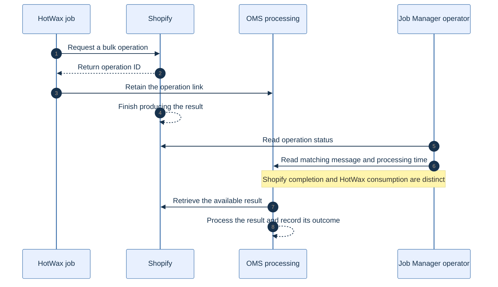

<!-- markdownlint-configure-file { "MD025": { "front_matter_title": "" } } -->

# See both sides of a Shopify bulk operation

HotWax Commerce's Job Manager adds a clearer answer to a common operations question: has Shopify finished, and has HotWax processed the result?

**Availability:** these changes merged into Job Manager `main` in October; no October GitHub release was found for this app at the cutoff. System Tasks additionally requires a recognized OMS release of **6.5.0 or later** and the corresponding administrative APIs.

## Follow the operation across systems

The new **Shopify → Bulk operations** page reads Shopify's operations and matches them to HotWax messages. It shows the Shopify status, timing, counts, and available result files alongside the linked HotWax job, run, status, and processing time.

A Shopify operation can be **Completed** while HotWax has not yet consumed its file. Unmatched operations remain visible so operators can see when a pipeline link is missing.

The page lets an operator compare the two stages without treating one completion time as proof of the other. [Open the SVG diagram](../assets/bulk-operation-visibility.svg).

## Filter within the right scope

Shop selection follows the selected product store. All shops combines separate shop queries, and partial failures identify the shops that could not be loaded. Search accepts operation IDs; dates follow the shop's timezone. The HotWax-link filter applies to the currently loaded page, and count tiles describe a bounded recent window rather than a lifetime total.

Linked HotWax details depend on the message-lookup APIs the instance supports. Older instances can fall back to Shopify-only information.

## Find shared jobs and resolve existing tasks

Jobs on shared remotes, including SFTP, now appear in the catalog and on their detail pages. Shopify-specific jobs remain scoped to their own store.

The new **System Tasks** page searches and filters existing tasks, supports assignee changes, and resolves tasks with confirmation. Resolved cards show completion time and become read-only. There is no task-creation flow. Older or unknown OMS versions hide the page and redirect direct links.

Sources: [bulk operations #1114](https://github.com/hotwax/job-manager/pull/1114), [shared-remote jobs #1119](https://github.com/hotwax/job-manager/pull/1119), and [System Tasks #1120](https://github.com/hotwax/job-manager/pull/1120).

[October overview](../README.md) · [All release notes](../release-notes.md) · [Source ledger](../source-ledger.md)
