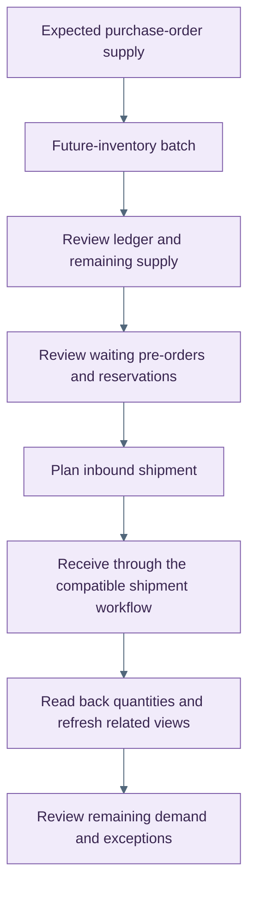

<!-- markdownlint-configure-file { "MD025": { "front_matter_title": "" } } -->

# Preview the new pre-order workspace

HotWax Commerce's rebuilt Pre-order App brings demand, future inventory, purchase orders, and inbound shipments into a shared workspace. Its October frontend merges are a preview of ongoing development, not a general-availability announcement.

**Availability:** the frontend rebuild and follow-up workflows merged on 19–29 October, with more OMS, receiving, and Shopify integration work merged through October 31. No October Pre-order App GitHub release was found in the full-month snapshot. The backend migration PR and hosted acceptance tracker were still open when rechecked November 4. Compatible feature components are required; an ordinary app update is not enough to enable the full workflow.

## Follow demand back to expected supply

The workspace adds demand and supply summaries, exception views, future-inventory batches with their ledger and waiting orders, purchase orders, and inbound shipments. Follow-up work adds routing, setup, reservation, and shipment workflows.

Receipt submission stays locked while saved quantities are being read back. Shipment writes refresh the related lists. If an arrival-date update saves only partially, the app reloads persisted values while retaining the partial error.

This illustrates the intended workspace flow. It does not imply that all release and external-integration acceptance gates are complete. [Open the SVG diagram](../assets/preorder-supply-preview.svg).

## Import the remaining parent quantity

The Future inventory CSV help now explains the allocation-adjusted contract for an external-only parent batch. If 2 units from a 4-unit parent are allocated to a shipment, the later file should carry **parent 2 + shipment 2**. Sending **parent 4 + shipment 2** would represent 6 units of total supply.

This October help-text change explains the existing import calculation; it does not change that calculation.

## Keep future supply aligned as plans change

Late October work connects the workspace to the current OMS and receiving contracts. Creating an inbound shipment moves its quantity from the purchase-order remainder into a shipment batch; the existing reservations stay with the remainder. A receipt reduces the shipment's future quantity, but that integration alone does not allocate waiting orders to the received physical stock.

Changing a purchase-order line's expected arrival updates its remainder batch without rewriting shipment arrival dates. Cancelling the line closes its remaining future supply without automatically reallocating customer reservations. Separately, rejecting or cancelling an order item releases that item's future-inventory reservation. These are different operations and should not be treated as one cancellation workflow.

The Shopify connector also adds future-reserved quantity projection, app-owned fulfillment holds, and separate future-inventory publication. These changes merged late in the month; no matching October feature release or complete hosted acceptance is established here. [Read the Shopify integration details](shopify-transfer-and-fulfillment-control.md).

## Acceptance still matters

The source PRs report local service, database, API, and frontend checks. Those checks do not establish complete hosted, Shopify, role-permission, or release acceptance. The receipt, cache-refresh, arrival-date, and import-help issues cited in the frontend work were closed by this cutoff, while the broader hosted QA tracker remained open.

Sources: [Pre-order rebuild #392](https://github.com/hotwax/preorder/pull/392), [workflow and QA fixes #394](https://github.com/hotwax/preorder/pull/394), [CSV help #395](https://github.com/hotwax/preorder/pull/395), [current contracts #397](https://github.com/hotwax/preorder/pull/397), [shipment batches #1258](https://github.com/hotwax/oms/pull/1258), [receiving integration #437](https://github.com/hotwax/hotwax-poorti/pull/437), [purchase-order cancellation #1263](https://github.com/hotwax/oms/pull/1263), [arrival-date changes #1264](https://github.com/hotwax/oms/pull/1264), and [order-item reservation release #1265](https://github.com/hotwax/oms/pull/1265). Backend status: [migration #75](https://github.com/hotwax/preorder-maarg/pull/75) and [hosted QA #95](https://github.com/hotwax/preorder-maarg/issues/95), which require repository access.

[October overview](../README.md) · [All release notes](../release-notes.md) · [Source ledger](../source-ledger.md)
