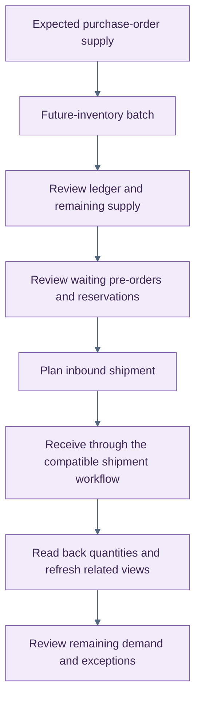

<!-- markdownlint-configure-file { "MD025": { "front_matter_title": "" } } -->

# Preview the new pre-order workspace

HotWax Commerce's rebuilt Pre-order App brings demand, future inventory, purchase orders, and inbound shipments into a shared workspace. Its October frontend merges are a preview of ongoing development, not a general-availability announcement.

**Availability:** the frontend rebuild and follow-up workflows merged on 19–20 October. No October Pre-order App GitHub release was found at the cutoff. The backend migration PR remains open, and the hosted acceptance tracker remains open. Compatible feature components are required; an ordinary app update is not enough to enable the full workflow.

## Follow demand back to expected supply

The workspace adds demand and supply summaries, exception views, future-inventory batches with their ledger and waiting orders, purchase orders, and inbound shipments. Follow-up work adds routing, setup, reservation, and shipment workflows.

Receipt submission stays locked while saved quantities are being read back. Shipment writes refresh the related lists. If an arrival-date update saves only partially, the app reloads persisted values while retaining the partial error.

This illustrates the intended workspace flow. It does not imply that all release and external-integration acceptance gates are complete. [Open the SVG diagram](../assets/preorder-supply-preview.svg).

## Import the remaining parent quantity

The Future inventory CSV help now explains the allocation-adjusted contract for an external-only parent batch. If 2 units from a 4-unit parent are allocated to a shipment, the later file should carry **parent 2 + shipment 2**. Sending **parent 4 + shipment 2** would represent 6 units of total supply.

This October help-text change explains the existing import calculation; it does not change that calculation.

## Acceptance still matters

The source PRs report local service, database, API, and frontend checks. Those checks do not establish complete hosted, Shopify, role-permission, or release acceptance. The receipt, cache-refresh, arrival-date, and import-help issues cited in the frontend work were closed by this cutoff, while the broader hosted QA tracker remained open.

Sources: [Pre-order rebuild #392](https://github.com/hotwax/preorder/pull/392), [workflow and QA fixes #394](https://github.com/hotwax/preorder/pull/394), and [CSV help #395](https://github.com/hotwax/preorder/pull/395). Backend status: [migration #75](https://github.com/hotwax/preorder-maarg/pull/75) and [hosted QA #95](https://github.com/hotwax/preorder-maarg/issues/95), which require repository access.

[October overview](../README.md) · [All release notes](../release-notes.md) · [Source ledger](../source-ledger.md)
