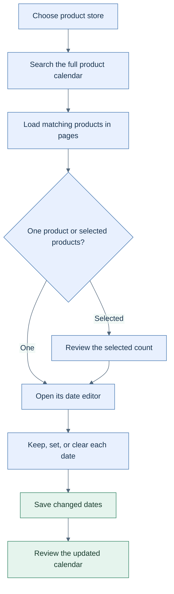

<!-- markdownlint-configure-file { "MD025": { "front_matter_title": "" } } -->

# Manage product dates across the whole catalog

HotWax Commerce's Products App brings calendar search, date editing, and product identity into a more consistent catalog workflow. Merchandising teams can find products beyond the first loaded page and change the dates they intend to change.

**Availability:** merged into Products `main` in October. No October GitHub release was found for this app at the cutoff. The deployed app and its compatible OMS calendar services determine availability.

## Find the products you mean

The product calendar loads 50 rows at a time and searches the store on the server by product ID, name, or internal name. Its total reflects matching results across the store. It replaces the earlier 500-row request and search limited to those loaded rows.

The workbench adds clearer matching counts, more sorting options, and consistent primary and secondary identifiers. Administrators with the required permission can select their preferred identifiers in Settings and see how many products contain them. A missing identifier falls back to the product's available name or ID.

## Change dates without changing everything

Open one calendar row to edit its lifecycle dates, or enter Select mode to update selected products together. For each date, keep the existing value, set a new one, or clear it. Unchanged date fields are omitted from the save request.

Selection applies to loaded rows. Changing the search, filters, or sort removes selections that are no longer shown. Review the selected count before saving or adding tags.

The calendar workflow keeps selection and date changes explicit. [Open the SVG diagram](../assets/product-calendar.svg).

## Review catalog links with context

Shopify association cards check saved links against Shopify, identify missing or mismatched IDs, and support multiple listings in the same shop. Adding a link offers Shopify search or manual entry. A link already assigned to another OMS product is blocked rather than silently moved.

Readable product history depends on the corresponding OMS history fix. App UI changes alone do not make history available on an older backend.

Sources: [Products #80](https://github.com/hotwax/products/pull/80), [review fixes #87](https://github.com/hotwax/products/pull/87), and [tag synchronization #70](https://github.com/hotwax/products/pull/70). #87 merged into the feature branch before #80 brought that work into `main`.

[October overview](../README.md) · [All release notes](../release-notes.md) · [Source ledger](../source-ledger.md)
