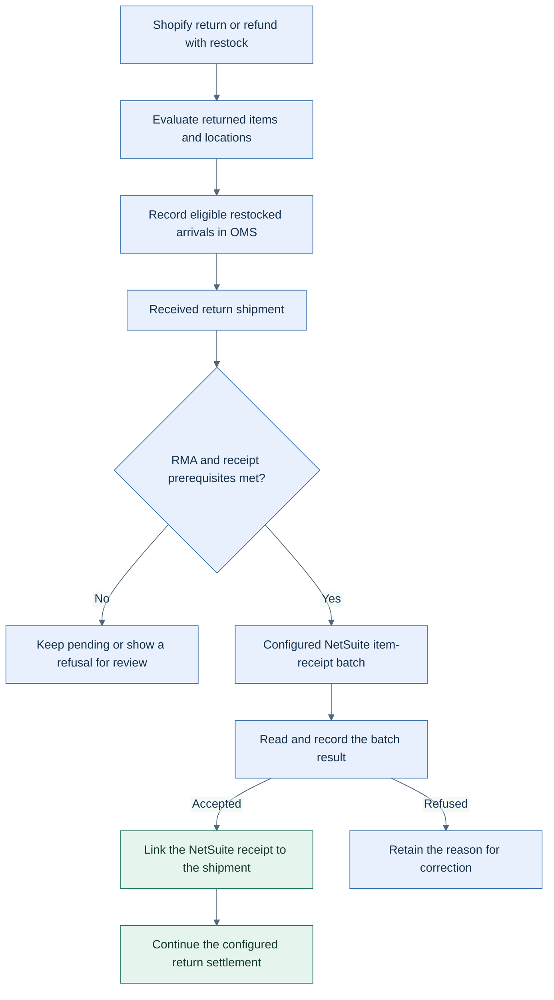

<!-- markdownlint-configure-file { "MD025": { "front_matter_title": "" } } -->

# Keep return receipts and NetSuite records connected

HotWax Commerce's October return updates connect the physical arrival of returned goods with the records used to reconcile those returns in NetSuite.

**Availability:** the Shopify connector **v4.5.0** and NetSuite connector **v3.5.0** release records list return-receipt foundations. NetSuite **v3.5.1** lists receipt-window, return-facility, and cancellation changes; **v3.5.2** lists bin-aware receipt detail. Compatible OMS services, ERP-side scripts, mappings, and configured jobs are also required.

## Restock the item that was actually returned

For a Shopify return completed without a refund, the connector evaluates each piece's disposition. One restocked piece no longer determines the outcome for every line. A partially restocked line is recorded as not restocked under this contract rather than treating its entire quantity as returned to stock.

Restocked return arrivals can be recorded as received return shipments. Those shipments give the NetSuite receipt integration a concrete arrival to track, with result history for each submission attempt.

The receipt is one stage of the return lifecycle; settlement still depends on its own prerequisites. [Open the SVG diagram](../assets/return-receipts.svg).

## Handle timing and return location explicitly

The NetSuite RMA receipt pull overlaps its normal incremental window by five minutes by default, helping capture receipts that become visible after an earlier query. Receipt-line history prevents the overlap from recording a line twice. An explicit backfill start time does not receive that overlap.

An optional return-facility configuration lets return documents use the facility that took the goods back. It is opt-in and depends on that facility's customer, location, department, and subsidiary mappings.

Cancelled returns are excluded from new RMA submissions. For eligible RMAs already sent, the close workflow handles open lines, while RMAs with item receipts or credit memos are left alone. That workflow also needs its configured job.

## Prepare bin-aware receipt detail

The connector can import NetSuite's **Use Bins** setting into the product's receipt-inspection flag. Return receipt detail is added for products that require it; a kit's components are evaluated individually. Populate those product values before activating the changed receipt behavior. The two synchronization jobs are seeded paused.

Restocking-fee support also merged this month. It requires a configured fee product with a NetSuite item identification. A fee arriving after an RMA was already created is a documented limitation; the source PR does not establish that the final product-lookup path has completed acceptance testing.

Sources: [Shopify per-item dispositions #883](https://github.com/hotwax/mantle-shopify-connector/pull/883), [return shipments #893](https://github.com/hotwax/mantle-shopify-connector/pull/893), [NetSuite receipt integration #488](https://github.com/hotwax/mantle-netsuite-connector/pull/488), [incremental window #517](https://github.com/hotwax/mantle-netsuite-connector/pull/517), [return facility #524](https://github.com/hotwax/mantle-netsuite-connector/pull/524), [cancelled RMAs #532](https://github.com/hotwax/mantle-netsuite-connector/pull/532), [Use Bins #557](https://github.com/hotwax/mantle-netsuite-connector/pull/557), and [restocking fees #573](https://github.com/hotwax/mantle-netsuite-connector/pull/573). These sources require repository access.

[October overview](../README.md) · [All release notes](../release-notes.md) · [Source ledger](../source-ledger.md)
