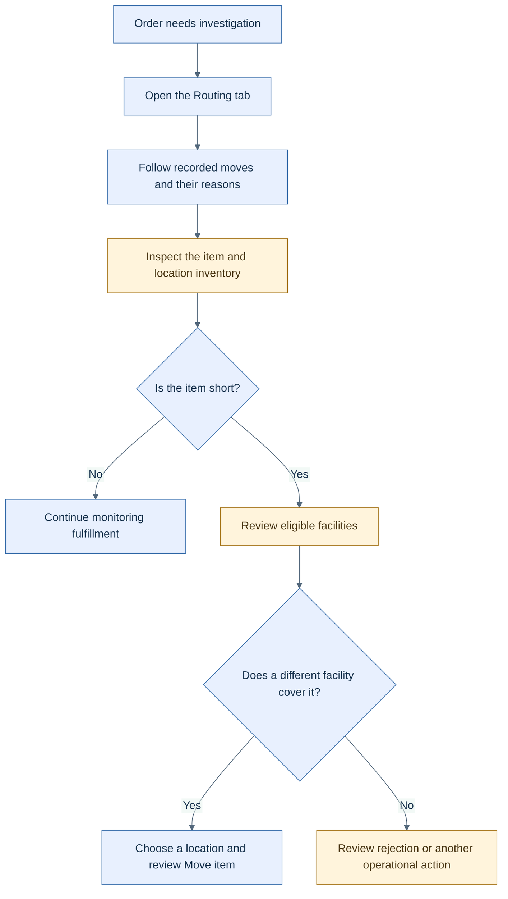

<!-- markdownlint-configure-file { "MD025": { "front_matter_title": "" } } -->

# See why an order moved and where stock is held

HotWax Commerce adds two complementary views of routing: the path of an individual order and the current inventory constraints across a store network.

**Availability:** Order Manager's Routing tab and facility-picker changes are listed in **v1.5.0**, published 15 October. The Order Routing dashboard merged on 19 October, after that app's **v2.5.0** release, and requires compatible OMS data documents. The dashboard is not established as part of v2.5.0.

## Follow an order's routing history

Open an order's **Routing** tab to see its ship groups move through locations. The graph labels moves such as allocation, rejection, parking, and return to the brokering queue. It identifies the rule, user, or system recorded for the move. Repeated routing attempts are grouped so the path stays readable.

Item cards connect that history to inventory details. A short-stock warning offers the existing Reject item and Move item actions. The facility picker pins the current location and keeps Save disabled until a different location is selected. It also warns when no facility in the product store can cover the selection.

This is an investigation path; viewing the graph does not move an order. [Open the SVG diagram](../assets/routing-visibility.svg).

## Explain network constraints

The new Order Routing dashboard combines weekly routing activity, store-shipped units, current safety stock, and shipping exclusions. Analysts can drill from a routing rule into its editor and see stores holding the most safety stock.

Weekly charts use complete Monday-to-Sunday weeks in UTC. Safety stock is a current snapshot, not reconstructed weekly history. Where the stored buffer cannot be attributed to a matching rule, the dashboard labels it **Unattributed**. Pickup and point-of-sale orders are excluded from the weekly routing analysis.

The existing v2.5.0 release separately adds carrier postal-code filters and sorting to inventory rules.

Sources: [Order Manager #587](https://github.com/hotwax/order-manager/pull/587), [facility picker #589](https://github.com/hotwax/order-manager/pull/589), [v1.5.0](https://github.com/hotwax/order-manager/releases/tag/v1.5.0), [Order Routing #584](https://github.com/hotwax/order-routing/pull/584), and [v2.5.0](https://github.com/hotwax/order-routing/releases/tag/v2.5.0).

[October overview](../README.md) · [All release notes](../release-notes.md) · [Source ledger](../source-ledger.md)
