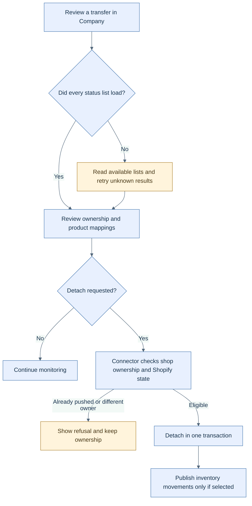

<!-- markdownlint-configure-file { "MD025": { "front_matter_title": "" } } -->

# Follow Shopify sync from transfer ownership to fulfillment

HotWax Commerce's October Shopify work gives operators more context when transfers or fulfillment updates need attention, with recovery changes behind those workflows.

**Availability:** Company **v2.6.0** lists transfer-monitor diagnostics; **v2.8.0** lists the single-call detach flow. The Shopify connector's **v4.5.0** release lists the associated transfer and fulfillment work, and **v4.5.2** lists active-inventory reset comparison. App and backend versions must be compatible. A GitHub release does not confirm a tenant rollout.

## Read partial sync results accurately

The transfer monitor displays lists that loaded while marking failed lists as unknown. Cached rows survive incomplete reads. Mapping review adds Shopify listing context and supports selecting a tracked, unmapped variant for a missing association, with checks before and after saving.

Recent-order context is bounded: the lookup covers 30 days with a search cap, and the UI labels lower-bound counts. It is not a complete sales report.

## Detach only an eligible transfer

The Company App uses one backend call to detach a transfer from native Shopify sync. The connector refuses detachment if Shopify already holds the transfer or another shop owns it. Eligible detachment removes ownership and item mappings in one transaction. Publishing the corresponding inventory movements is an explicit option, off by default.

Detachment has eligibility checks; it is not a general way to cancel a Shopify transfer. [Open the SVG diagram](../assets/shopify-transfer-control.svg).

## Recover fulfillment without unnecessary repeat creation

Shipment-driven fulfillment feeds queue messages for a dedicated sender. After Shopify returns a fulfillment ID, the connector saves it before completing the remaining local work. A retry with that saved ID finishes the local update without issuing another fulfillment creation request. A separate recovery path can adopt an existing successful Shopify fulfillment when all requested lines are already closed.

This is recovery behavior, not an exactly-once guarantee: a process stop between Shopify's response and the first saved ID remains a documented gap. The dedicated sender is seeded paused, so deployment also needs deliberate sender configuration and review of overlapping jobs.

## Compare inventory before importing changes

The active-inventory reset work compares mapped Shopify levels with OMS quantities and queues changes through Data Manager, including changes to zero or negative quantities. Later October changes count and skip unmapped items instead of failing the whole prepared file, and skip channel or virtual locations during inbound reset. Ambiguous or changed mappings still need correction.

Treat Data Manager's source, unchanged, skipped, and processed counts separately. They describe different stages and should not all be read as the number of stock changes.

Sources: [Company #479](https://github.com/hotwax/company/pull/479), [#501](https://github.com/hotwax/company/pull/501), [v2.8.0](https://github.com/hotwax/company/releases/tag/v2.8.0), [Shopify fulfillment queue #842](https://github.com/hotwax/mantle-shopify-connector/pull/842), [saved fulfillment ID #861](https://github.com/hotwax/mantle-shopify-connector/pull/861), [recovery #892](https://github.com/hotwax/mantle-shopify-connector/pull/892), [reset comparison #979](https://github.com/hotwax/mantle-shopify-connector/pull/979), [unmapped items #992](https://github.com/hotwax/mantle-shopify-connector/pull/992), and [location guard #1007](https://github.com/hotwax/mantle-shopify-connector/pull/1007). Connector sources require repository access.

[October overview](../README.md) · [All release notes](../release-notes.md) · [Source ledger](../source-ledger.md)
