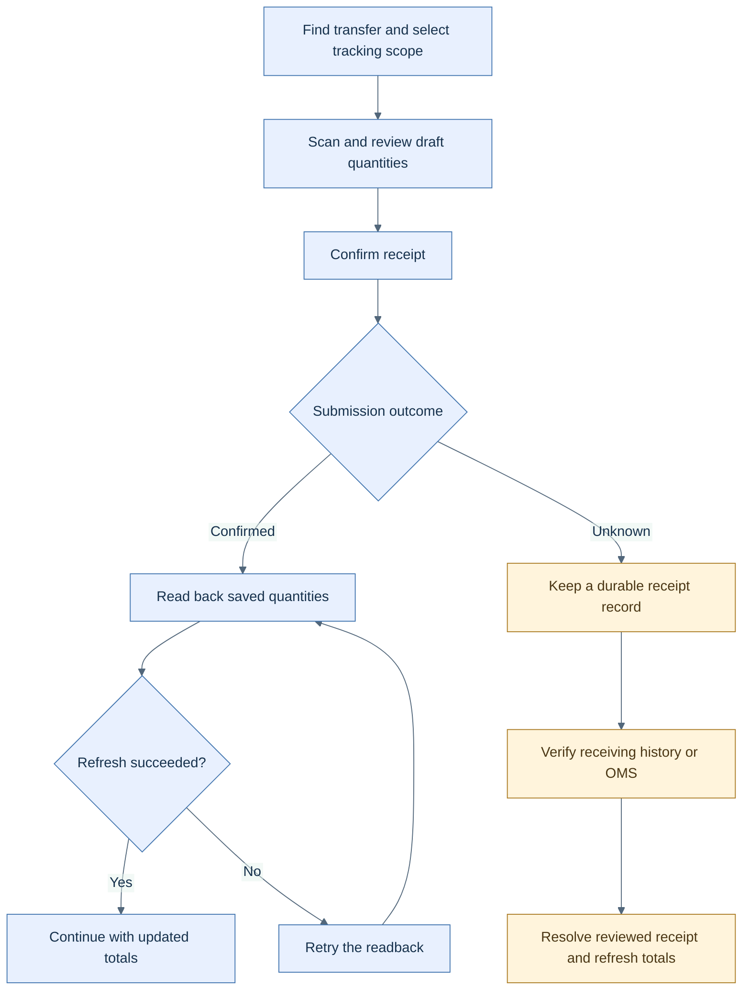

<!-- markdownlint-configure-file { "MD025": { "front_matter_title": "" } } -->

# Keep store receiving and counts clear from scan to confirmation

HotWax Commerce's store apps add clearer handling for the moments between scanning an item, submitting a receipt, and seeing the saved result.

**Availability:** the Receiving and Inventory Count improvements below merged in October; their October tags do not establish inclusion. Git ancestry checks show Receiving #739/#740 outside **v4.2.2** and Inventory Count #1463 outside **v5.2.1**. Packed-transfer follow-up is explicitly listed in Fulfillment **v4.2.3** and **v4.2.4**, on the v4.2 maintenance line.

## Find the right transfer and box

Receiving adds tracking-code search, package context, and **Scan all** shortcuts. An exact, unique tracking-code match can open its transfer with the matching box selected. Scan shortcuts fill draft quantities; the normal receipt action still submits them.

Box filters select order lines. Receipt quantities remain totals for those lines across boxes. Completed transfers remain server-paged, and historical tracking search covers packages already loaded into the app.

## Review a receipt whose outcome is uncertain

A confirmed receipt is not sent again merely because the subsequent refresh failed. If the original submission's outcome is unknown, Receiving retains a record outside its disposable cache and blocks another submission until the operator reviews receiving history or the OMS. Resolving that review clears the block and drafts; it does not submit inventory.

Refreshing a receipt result and sending a receipt are separate actions. [Open the SVG diagram](../assets/receiving-confirmation.svg).

## Keep count progress trustworthy

Inventory Count improves mobile scanning and quantity entry, distinguishes failed exports, waits for session synchronization before submission, and preserves zero quantities in progress views. Re-entering a session while an earlier status write is pending keeps controls blocked until the saved state is known. Further fixes address admin navigation and browser Back navigation.

The latest iPad quantity-entry changes depend on the shared AccxUI keyboard helpers. Their app changes pin the framework commit; neither the October AccxUI tags nor the earlier app tags prove those helpers are included.

## Finish packed transfers

Fulfillment's **Transfer Orders → Packed** segment shows shipments still waiting for Ship. Packing alone does not complete the transfer. The v4.2.4 follow-up adds **Cancel shipment** from the packed-shipment detail flow, with confirmation, so its items can be packed again. Label-purchase restrictions still apply.

The separate live Open Orders and whole-order rejection rework merged into Fulfillment `main` on 20 October. It is outside the earlier v4.3.0 tag and should be checked independently when choosing an app build.

Sources: [Receiving #739](https://github.com/hotwax/receiving/pull/739), [receipt recovery #740](https://github.com/hotwax/receiving/pull/740), [iPad entry #757](https://github.com/hotwax/receiving/pull/757), [Inventory Count #1463](https://github.com/hotwax/inventory-count/pull/1463), [session progress #1482](https://github.com/hotwax/inventory-count/pull/1482), [navigation #1489](https://github.com/hotwax/inventory-count/pull/1489), [Fulfillment #1717](https://github.com/hotwax/fulfillment/pull/1717), [#1721](https://github.com/hotwax/fulfillment/pull/1721), and [#1702](https://github.com/hotwax/fulfillment/pull/1702).

[October overview](../README.md) · [All release notes](../release-notes.md) · [Source ledger](../source-ledger.md)
