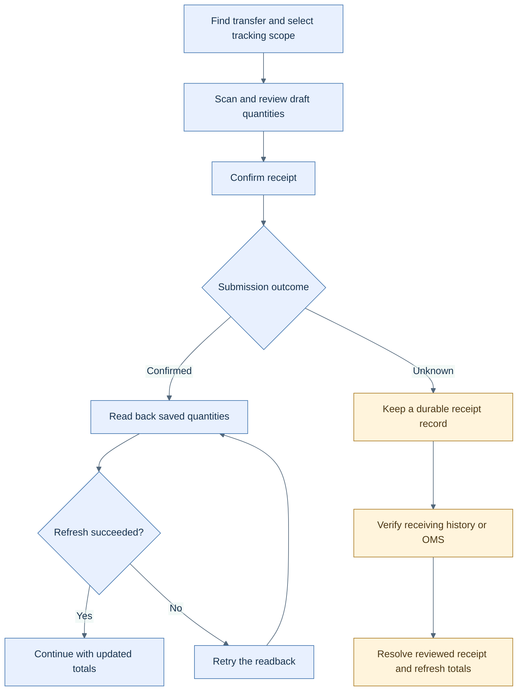

<!-- markdownlint-configure-file { "MD025": { "front_matter_title": "" } } -->

# Keep store receiving and counts clear from scan to confirmation

HotWax Commerce's store apps add clearer handling for the moments between scanning an item, submitting a receipt, and seeing the saved result.

**Availability:** Inventory Count **v5.3.0**, published October 24, explicitly lists the scanning, export, session, navigation, iPad entry, and session-lock improvements below. The earlier **v5.2.1** excludes the featured scanning change. Receiving #739/#740 remain merged work: ancestry checks exclude them from **v4.2.2** and the later **v4.2.4** maintenance release. Fulfillment lists the Packed segment in **v4.2.3** and **v4.3.1**; cancellation from shipment detail is separately established in **v4.2.4**.

## Find the right transfer and box

Receiving adds tracking-code search, package context, and **Scan all** shortcuts. An exact, unique tracking-code match can open its transfer with the matching box selected. Scan shortcuts fill draft quantities; the normal receipt action still submits them.

Box filters select order lines. Receipt quantities remain totals for those lines across boxes. Completed transfers remain server-paged, and historical tracking search covers packages already loaded into the app.

## Review a receipt whose outcome is uncertain

A confirmed receipt is not sent again merely because the subsequent refresh failed. If the original submission's outcome is unknown, Receiving retains a record outside its disposable cache and blocks another submission until the operator reviews receiving history or the OMS. Resolving that review clears the block and drafts; it does not submit inventory.

Refreshing a receipt result and sending a receipt are separate actions. [Open the SVG diagram](../assets/receiving-confirmation.svg).

## Keep count progress trustworthy

Inventory Count improves mobile scanning and quantity entry, distinguishes failed exports, waits for session synchronization before submission, and preserves zero quantities in progress views. Re-entering a session while an earlier status write is pending keeps controls blocked until the saved state is known. Further fixes address admin navigation and browser Back navigation.

Inventory Count v5.3.0 lists the shared-framework iPad keyboard integration. Receiving's corresponding integration remains merged work and is outside v4.2.4. App adoption matters alongside the shared framework version.

Session-lock heartbeats now renew from the current time, preventing repeated heartbeats from pushing expiry farther into the future. Once heartbeats stop, a normally renewed session can expire within its configured lease. Previously inflated abandoned locks are not retroactively cleared by this client change.

## Finish packed transfers

Fulfillment's **Transfer Orders → Packed** segment shows shipments still waiting for Ship. Packing alone does not complete the transfer. The segment is listed in v4.2.3 and the October 30 **v4.3.1** release, with a separate forward-port into `main`. The v4.2.4 follow-up adds **Cancel shipment** from the packed-shipment detail flow, with confirmation, so its items can be packed again. Cancellation is not established for v4.3.1 by the Packed-segment release entry. Label-purchase restrictions still apply.

The separate live Open Orders and whole-order rejection rework merged into Fulfillment `main` on 20 October. It is outside the earlier v4.3.0 tag and should be checked independently when choosing an app build.

Sources: [Receiving #739](https://github.com/hotwax/receiving/pull/739), [receipt recovery #740](https://github.com/hotwax/receiving/pull/740), [iPad entry #757](https://github.com/hotwax/receiving/pull/757), [Inventory Count #1463](https://github.com/hotwax/inventory-count/pull/1463), [session progress #1482](https://github.com/hotwax/inventory-count/pull/1482), [navigation #1489](https://github.com/hotwax/inventory-count/pull/1489), [session lease #1490](https://github.com/hotwax/inventory-count/pull/1490), [v5.3.0](https://github.com/hotwax/inventory-count/releases/tag/v5.3.0), [Fulfillment #1717](https://github.com/hotwax/fulfillment/pull/1717), [#1721](https://github.com/hotwax/fulfillment/pull/1721), [v4.3.1](https://github.com/hotwax/fulfillment/releases/tag/v4.3.1), [main forward-port #1718](https://github.com/hotwax/fulfillment/pull/1718), and [#1702](https://github.com/hotwax/fulfillment/pull/1702).

[October overview](../README.md) · [All release notes](../release-notes.md) · [Source ledger](../source-ledger.md)
