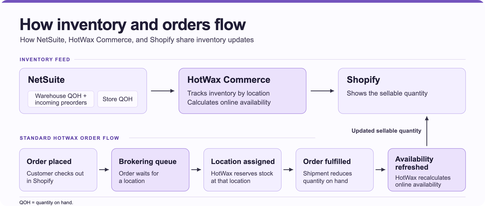

# Malbon Inventory and Order Commitments

How NetSuite inventory feeds, customer orders, and Shopify updates fit together

Malbon’s repository defines two inventory exports from NetSuite: a warehouse available-to-promise (ATP) feed and a store quantity-on-hand (QOH) feed. The sections below explain what the files contain, how the order commitment moves through HotWax, and which Shopify rules are specific to Malbon.

*The diagram summarizes the inventory feed and order fulfillment flow. The following sections explain the queue commitment and Malbon-specific Shopify rules.*

## What NetSuite sends

NetSuite creates two separate inventory files. The warehouse file uses the quantity available at each location. The store file uses the quantity on hand at each location.

### Warehouse ATP

The warehouse search reads NetSuite’s location quantity available field. If that value is empty, the search uses zero. The file marks the row as an ATP reset.

Search ID: customsearch_export_inventory_item_atp. Filename prefix: InventoryItemWhAtpExport_. The search filters to location type 2.

### Store QOH

The store search reads NetSuite’s location quantity on hand field. If that value is empty, the search uses zero. The file marks the row as a QOH reset.

Search ID: customsearch_export_inventory_item_qoh. Filename prefix: InventoryItemWhQOHExport_. The search filters to location type 1.

The Store QOH deployment is titled `HC_generateCSV_InventoryItemsStore_QOH` but uses the prefix `InventoryItemWhQOHExport_`; the `Wh` segment is present in the checked-in setting.

Both files identify the item and location, provide an inventory quantity, and specify which reset type to use. They include active inventory part, group, kit, and non-inventory part items.

The saved searches filter by item type, inactive status, and location type. The `HotWax Inventory Sync` location checkbox (`custrecord_hc_inv_sync`) is defined in the repository, but neither inventory saved search includes it as a filter. For these exports, the saved-search filters select rows by item and location type, not by that checkbox.

## How the files are created and sent

Each export script runs its saved search and creates a dated CSV in NetSuite’s Inventory Item CSV folder. If the search returns no results, the script does not create a file.

A second script sends CSV files from that folder to the configured SFTP connection. It gets the connection settings from a NetSuite record and moves successfully uploaded files to Archive Inventory Item CSV.

### Inventory CSV uploader

The uploader record ID is `customscript_imp_inventoryitem`, although the script is named `HC_uploadCSV_InventoryItems`. Its two checked-in deployments are marked `TESTING` and have no recurrence blocks. Each run selects at most 20 CSV files. The script appends `inventoryitem` to the configured SFTP directory when creating the connection, then passes `/csv/` as the directory in each upload call. The repository shows these values but does not confirm the live SFTP path or upload schedule.

## What happens when a customer places an order

### 1. The order enters HotWax

A customer places an order in Shopify. The order enters HotWax’s brokering queue while HotWax chooses a store or warehouse to fulfill it.

### 2. HotWax holds the online promise

While the order waits in the queue, HotWax reduces Online ATP by the promised quantity. This keeps those units from being promised to another online customer.

### 3. HotWax assigns a location

After HotWax selects a store or warehouse, it reserves the order quantity there and that location’s ATP decreases.

### 4. Fulfillment changes the on-hand quantity

When HotWax receives the fulfillment update, QOH decreases to reflect the goods leaving the location. HotWax recalculates Online ATP and updates Shopify with the sellable quantity.

## How to read the numbers

QOH is the physical baseline. An order is a commitment against that inventory. While it waits for a location, it reduces Online ATP. After allocation, it is held against the selected location’s ATP. After fulfillment, QOH reflects the physical movement.

The quantities in NetSuite, HotWax, and Shopify are views of the same inventory at different stages. Do not add the three system totals together.

Flow: NetSuite warehouse ATP and store QOH files → HotWax inventory and online availability → Shopify sellable quantity. Shopify order → HotWax brokering queue → location allocation → fulfillment update → refreshed HotWax availability → Shopify.

## Malbon’s Shopify rules

Malbon’s inventory-event customization allows physical inventory changes at locations outside a shop’s transfer facility group to remain eligible for Shopify updates. The group is configured in HotWax; its live location membership is not included in the repository.

For transfer orders, Malbon queues a Shopify transfer after approval only when at least one end of the transfer is in the shop’s configured transfer facility group. If neither end is included, the transfer is not sent to Shopify. If only one end is included, the Shopify transfer uses that location and leaves out the other one.

## Sources

- [Warehouse ATP saved search and filters](https://github.com/hotwax/malbon/blob/bcc12bd1d85e1e16569603883ec88d0d48ab7431/netsuite/src/Objects/HotWaxCommerce/SyncInventory/customsearch_export_inventory_item_atp.xml)

- [Store QOH saved search and filters](https://github.com/hotwax/malbon/blob/bcc12bd1d85e1e16569603883ec88d0d48ab7431/netsuite/src/Objects/HotWaxCommerce/SyncInventory/customsearch_export_inventory_item_qoh.xml) and [Store QOH deployment prefix and status](https://github.com/hotwax/malbon/blob/bcc12bd1d85e1e16569603883ec88d0d48ab7431/netsuite/src/Objects/HotWaxCommerce/SyncInventory/customscript_hc_inventoryitem_store_qoh.xml)

- NetSuite inventory [export scripts](https://github.com/hotwax/malbon/tree/bcc12bd1d85e1e16569603883ec88d0d48ab7431/netsuite/src/FileCabinet/SuiteScripts/HotWaxCommerce/SyncInventory) and [deployment and schedule records](https://github.com/hotwax/malbon/tree/bcc12bd1d85e1e16569603883ec88d0d48ab7431/netsuite/src/Objects/HotWaxCommerce/SyncInventory)

- [NetSuite CSV upload script](https://github.com/hotwax/malbon/blob/bcc12bd1d85e1e16569603883ec88d0d48ab7431/netsuite/src/FileCabinet/SuiteScripts/HotWaxCommerce/SyncInventory/HC_uploadCSV_InventoryItems.js) and [script record and deployments](https://github.com/hotwax/malbon/blob/bcc12bd1d85e1e16569603883ec88d0d48ab7431/netsuite/src/Objects/HotWaxCommerce/SyncInventory/customscript_imp_inventoryitem.xml)

- [HotWax Inventory Sync location field definition](https://github.com/hotwax/malbon/blob/bcc12bd1d85e1e16569603883ec88d0d48ab7431/netsuite/src/Objects/HotWaxCommerce/SyncInventory/custrecord_hc_inv_sync.xml) and [SDF deployment manifest](https://github.com/hotwax/malbon/blob/bcc12bd1d85e1e16569603883ec88d0d48ab7431/netsuite/src/deploy.xml)

- [Malbon Shopify inventory-event rule](https://github.com/hotwax/malbon/blob/bcc12bd1d85e1e16569603883ec88d0d48ab7431/service/co/hotwax/sob/product/InventoryEventServices.xml)

- [Malbon Shopify transfer-order rule](https://github.com/hotwax/malbon/blob/bcc12bd1d85e1e16569603883ec88d0d48ab7431/service/co/hotwax/shopify/transfer/ShopifyInventoryTransferServices.xml)

- [HotWax Inventory Lifecycle](https://docs.hotwax.co/documents/learn-hotwax-oms/business-process-models/inventory-lifecycle)

- [HotWax Shopify integration overview](https://docs.hotwax.co/documents/learn-shopify)

- [NetSuite scheduled script deployment status guidance](https://docs.oracle.com/en/cloud/saas/netsuite/ns-online-help/section_1508948655.html)

