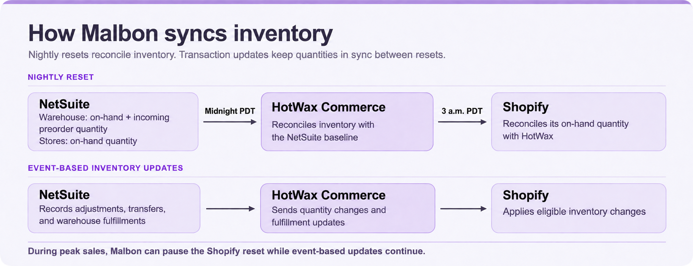

# Malbon Inventory and Order Commitments

How NetSuite inventory feeds, customer orders, and Shopify updates fit together

Malbon uses two inventory feeds from NetSuite. The warehouse feed combines quantity on hand (QOH) with incoming preorder quantity. The store feed contains QOH. The sections below explain what the files contain, how the order commitment moves through HotWax, and which Shopify rules are specific to Malbon.

*The diagram summarizes the inventory feed and order fulfillment flow. The following sections explain the queue commitment and Malbon-specific Shopify rules.*

## What NetSuite sends

### Warehouse on-hand and preorder inventory

In the live configuration reported in the implementation review, the warehouse search adds location quantity on hand to incoming preorder quantity from open purchase orders for warehouse location `221`. The file marks each row as a QOH reset.

The checked-in search `customsearch_export_inventory_item_atp` still uses location quantity available and marks rows as an ATP reset. That search definition describes the repository configuration.

### Store QOH

The store search reads NetSuite’s location quantity on hand field. If that value is empty, the search uses zero. The file marks the row as a QOH reset.

Search ID: customsearch_export_inventory_item_qoh. Filename prefix: InventoryItemWhQOHExport_. The search filters to location type 1.

The Store QOH deployment is titled `HC_generateCSV_InventoryItemsStore_QOH` but uses the prefix `InventoryItemWhQOHExport_`; the `Wh` segment is present in the checked-in setting.

The checked-in saved searches identify the item, location, quantity, and reset type. They filter by item type, active status, and location type. Eligible item types include inventory part, group, kit, and non-inventory part. Neither checked-in search uses the `HotWax Inventory Sync` location checkbox (`custrecord_hc_inv_sync`).

## How the files are created and sent

Each export script runs its saved search and creates a dated CSV in NetSuite’s Inventory Item CSV folder. If the search returns no results, the script does not create a file.

A second script sends CSV files from that folder to the configured SFTP connection. It gets the connection settings from a NetSuite record and moves successfully uploaded files to Archive Inventory Item CSV.

### Inventory CSV uploader

The uploader record ID is `customscript_imp_inventoryitem`, although the script is named `HC_uploadCSV_InventoryItems`. Its two checked-in deployments are marked `TESTING` and have no recurrence blocks. Each run selects at most 20 CSV files. The script appends `inventoryitem` to the configured SFTP directory when creating the connection, then passes `/csv/` as the directory in each upload call. The repository shows these values but does not confirm the live SFTP path or upload schedule.

### Daily inventory resets and peak sales

Malbon runs a full on-hand inventory reset from NetSuite to HotWax daily at midnight PDT. A separate on-hand reset sends inventory from HotWax to Shopify daily at 3:00 a.m. PDT. During peak sales events such as Black Friday and Cyber Monday, Malbon can pause the Shopify reset and rely on event-based ledger updates to keep inventory in sync and reduce oversell risk.

## What happens when a customer places an order

### 1. The order enters HotWax

A customer places an order in Shopify. The order enters HotWax’s brokering queue while HotWax chooses a store or warehouse to fulfill it.

### 2. HotWax holds the online promise

While the order waits in the queue, HotWax reduces Online ATP by the promised quantity. This keeps those units from being promised to another online customer.

### 3. HotWax assigns a location

After HotWax selects a store or warehouse, it reserves the order quantity there and that location’s ATP decreases.

### 4. Fulfillment changes the on-hand quantity

When HotWax receives the fulfillment update, QOH decreases to reflect the goods leaving the location. HotWax recalculates Online ATP and updates Shopify with the sellable quantity.

## How to read the numbers

QOH is the physical baseline. The warehouse feed adds incoming preorder units, so its total can be higher than the physical count. An order is a commitment against inventory. While it waits for a location, it reduces Online ATP. After allocation, it is held against the selected location’s ATP. After fulfillment, QOH reflects the physical movement.

The quantities in NetSuite, HotWax, and Shopify are views of the same inventory at different stages. Do not add the three system totals together.

Flow: NetSuite warehouse on-hand and incoming preorder quantities, plus store QOH → HotWax inventory and online availability → Shopify sellable quantity. Shopify order → HotWax brokering queue → location allocation → fulfillment update → refreshed HotWax availability → Shopify.

## Malbon’s Shopify rules

Malbon’s inventory-event customization allows physical inventory changes at locations outside a shop’s transfer facility group to remain eligible for Shopify updates. The group is configured in HotWax; its live location membership is not included in the repository.

For transfer orders, Malbon queues a Shopify transfer after approval only when at least one end of the transfer is in the shop’s configured transfer facility group. If neither end is included, the transfer is not sent to Shopify. If only one end is included, the Shopify transfer uses that location and leaves out the other one.

For a warehouse-to-store transfer where the store is outside the group, Shopify tracks the warehouse commitment and omits the store endpoint. This avoids a second deduction from store inventory managed by Retail Ops.
